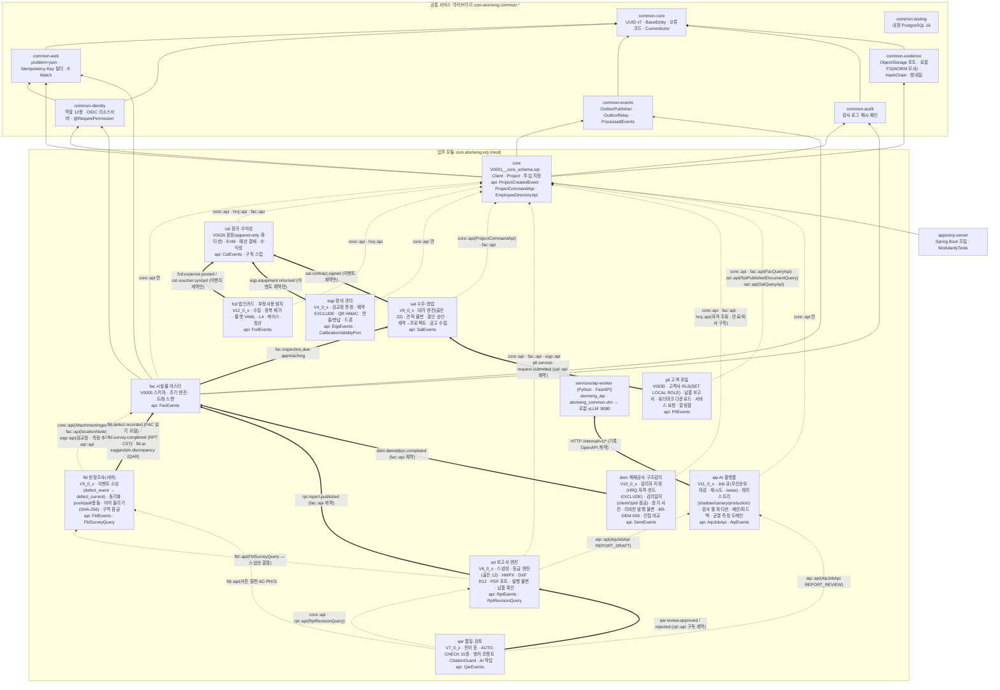
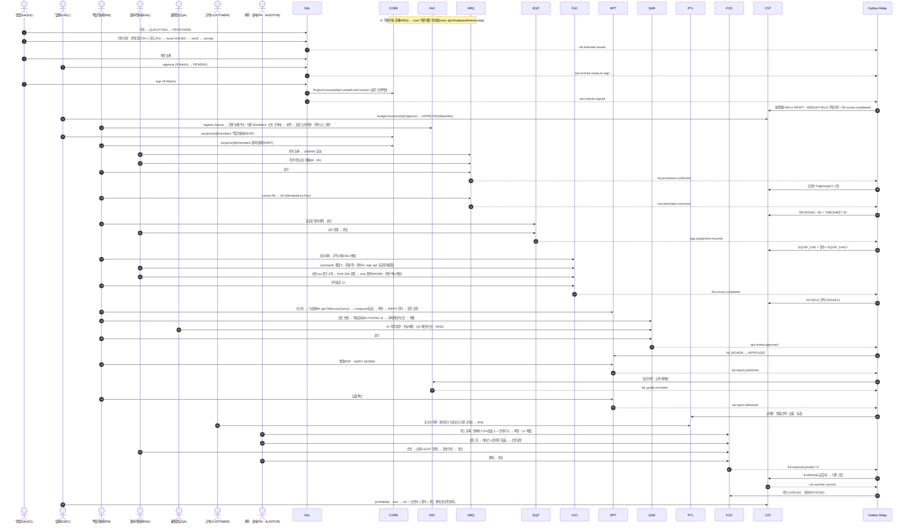

# 에이톰 안전진단 ERP — 공통 플랫폼 (Phase 0, 첫 단계)

## 쉬운 말 한 장 요약

- 이 저장소는 회사 ERP(회사 일을 한곳에서 관리하는 프로그램)의 **바닥 공사**입니다. 집으로 치면 기초·배관·전기 배선을 먼저 깐 상태예요.
- 지금 들어 있는 것은 다섯 가지입니다.
  1. **데이터 창고 설계도**(`V0001__core_schema.sql`): 고객·프로젝트·직원 표와, 기록을 지울 수 없게 막는 장치.
  2. **우편함(Outbox)**: "프로젝트가 생겼어요" 같은 소식을 업무 저장과 **같이** 저장했다가, 배달부(Relay)가 나중에 확실히 전달합니다. 배달이 실패하면 10초→20초→40초→80초 기다렸다 다시 시도하고, 5번 실패하면 "반송함"(DLQ)에 넣습니다.
  3. **중복 클릭 방지**(Idempotency-Key): 현장 태블릿이 같은 요청을 여러 번 보내도 한 번만 처리하고, 두 번째부터는 "이미 처리했어요"(`Idempotent-Replayed: true`)라고 같은 답을 돌려줍니다.
  4. **출입증 검사**(역할·권한): 12가지 역할(임원, 영업, 기술자, 재무, 감사 등)마다 할 수 있는 일을 정하고, 기술자는 **자기가 투입된 프로젝트만** 볼 수 있습니다.
  5. **알기 쉬운 오류 쪽지**(problem+json): 오류마다 `CORE-409-010` 같은 번호가 붙어 원인을 바로 찾을 수 있습니다.
  6. **누가 무엇을 할 수 있나 표 전수 검사**: 설계 표(12역할 × 11모듈 = 132칸)를 한 칸씩 모두 시험합니다.
  7. **개인정보 가리기**: 민감정보를 조회하면 감사 로그에 "누가 봤는지"는 남기되, 이름은 `홍*동`처럼 가려서 남깁니다.
  8. **사진 증거 보관**: 현장 사진을 올리면 서버가 지문(SHA-256)을 다시 계산해 위조를 막고, 사진끼리 지문을 사슬처럼 이어(해시 체인) 중간 사진을 몰래 바꾸면 들통나게 합니다. 원본은 지울 수 없는 칸(WORM)에 보관하고 작은 미리보기(썸네일)를 만듭니다.
  9. **첫 업무 모듈 FAC(시설물 마스터)**: 건물을 등록하고(같은 건물 중복 등록은 막음), 점검 보고서가 나오면 안전등급(A~E)을 기록합니다. 등급 기록은 고칠 수도 지울 수도 없습니다. 법에서 정한 점검 주기 표(⚠️ 예시 값)로 다음 점검 날짜를 계산하고, 180·90·30일 전과 날짜가 지났을 때 영업팀에 알림 이벤트를 보냅니다.
  10. **건축물대장 자동 입력·병합·위치 계층**: 주소를 넣으면 공공 API(도로명주소·건축물대장)에서 건물 정보를 가져와 자동으로 채우고, API가 멈추면 3번 다시 시도한 뒤 손으로 입력하는 방식으로 넘어갑니다. 같은 건물이 두 번 등록됐으면 하나로 합치고(병합), 층·구역·기둥·보 같은 위치를 나무 모양 목록(ltree)으로 관리합니다. 결함이 기록된 기둥은 대신할 기둥을 정해야만 지울 수 있습니다.
  11. **두 번째 업무 모듈 HRQ(인력·자격)**: 기술자 등급·자격을 기록하고, 자격 만료가 다가오면 한 번만 알립니다. 회사가 안전진단기관 등록을 유지하려면 등급별로 사람이 몇 명 있어야 하는데(⚠️ 예시 기준), 누가 퇴사하면 언제부터 모자라는지 미리 계산합니다. 근무시간(타임시트)은 팀장이 승인하면 원가로 넘어가고, 고칠 때는 지우지 않고 "새 판(리비전)"을 만들며, 월 마감한 달은 함부로 못 고칩니다.
  12. **세 번째 업무 모듈 CST(원가·수익성, 첫 단계)**: 팀장이 승인한 근무시간이 오면 "시간 ÷ 8 × 등급별 하루 단가"로 인건비를 원가 장부(원장)에 적습니다. 장부는 **고치거나 지울 수 없고**, 근무시간이 정정되면 원래 줄을 마이너스로 지우는 줄(역분개)과 새 줄을 함께 적습니다. 같은 소식이 두 번 와도 한 번만 적고, 정정 소식이 원래 소식보다 먼저 오면 잠시 미뤘다가 다시 처리합니다. 마감한 달에 들어올 원가는 다음 열린 달로 넘깁니다. HRQ 월 마감 소식은 **장부에 다시 적지 않고** 두 시스템 합계가 맞는지만 확인합니다(이중 집계 방지). 계획 대비 실적(EVM: CPI·SPI 등)을 계산해 신호등(초록·노랑·빨강)으로 경보합니다. 금액은 전부 소수 오차가 없는 BigDecimal 로 계산합니다.
  13. **네 번째 업무 모듈 FCD(법인카드 관리 · 부정사용 탐지, 첫 단계)**: 카드사 명세서(CSV · 엑셀)를 올리면 글자 깨짐(한글 인코딩)과 머리글 줄을 스스로 알아내고, 같은 결제가 여러 파일에 두 번 들어와도 **한 건으로 합칩니다**(애매하면 사람에게 확인 요청). 카드번호 원문은 어디에도 저장하지 않고 '지문(토큰)'만 남깁니다. 규칙 책(룰셋 YAML)은 **파이썬 시제품과 똑같은 파일**을 그대로 읽어 "심야 사용 · 금지 업종 · 쪼개기 결제" 같은 규칙을 점수(0–100)로 바꾸는데, 같은 합성 데이터로 돌렸을 때 **파이썬과 결과가 한 글자도 다르지 않음**을 시험으로 확인했습니다(골든 패리티). 점수가 높은 거래는 한 달 검토 예산(1,000건당 20건) 안에서 '확인이 필요한 사용'으로 케이스를 열고, 본인이 소명하면 **본인 · 결재자가 아닌 감사 담당**이 판정합니다. 정산이 끝나면 원가 모듈(CST)에 `fcd.expense.posted` 를 보내 원가 장부에 적히고, 전표가 동기화되면 회신(`cst.voucher.synced`)을 받아 정산서를 '전표 완료'로 바꿉니다. 퇴사 소식이 오면 카드에 '정지 검토' 표시만 하고 **결제를 자동으로 막지는 않습니다**.
  14. **다섯 번째 업무 모듈 EQP(장비 관리, 첫 단계)**: 슈미트해머·초음파 측정기·드론 같은 장비를 대장에 올리고, 검교정(장비가 정확한지 공인기관이 확인한 날짜와 유효기한)을 기록합니다. 유효기한이 지난 장비는 예약도 반출도 막고(QA 가 사유를 적어 최대 7일까지만 예외 허용), 같은 장비를 같은 날짜에 두 팀이 동시에 예약해도 데이터베이스가 한 건만 받아 줍니다. 장비에 붙이는 QR 은 비밀 열쇠로 서명해서 위조 라벨은 거부합니다. 매일 밤 "곧 만료(D-60·30·7·0)"·"만료됨" 알림을 한 번씩만 보내고, 장비를 반납하면 사용 일수를 원가 모듈(CST)에 알려 장비 사용료가 원가 장부에 한 번만 올라갑니다. 드론 비행기록은 승인 구역을 벗어났는지 표시합니다.
  15. **여섯 번째 업무 모듈 SAL(수주·영업, 첫 단계)**: 영업 기회를 "리드 → 검토 → 제안 → 협상 → 수주(WON) → 계약"으로 관리하고, 정해진 순서 말고는 단계를 못 건너뛰게 합니다. 용역비(대가)는 **기준일에 유효한 요율표(⚠️ 예시 값)** 로 "인·일 × 노임단가 + 경비 + 제경비 + 기술료"를 계산하며, 같은 입력을 **파이썬으로 따로 계산한 합성 정답 22건**과 원 단위까지 맞는지 시험합니다. 견적은 버전(v1, v2 …)으로 쌓이고, **발행된 견적은 데이터베이스가 금액을 못 고치게 막습니다.** 할인은 영업 5%·영업팀장 10%까지 바로 되고, 넘으면 **임원(EXEC)만** 승인할 수 있습니다(최대 49%, 50% 이상은 데이터베이스가 거부). 계약은 임원 결재 → 고객 서명 기록 순서로 진행되고, 서명이 기록되는 순간 **프로젝트 번호(PRJ-연도-번호)** 가 생기며 원가 모듈(CST)에 소식이 가서 **실행예산 초안**이 한 번만 만들어집니다. 나라장터 공고는 "마지막으로 성공한 수집 시각 − 10분"부터 다시 읽어 실패한 구간도 빠뜨리지 않고(공공 API 명세 ⚠️ 확인 필요), 적격심사 점수는 **실적증명서 표(performance_record)만** 근거로 쓰며 공동도급 실적은 지분만큼만 셉니다.
  16. **일곱 번째 업무 모듈 RPT(보고서 엔진, 첫 단계)**: 현장 결함 자료를 한 시점에 **얼려(스냅샷 동결)** 지문(SHA-256)을 남기고, 기둥·보·슬래브 같은 부재마다 균열폭·박리 면적·철근노출 비율을 **기준표(⚠️ 예시 값, 시행일이 있는 규칙표)** 에 대어 a~e 로 매긴 뒤 층 → 동 → 시설물 순서로 점수를 모아 **안전등급 A~E 초안**을 냅니다. 같은 계산을 **파이썬으로 따로 만든 합성 정답 12건**과 한 자리까지 맞는지 시험합니다. 결함물량표·상태평가표·외관조사망도(CAD 로 여는 **DXF** 도면 + 미리보기 그림)를 자동으로 만들고, 한글 문서(**HWPX** = XML 을 묶은 압축 파일)를 서식(템플릿)에 채워 넣어 만든 뒤 압축을 풀어 구조·스키마·참조를 스스로 검사합니다(한컴 프로그램 없이). PDF 는 변환 서버(Gotenberg) 연결 부품으로 만들고, 시험에서는 가짜 변환기를 씁니다. 책임기술자가 등급을 바꾸려면 **사유 100자 + 근거 결함**이 필요하고, 검토 승인 뒤 **발행하면 고칠 수도 지울 수도 없습니다**(데이터베이스가 막고, 파일은 지울 수 없는 칸에 보관). 발주처가 받았다고 확인하면 '납품됨'이 되고, 고칠 일이 생기면 **정정본(Rev.2)** 을 새로 발행해 이전 판은 '대체됨'이 됩니다. 발행 소식은 FAC 가 받아 안전등급 이력과 다음 점검일을 바로 고칩니다(실제 흐름으로 시험). 검토(QAR) 모듈을 위해 문단마다 **몇 쪽 어디에 있는지(anchors.json)** 와 **섹션별로 누가 고쳤는지**를 알려 주는 조회 창구도 만들었습니다.
  17. **여덟 번째 업무 모듈 QAR(품질·검토, 첫 단계)**: 보고서를 내보내기 전에 **"작성자 자체검토 → 제출 → AI 검토 → QA 검토 → 책임기술자 승인"** 순서로 꼭 거치게 하는 **품질 관문**입니다. 순서표(전이 표)에 없는 이동은 막고, 막을 때는 이유를 **한 번에 모두** 알려 줍니다. 자동 검사기(AUTO-CHECK)가 규칙 15가지(⚠️ 예시 기준, 시행일이 있는 규칙 세트 2025.1 · 2026.1)로 "본문에 3개소라고 썼는데 결함물량표는 2개소" 같은 **숫자 불일치**, 근거 없는 등급, 검교정이 끝난 장비로 잰 값, 빠진 목차, "완전히 안전" 같은 위험한 표현을 찾아냅니다. 심각한 문제(BLOCKING)가 하나라도 있으면 제출도 승인도 안 되고 예외 허락(waiver)도 못 받으며, 가벼운 경고(WARNING)만 PM · QA **두 사람**이 사유를 적으면 넘어갈 수 있습니다(데이터베이스도 막음). 작성자나 그 보고서를 고친 사람은 **자기 보고서의 QA 검토자가 될 수 없고**, QA 검토자는 최종 승인자가 될 수 없습니다(직무 분리). QA 는 보고서의 **정확한 문장 위치(몇째 블록 몇째 글자)** 에 코멘트를 달고, 코멘트는 작성자가 답하고 "해결 요청"을 해도 **QA 가 확인해야만** 닫힙니다(답변 기록은 지울 수 없음). AI(회사 안 vLLM 서버 연결 부품, 시험에서는 가짜)가 낸 지적은 **보고서에 실제로 있는 문장과 숫자를 인용했을 때만** 보여 주고, 지어낸 인용은 버립니다. AI 가 10분 안에 답하지 않으면 건너뛰고 "AI 검토 미수행" 표시를 붙입니다. 최종 승인이 나면 소식(`qar.review.approved`)이 RPT 로 가서 **그때서야 발행할 수 있습니다**(실제 흐름으로 시험). 발행 뒤 정정본(Rev.2)이 생기면 승인된 검토를 다시 자체검토로 되돌려 새 라운드로 검토합니다.
  18. **아홉 번째 업무 모듈 DEM(해체공사 · 구조감리, 첫 단계)**: 해체공사 프로젝트를 "준비 → 검토 → 허가 대기 → 착공 → 완료 신고 → 종료" 순서로 관리하고, 감리 업무가 있는 현장은 **책임감리자를 정하지 않으면 착공할 수 없습니다.** 감리자를 정할 때는 인력 모듈(HRQ)에서 자격을 확인하고(⚠️ 예시 자격 목록), 한 사람이 동시에 맡을 수 있는 현장 수(⚠️ 예시 3곳)를 넘으면 막으며, 같은 현장에 책임감리자 기간이 겹치면 데이터베이스가 거부합니다. HRQ 에서 **"자격 만료"** 소식이 오면 그 자격으로는 더 이상 감리자로 정할 수 없고, 지금 맡고 있는 현장에는 "감리자 공백" 경고를 띄워 대체 감리자를 정할 때까지 일지 작성을 막습니다. **"퇴사"** 소식이 오면 맡은 현장에서 자동으로 빠지고 같은 경고를 띄웁니다. 감리일지는 공정별 점검표(⚠️ 예시 항목 5공정 17개)로 쓰고, "사진 필수" 항목은 사진 없이 "적합"으로 처리할 수 없으며, 부적합은 시정지시서(CO-연도-번호)가 자동으로 나옵니다. 현장 태블릿이 **통신이 끊긴 채 쓴 일지를 나중에 여러 번 보내도**(작업 번호 clientOpId) 한 번만 처리되고 같은 답을 돌려받습니다. 일지는 다음 날 0시에 내용 지문(SHA-256)과 함께 **잠기고**, 잠긴 뒤 도착한 내용은 원문을 바꾸지 않고 "정정 대기"로만 남습니다. 증거 사진은 공통 첨부 기능으로 올린 뒤 지문을 다시 계산해 위조를 막고, 나중에 원본이 바뀌면 검증에서 "불일치"로 드러납니다. 구조 도면은 리비전(A, B …)을 쌓다가 발행하면 0, 1, 2 … 번호가 붙고 **발행본은 데이터베이스가 고칠 수도 지울 수도 못하게 막습니다**(새 판이 나올 때 "대체됨"으로 바뀌는 것만 허용). 검토의견이 하나라도 "미결(열림 · 회신됨 · 재지적)"이면 **시공용 최종 발행이 안 됩니다.** 인접 건물을 해체 전 · 후로 조사해 결함을 위치로 짝지어(헝가리안 매칭) "진전 · 신규 · 동일 · 보수/미확인"으로 나눕니다. 해체 완료를 신고하면 소식(`dem.demolition.completed`)이 시설물 모듈(FAC)로 가서 **건물이 '멸실'로 바뀌고 점검 일정이 취소됩니다**(실제 흐름으로 시험).
  19. **열 번째 업무 모듈 PTL(고객 포털, 첫 단계)**: 건물주·관리주체(고객사)가 **자기 건물 목록·안전등급·다음 법정점검 날짜**를 보고, **납품된 보고서**를 내려받고, 견적·긴급점검을 요청하는 창구입니다. 가장 중요한 약속은 "**다른 회사 자료는 절대 못 본다**"입니다. 그래서 모든 포털 자료에 고객사 번호를 붙이고, 데이터베이스가 스스로 "이 줄은 지금 로그인한 고객사 것만 보여줘"라는 규칙(행 수준 보안, RLS)을 지키게 했습니다. 다른 회사 보고서 번호를 직접 넣어도 "없음(404)"만 나오고, 그 시도는 기록에 남습니다. 보고서를 내려받을 때마다 PDF 각 쪽과 파일 정보에 **고객사 번호·시각·다운로드 번호**를 찍어(워터마크) 유출되면 누가 언제 받은 파일인지 바로 찾을 수 있습니다. 정정본이 나오면 옛 보고서에 "대체됨" 안내가 붙고 내려받기는 막힙니다. 견적 요청은 영업(SAL)에 자동으로 리드로 넘어갑니다.
  20. **열한 번째 모듈 AIP(AI 플랫폼, 첫 단계)**: 회사 GPU 서버의 AI(균열 판독 · 소견 초안 · 보고서 검토)를 ERP 가 **줄(큐)을 세워 순서대로** 맡기고, 누가 무엇을 맡겼는지 · 어떤 모델과 프롬프트로 · 어떤 입력에 · 무슨 답이 나왔는지를 **월별 서랍(파티션)에 지울 수 없게** 남깁니다(감사). 급한 일(P1)이 먼저 처리되고, AI 서버가 멈추면 일은 '대기'로 남아 **ERP 다른 기능은 그대로** 돌아갑니다. 일하던 AI 프로그램이 갑자기 죽어도 정해진 시간(임대)이 지나면 다른 프로그램이 이어받고, 결과는 **딱 한 번만** 저장됩니다. 3번 실패하면 '포기(DEAD)'로 표시합니다. 균열 사진에 마커(ArUco, 한 변 50mm 인쇄 표지)가 있으면 **사진 1칸(px)이 몇 mm 인지** 계산해 균열 폭을 mm 로 재고, 마커가 없거나 벽에서 들떠 있으면(오차 2px 초과) **폭 숫자를 만들지 않고 '현장 측정 필요'만** 붙입니다. 균열 중심선 길이는 '가로 · 세로 이웃 1, 대각선 이웃 √2 를 더해 2 로 나누기', 10칸보다 짧은 잔가지는 잘라냅니다 — 이 계산은 **파이썬 워커와 자바가 같은 답**을 내는지 합성 정답(골든)으로 시험합니다. AI 결과는 언제나 **'제안'** 이라 기술자가 수락 · 수정 · 거절해야 하고, 고객이 학습 활용에 동의했고 얼굴 · 번호판을 가렸을 때만 라벨링 줄에 올리며, 검수 승인까지 끝나 **데이터셋에 담기는 순간에만 '학습에 써도 됨'** 이 됩니다. 새 모델은 그림자(shadow) → 일부 사용자(canary 10%) → 전체(production) 순서로만 올라가고, QA · 임원 승인이 없으면 못 올라갑니다. 보고서 엔진(RPT)의 AI 소견 초안과 검토(QAR)의 AI 검토는 이 모듈을 **바로 불러(동기 호출)** 씁니다. 실제 AI 일은 새 파이썬 서비스 `services/aip-worker`(FastAPI)가 하며 기본값은 **꺼짐**입니다.
  21. **열두 번째 모듈 FLD(현장조사 앱의 서버 쪽, 첫 단계)**: 기술자가 태블릿으로 **통신이 안 되는 지하에서도** 결함(균열 · 박락 …)을 도면 위에 기록하면, 나중에 연결될 때 서버로 **한꺼번에 보내는(동기화)** 약속을 서버에 만들었습니다(앱 화면은 이 PC 에 Flutter 가 없어 다음 단계). 모든 변경은 **지울 수 없는 일기장(이벤트 저장소)** 에 한 줄씩 쌓이고, 지금 모습(결함 현황표)은 그 일기장을 처음부터 다시 읽어 언제든 똑같이 만들 수 있습니다(시험: 지우고 다시 만들어도 지문이 같음). 같은 묶음을 세 번 보내도 **작업 번호(clientOpId)** 로 한 번만 저장하고, 두 기기가 같은 균열 폭을 서로 다르게(0.25 / 0.30) 고치면 **나중에 온 쪽을 "충돌"로 따로 보관**해 사람이 "서버 값 · 내 값 · 합친 값" 중 하나를 고르게 합니다. 메모처럼 측정값이 아닌 칸은 **더 늦게 쓴 시각(HLC 시계)** 이 이깁니다. 측정값에는 **장비 번호**가 꼭 있어야 하고, 장비 모듈(EQP)에 물어 **교정이 지난 장비로 잰 값은 "잠정"으로만 남겨 보고서에 못 들어가게** 막습니다. 큰 사진은 **조각(청크)으로 이어 올리고**, 끊기면 "어디까지 받았나요?"(HEAD) 물어 이어서 보내며, 다 받으면 지문(SHA-256)을 다시 계산해 **1바이트라도 바뀌었으면 거부하고 다시 올리라고** 알려 줍니다. 통과한 사진은 공통 첨부(지울 수 없는 칸 + 사진 사슬)로 넘어갑니다. 구역을 잠그려면 미완성 결함 · 미해결 충돌 · 미결 AI 제안 · 거부된 사진이 **0건**이어야 하고, 모든 구역이 잠기면 "현장조사 완료" 소식이 **딱 한 번** 나가 보고서(RPT) · 원가(CST)가 받습니다. 보고서 스냅샷은 이제 요청 본문 대신 **FLD 에서 결함을 직접 읽고**, 검토(QAR)는 FLD 사진으로 사진 규칙을 검사하며, AI 폭이 사람 측정의 2배 이상 다르면 QAR 에 알립니다.
  22. **전체 업무 흐름 시험(골든 패스, 6장)**: 영업 계약 → 건물 등록 → 사람 · 장비 투입 → 현장조사 → 보고서 → 품질 검토 → 고객 포털 → 법인카드 정산까지 **한 회사의 일 하나를 처음부터 끝까지** HTTP 로만 따라가고, 마지막에 원가 장부(인건비 + 장비 + 카드 경비)가 **원 단위까지 맞는지**, 기록 사슬(해시 체인)이 안 끊겼는지, 카드번호가 어디에도 안 남았는지, 배달 안 된 소식이 없는지 확인합니다. 이 시험으로 **모듈 사이 이음새 5곳**(직원 대장 · 프로젝트 투입 · 예산 결재 · 현장조사 진척 · 수익성 조회)이 빠져 있던 것을 찾아 고쳤습니다.
  23. **보안 검토 정책 결정 32건 적용(2026-10-26, 4-16 절)**: "누가 승인할 수 있나"를 정하지 못해 남겨 두었던 32가지를 검토서의 권장안대로 모두 정했습니다. 핵심은 **"만든 사람은 자기 것을 승인할 수 없다"** 입니다. 타임시트는 그 프로젝트 **책임자(RESP)만** 승인하고(본인 것은 누구도 못 함, 임원 · 경영지원은 사유를 적어 대신 승인), 고친 시간은 다시 승인받아야 원가에 들어갑니다. 할인 · 계약 · 예산 · 감리일지 정정 · 도면 리비전 · 보고서 최종 승인 · AI 모델 두 번 승인 · 카드 배치 되돌리기도 모두 **두 사람**이 나눠 합니다. 고객 계정은 **고객 포털 주소(`/api/v1/ptl/**`)만** 쓸 수 있습니다. 운영 서버는 정해진 실행기(`deploy/prod/run-erp.*`)로만 켜고, 기본 비밀번호 · 가짜 연결 부품 · 임시 폴더 증거 저장소로는 아예 켜지지 않습니다.
  24. **웹 4차 화면(4-17 절)**: 영업 파이프라인 칸반 · 나라장터 공고 목록 · 적격심사 모의계산, 감리일지 작성(통신이 끊겨도 브라우저에 초안 저장 → 다시 연결되면 같은 작업 번호로 재전송) · 정정 요청 · 승인, 현장조사 회차 만들기 · 구역 설정, 그리고 모든 모듈에서 **"내가 승인할 일"** 을 한 곳에 모은 **내 할 일** 화면(머리글 숫자 배지)을 더했습니다.
- 모든 기능은 자동 시험 **941개**(PostGIS 서버가 있을 때만 도는 1개를 빼고 모두 통과 — 2026-10-26 3차 보안 정책 적용 기준)와 AIP 파이썬 워커 시험 **50개**, 웹 Vitest **98개** · Playwright E2E **37개**로 확인했습니다. 공공 API 는 WireMock 가짜 서버(합성 응답)로 시험합니다. 시험 데이터는 전부 **가짜(합성) 데이터**입니다.

> 설계 근거: Notion「00. 공통 아키텍처 · 설계 표준 v0.3」, 「00-IMPL. 공통 플랫폼 구현 보고서」, 「에이톰 플랫폼 모듈 라이브러리(ATOM-LIB-001)」.

### 용어 정리

| 용어 | 쉬운 뜻 |
|---|---|
| 모듈형 모놀리스 | 프로그램은 하나지만 안에 칸막이(모듈)를 쳐서 서로 함부로 못 건드리게 한 구조 |
| Spring Modulith | 칸막이를 어겼는지 자동으로 검사해 주는 도구 |
| Flyway | 데이터베이스 설계도를 버전 순서대로 적용해 주는 도구 |
| Outbox / Relay | 보낼 소식을 먼저 우편함에 넣고(Outbox), 배달부(Relay)가 꺼내 전달 |
| DLQ (outbox_dead) | 여러 번 배달 실패한 소식을 모아 두는 반송함 |
| 멱등(Idempotency) | 같은 요청을 여러 번 보내도 결과가 한 번 보낸 것과 같음 |
| ETag / If-Match | 문서 버전 번호. 남이 먼저 고쳤으면 "버전이 달라요"(412)라고 막음 |
| 해시 체인 | 기록마다 앞 기록의 지문을 이어 붙여, 중간을 몰래 고치면 들통나게 하는 방법 |
| UUID v7 | 시간 순서대로 정렬되는 고유 번호(아이디) |
| RFC 7807 problem+json | 오류를 정해진 JSON 모양으로 알려주는 국제 표준 |

---

## 1. 모듈 구성



- 공통 라이브러리는 업무 모듈(`com.atomeng.erp..`)을 **절대 import 하지 않습니다**(ArchUnit 규칙 R1).
- 업무 모듈끼리는 `{mod}::api` 명명 인터페이스로만 접근합니다(Spring Modulith `verify()`).

```
atom-erp/
├─ common/common-{core,web,identity,events,audit,testing}
├─ modules/core/                 # com.atomeng.erp.core
│  └─ src/main/resources/db/migration/core/V0001__core_schema.sql
│     └─ db/migration-ext/V0004__core_postgis_ext.sql   (프로필 postgis)
└─ apps/erp-server/              # com.atomeng.erp.ErpServerApplication
```

## 2. 빌드 방법 (Windows, 시스템 설정 변경 없이)

시스템에 Java/Gradle/Docker/PostgreSQL 이 없어도 됩니다. PyCharm 에 들어 있는 JBR(JDK 25)을 **명령 한 번에만** 지정합니다.

```bash
# Git Bash
cd C:/Users/atomS/atom-erp
JAVA_HOME="/c/Program Files/JetBrains/PyCharm 2026.1.2/jbr" ./gradlew build
```

```powershell
# PowerShell (현재 창에서만 유효)
$env:JAVA_HOME = "C:\Program Files\JetBrains\PyCharm 2026.1.2\jbr"; .\gradlew.bat build
```

- Gradle 9.7.1 은 wrapper 가 자동으로 내려받습니다.
- 바이트코드는 `--release 21`(Java 21)로 만듭니다. JDK 21 이 있는 CI 에서는 toolchain 21 로 바꿔도 됩니다.
- 통합 테스트는 **zonky embedded-postgres**(PostgreSQL 16.15 바이너리, Maven Central)로 Docker 없이 실행됩니다.
- 모듈 문서(PlantUML)는 `apps/erp-server/build/spring-modulith-docs/` 에 생성됩니다.

선택 실행:

```bash
./gradlew :modules:core:test          # 마이그레이션 테스트
./gradlew :apps:erp-server:test --tests '*ModularityTests*'
ATOM_PG_POSTGIS_URL='jdbc:postgresql://host:5432/db?user=..&password=..' ./gradlew :modules:core:test  # PostGIS 확장 테스트(TC-CORE-008)
```

AIP Python 워커(선택, 시스템 설정 변경 없이 uv 가상환경만):

```bash
cd services/aip-worker
uv sync                                   # Python 3.12 · atomeng_common(../../../atom-common) 경로 의존
uv run pytest -q                          # 단위 · 계약 시험(로컬 vLLM 이 꺼져 있으면 실서버 시험은 skip)
uv run python tools/export_openapi.py     # 계약(contract/openapi.json) 다시 기록 — Java 계약 시험이 이 파일을 읽음
ATOM_AIP_WORKER_SECRET=<32바이트 이상> uv run uvicorn atomeng_aip.app:app --host 127.0.0.1 --port 8090   # ERP 연결: ATOM_AIP_WORKER_URL=http://127.0.0.1:8090 + 같은 ATOM_AIP_WORKER_SECRET (HMAC 서명, 보안 검토 AIP-06)
uv run python ../../tools/aip_golden_gen.py   # 측정 골든(Java MeasureGoldenTest) 다시 생성
```

- 워커는 vLLM(127.0.0.1:8080)에 **요청만** 보냅니다(기동 · 중지 · 학습 없음). ERP 의 `atom.aip.worker.base-url` 은 기본 **빈 값(꺼짐)** 입니다.

로컬 실행(실제 PostgreSQL 필요, Keycloak 없이 헤더 인증):

```bash
PG_HOST=localhost PG_APP_USER=postgres PG_APP_PASSWORD=... \
  ./gradlew :apps:erp-server:run --args='--spring.profiles.active=local-noauth'
# 요청 예: -H 'X-Actor-Id: <uuid>' -H 'X-Roles: SALES' -H 'Idempotency-Key: <uuid>'
```

웹 프론트엔드(React · 1 · 2 · 3차 화면, 고객 포털 `/portal`)와 내장 DB 개발 서버:

```bash
./gradlew :apps:erp-server:devServer      # 내장 PostgreSQL + local-noauth + 합성 시드 → http://127.0.0.1:8081 (운영 금지)
cd apps/erp-web && npm install && npm run dev   # http://127.0.0.1:5173 — 자세한 내용은 apps/erp-web/README.md
```

## 2-1. 마이그레이션 규칙 (Flyway)

2026-10-19 에 모든 마이그레이션을 **전역 단조 번호 하나**로 다시 매겼습니다(배포 전이라 허용 — 이 커밋이 첫 기준선).
예전 방식(모듈별 버전 대역 V1·V2_0_x … V13_0_0)은 나중에 앞쪽 대역에 추가한 파일(V4_0_2 · V5_0_x · V6_0_3 · V7_0_2 등)이
이미 V13 까지 적용된 DB 에서 건너뛰어지거나 out-of-order 를 켜야만 적용되는 문제가 있었습니다.

**규칙**

1. 파일 이름 `V<4자리 전역 번호>__<모듈>_<설명>.sql` (예: `V0035__fac_add_building_note.sql`). 파일은 자기 모듈 폴더
   `modules/<모듈>/src/main/resources/db/migration/<모듈>/`(PostGIS 등 확장 의존이면 `db/migration-ext/`)에 둡니다.
2. 새 마이그레이션은 **어느 모듈이든 저장소 전체의 다음 번호**를 씁니다(모듈 대역 없음). 번호는 모듈 · ext 를 통틀어 유일.
3. **기준선** `db/migration-baseline.txt` 에 있는 파일은 지우거나 이름 · 내용을 바꾸지 않습니다(sha256 고정). 고칠 것이 있으면 새 번호로 추가.
4. 기준선에 없는 새 파일의 번호는 **기준선 최대 번호보다 커야** 합니다. 브랜치 둘이 같은 번호를 잡으면 나중에 합치는 쪽이 다음 번호로 바꿉니다.
5. Flyway `out-of-order: false`(기본 · postgis 프로필 모두), `validate-on-migrate: true`. 낮은 번호가 뒤늦게 들어오면 건너뛰지 않고 기동이 실패합니다.
6. PostGIS 프로필(`db/migration-ext`)은 **설치 시점에 결정**합니다. ext 파일도 전역 번호를 쓰고 모듈 기본 파일 바로 뒤에 둡니다
   (V0004 core · V0008 fac · V0011 hrq). 기본 프로필로 설치한 DB 에 나중에 postgis 를 켜는 것은 지원하지 않습니다(검증 실패로 막힘).
7. 릴리스(배포) 직전 새 마이그레이션을 기준선에 올립니다:
   `./gradlew :apps:erp-server:test --tests '*MigrationBaselineTest*' -PupdateMigrationBaseline` → `db/migration-baseline.txt` 를 함께 커밋.
8. 모듈 의존 순서(최초 재번호): core → fac → hrq → eqp → sal → fld → rpt → qar → cst → dem → ptl → aip → fcd.
   하드 FK 는 cst · dem · fld → `fac.building`/`fac.location_node`, 모두 → `core.*` 뿐이고 나머지 모듈 간 참조는 논리 참조(이벤트 · `::api`)입니다.

**시험** (`apps/erp-server/src/test/java/com/atomeng/erp/migration/`)

| 시험 | 내용 |
|---|---|
| `MigrationBaselineTest` (DB 없음) | 이름 규칙 · 접두 = 폴더 모듈 · 번호 유일 · 기준선 파일 존재/내용 불변 · 새 번호 > 기준선 최대 · 최초 재번호의 모듈 순서 · application.yml out-of-order 금지 |
| `MigrationUpgradePathTest` (내장 PG) | ① 기준선 스냅숏 목록까지 적용한 DB → 이후 마이그레이션 적용 → 새 설치와 스키마 동일 ② 시험 전용 탐침 `V9001` 을 "새 마이그레이션"으로 더해 같은 비교 ③ 한 번호씩 올린 DB = 새 설치 ④ 기준선보다 낮은 `V0001.5` 뒤늦은 추가 → `FlywayValidateException`, DB 변경 없음. 비교 항목: 테이블/뷰 · 컬럼 · 제약 · 인덱스 · 트리거 · RLS 정책/플래그 · 함수 본문 · 뷰 정의 · 시퀀스 · 파티션 · 권한 · 시드 행 수 · Flyway 이력(버전 · 스크립트 · 체크섬) |

**이전 번호 → 새 번호** (설계 문서 · 아래 5장 편차 메모에 나오는 옛 번호 찾기용)

| 모듈 | 옛 번호 → 새 번호 |
|---|---|
| core | V1 → V0001 (`core_schema`), V1_2 → V0002, V1_3 → V0003, ext V1_1 → V0004 |
| fac | V2_0_0 → V0005, V2_0_1 → V0006, V2_0_2 → V0007, ext V2_99 → V0008 |
| hrq | V3_0_0 → V0009, V3_0_1 → V0010, ext V3_99 → V0011 |
| eqp | V4_0_0 → V0012, V4_0_1 → V0013, V4_0_2 → V0014 |
| sal | V9_0_0 → V0015, V9_0_1 → V0016 |
| fld | V5_0_0 → V0017, V5_0_1 → V0018 |
| rpt | V6_0_0 → V0019, V6_0_1 → V0020, V6_0_2 → V0021, V6_0_3 → V0022 |
| qar | V7_0_0 → V0023, V7_0_1 → V0024, V7_0_2 → V0025 |
| cst | V8_0_0 → V0026, V8_0_1 → V0027 |
| dem | V10_0_0 → V0028, V10_0_1 → V0029 |
| ptl | V13_0_0 → V0030 |
| aip | V11_0_0 → V0031, V11_0_1 → V0032 |
| fcd | V12_0_0 → V0033, V12_0_1 → V0034 |

재번호 이후 추가: `V0035` core 투입 지정 권한 · `V0036` sal 영업 그룹 관리 · `V0037` qar 검토자 프로필 관리 · `V0038` cst 요율 승인(모두 기준선 등록).

보안 검토 정책 결정 적용(2026-10-26, 4-16 절 — 모두 기준선 등록): `V0039` hrq 타임시트 승인 방식(RESP · DELEGATED + 사유) · 월 마감 재개 분리 · `V0040` cst 예산 상신자 · SYSADMIN 회계기간 조회 · `V0042` core 고객(CUSTOMER) 권한 ptl:* 만 · PM 영업기회/장비 조회 ALL · `V0043` sal 견적 작성자 할인 한도 · `V0044` eqp 예약 · 반출 PROJECT 범위 · 예외 4-eyes · `V0045` fcd 배치 롤백 요청(4-eyes) · 검토 실행 재정의 기록 · `V0047` dem PM/ENG 권한 PROJECT 범위 · `V0048` dem 리비전 검토 요청자 · 일지 정정 결정 · `V0050` aip QA≠EXEC 승인 CHECK · 판정자≠라벨러 트리거 · `aip:model:read` · `V0051` core outbox 구독자별 전달(`outbox_delivery`). 번호 `V0041` · `V0046` · `V0049` 는 병렬 작업 예약 번호라 비어 있습니다(Flyway 는 빈 번호를 허용, 다음 새 파일은 `V0052`).

## 3. 구현 내용 ↔ 설계 대응

| 설계 | 구현 위치 | 핵심 |
|---|---|---|
| 7.2 core 스키마·공통 6컬럼 | `V0001__core_schema.sql`, `BaseEntity` | client·employee·project·project_member·code·attachment·hash_anchor·audit_log(월 파티션)·doc_sequence |
| UUID v7 | `UuidV7`(Java), `core.uuid_generate_v7()`(SQL) | 같은 ms 단조 증가, 시계 역행 보호 |
| 10.2/10.3 Outbox | `OutboxPublisher`(MANDATORY), `OutboxRelay` | `FOR UPDATE SKIP LOCKED`, 이벤트 1건=트랜잭션 1개, 백오프 5·2ⁿ초(10/20/40/80), 5회째 `outbox_dead`, `requeueDead()` |
| 컨슈머 멱등 | `ProcessedEvents`, `@IdempotentListener` | `INSERT … ON CONFLICT DO NOTHING`, 실패 시 함께 롤백 |
| 9.4 멱등 키 | `IdempotencyFilter`, `IdempotencyStore` | PK (actor_id,key), CORE-428-001 / CORE-409-010 / CORE-422-009, `Idempotent-Replayed`, 5xx 미저장, 24시간 보관·정리 배치 |
| 8장 RBAC | `Role`(12종), `JwtAuthConverter`, `@RequirePermission`, `core.role_permission` | EMPLOYEE·FIN·AUDITOR 포함, PROJECT/CLIENT 행 수준 권한(CORE-403-002) |
| 8.1 OIDC | `IdentityAutoConfiguration` | 다중 issuer(atom-internal/atom-portal), issuer 메타데이터 지연 조회, 테스트·로컬은 헤더 스텁 |
| 9.2 오류 모델 | `GlobalProblemHandler`, `ProblemFactory` | 모든 오류 problem+json + `code` + `traceId`, ko/en title |
| 9.1 동시성 | `IfMatch`, JPA `@Version` | ETag `"v{n}"`, If-Match 불일치·경합 → 412 CORE-412-001 |
| NFR-CORE-07 감사 | `AuditLog`, `core.audit_append()` | 해시 체인 + append-only 트리거 + `audit_verify_chain()` |
| 8.2 권한 매트릭스 | `permission-matrix-8.2.csv` → `tools/gen_role_permission_seed.py` → `V0002__core_role_permission_matrix.sql` | 132셀·154권한, Java 독립 해석기로 셀별 정확 일치 검사 |
| 8.1 Keycloak | `deploy/keycloak/atom-internal-realm.json`, `atom-portal-realm.json` | 역할 11+1, 클라이언트 5, 매퍼 roles·eid·cid, PKCE, 조건부 OTP 흐름, 사용자·비밀값 없음 |
| Step 6 감사 | `@Audited` + `AuditAspect`, `@Pii` + `PiiMasking`, `AuditPartitionMaintenance` | VIEW_PII 동기 기록(fail-closed), 감사 JSON 마스킹, 월 파티션 사전 생성 |
| 11장 첨부 | `ObjectStorage`/`LocalFsObjectStorage`, `AttachmentService`, `ThumbnailGenerator` | presign→PUT→:complete, 해시 재계산(CORE-422-010), WORM 복사, 체인 잠금·연결·검증, outbox→썸네일 |
| 4장 모듈 경계 | `ModularityTests`, `ArchitectureRulesTest` | verify() + 위반 픽스처 음성 테스트 |

## 4. 테스트 ↔ TC-CORE

| TC | 시나리오 | 테스트 |
|---|---|---|
| TC-CORE-001 | ENG 가 담당 외 프로젝트 조회 → 403 CORE-403-002, 감사 로그 없음 | `AuthorizationIntegrationTest` |
| TC-CORE-002 | 같은 Idempotency-Key 로 고객 생성 3회 → 1건, 2·3회차 Replayed | `IdempotencyIntegrationTest` |
| TC-CORE-003 | 두 사용자 동시 수정 → 200 / 412 | `OptimisticLockIntegrationTest` (순차·동시 2종) |
| TC-CORE-004 | 생성 트랜잭션 예외 → 프로젝트·outbox 모두 롤백 | `OutboxIntegrationTest` |
| TC-CORE-005 | Relay 강제 종료 후 재기동 → 전량 발행, 중복 소비 0 | `OutboxIntegrationTest` |
| TC-CORE-006 | 해시 위조 업로드 → 422 CORE-422-010, temp 삭제 | `AttachmentIntegrationTest` |
| TC-CORE-007 | attachment.sha256 직접 UPDATE → 트리거 예외 | `CoreMigrationTest` |
| TC-CORE-009 | 오프라인 사진 10장 → 업로드 10, 체인 연속, 썸네일 | `AttachmentIntegrationTest` |
| TC-CORE-010 | PII 조회 → VIEW_PII 1건, 로그 원문 없음 | `AuditPiiIntegrationTest` |
| TC-CORE-008 | 규칙 기간 중복 ACTIVE → EXCLUDE 위반 | `PostgisExtMigrationTest` (PostGIS DB 있을 때만) |

권한 매트릭스: `PermissionMatrixTest` 152건(132셀 + 커버리지 1 + HTTP 프로브 19). 미대상: TC-CORE-011(AIP, Step 12), 012(PITR, Step 15).

## 4-1. FAC 시설물 마스터 (02 v0.3 / 02-IMPL Step 1·2·4·9·10·11 일부)

| 항목 | 구현 |
|---|---|
| 스키마 | `modules/fac/.../db/migration/fac/V0005__fac_schema.sql` — site·building(정본)·parcel·location_node(ltree)·drawing(+version)·분류 규칙/분류·grade_history·inspection_cycle_rule(EXCLUDE)·inspection_due·due_notification·repair_history·repair_target(대리키) = 14개 |
| 불변 | `fac.forbid_grade_mutation()` 트리거 — UPDATE/DELETE/TRUNCATE 모두 `restrict_violation(23001)` |
| PostGIS | `db/migration-ext/V0008__fac_postgis_ext.sql`(site.boundary, building.location) — 프로필 postgis(설치 시점 결정, out-of-order 없음) |
| 규칙 | `V0006__fac_cycle_rule_seed.sql` — 시특법 정기·정밀점검·정밀진단, 건축물관리법 점검 **⚠️ 예시 값**(approved_by NULL) |
| 엔진 | `InspectionCycleEngine`(순수 도메인): 기준일 시점 유효 규칙, 등급 일치 우선, 상위 점검 갈음, 최초 점검(사용승인일), calc_trace |
| API | `/api/v1/fac/buildings` POST(멱등)·GET 목록/단건(ETag)·PATCH(If-Match)·DELETE(논리) · `PUT /{id}/classification` · `GET /{id}/grades` · `GET /{id}/dues` |
| 이벤트 | 발행 `fac.building.registered`, `fac.grade.recorded`, `fac.grade.critical-detected`, `fac.inspection.due-approaching`, `fac.inspection.overdue` (core outbox) · 구독 `rpt.report.published` (스텁 계약) |
| 대장 ACL (Step 3) | `JusoClient`(도로명주소 → PNU), `BuildingRegisterClient`(총괄표제부·표제부·층별개요), 재시도 3회·지수 백오프, PNU 캐시 24h, 일일 쿼터, 키 미설정·장애 → 수기 모드. `GET /api/v1/fac/register-lookup`, 등록 시 `lookupAddress`·`mgmBldrgstPk`. **⚠️ 공공 API 명세 확인 필요** |
| 병합 (Step 5) | `POST /buildings/{id}/merge` — 노드(코드 충돌 `-M1`·ltree 루트 교체)·등급(복제+correction_of)·도래 취소·보수·도면·필지 이관, source=MERGED, `fac.building.merged` |
| 위치 계층 (Step 7) | `GET/POST /buildings/{id}/nodes`, `POST …/nodes:generate`(그리드 → COL·GIR·SLAB, 코드 `3F-C-X2Y3`), `POST …/nodes/{nodeId}:move`, `DELETE …/nodes/{nodeId}?replacedById=` — 결함 참조 읽기 모델 `fac.node_defect_ref`(`fld.defect.recorded` 구독) |
| TC | TC-FAC-001·002·003·004·005·006·007·008·011 (+ 상태 전이, 중복 PNU, 규칙 기간 중복, repair_target, ACL 7종) |

## 4-2. HRQ 인력·자격 (03 v0.4 / 03-IMPL Step 1·3·4·5·7·12 일부)

| 항목 | 구현 |
|---|---|
| 스키마 | `V0009__hrq_schema.sql` — employee(core.employee 1:1)·employee_termination·grade_history(EXCLUDE)·credential·training·registration/role_requirement/concurrency 규칙(EXCLUDE)·allocation·timesheet_entry(리비전·`ux_ts_revision`·`ux_ts_current`·append-only 트리거)·month_close(char(6))·notification_log |
| 규칙 시드 | `V0010` 등록요건·책임자격·동시수행·교육주기 **⚠️ 예시**(approved_by NULL) + HRQ 세부 권한 |
| 등록요건 | `ComplianceEngine`(순수, 높은 요건부터·낮은 적격 등급부터 소모, count_upward/count_leave), `GET /compliance`, `GET /compliance:forecast`(변화점 기반 최초 미달일) |
| 자격·등급 | 등록(PENDING)·승인/반려, 만료 스캔(06:00, 멱등 알림 기록), 등급 변경(이력 종료+신규), 퇴사 예정/확정 |
| 타임시트 | 주간 저장·제출, PM 승인, `POST /timesheets/{id}:correct`(Idempotency-Key 필수, 새 리비전), 월 마감·재오픈 |
| 이벤트 | `hrq.timesheet.confirmed`, `hrq.timesheet.corrected`(idempotencyKey=timesheetKey:newRevision), `hrq.manday.closed`, `hrq.credential.expired`, `hrq.employee.terminated`, `hrq.grade.changed` |
| TC | TC-HRQ-005(실데이터 예측)·006·007·011·012·013 (+ 등급 겹침, 확정 행 불변 트리거, 골든 8건) |

## 4-3. CST 원가·수익성 (08 v0.4 / 08-IMPL Step 1·3·6·11·12 일부)

| 항목 | 구현 |
|---|---|
| 스키마 | `modules/cst/.../db/migration/cst/V0026__cst_schema.sql` — rate_table(EXCLUDE)·employee_cost_rate·project_facility(→`fac.building`)·wbs_node·budget_revision(APPROVED 1개)·budget_line·accounting_period(char(6))·**cost_ledger_entry**(월 LIST 파티션, append-only 트리거 `CST-409-001`, 마감 월 INSERT 차단 `CST-409-002`, `UNIQUE NULLS NOT DISTINCT (source_type, source_id, period_ym, reversal_of)`, `reversal_of`)·manday_reconciliation·progress_record·evm_snapshot·voucher_sync·`mv_project_profitability` · `V0027` CST 세부 권한 |
| 금액 | numeric 만(부동소수 컬럼 0개 검사), Java `BigDecimal`/`Money`(KRW scale 0·외화 scale 2, HALF_UP 1회 반올림) |
| 인건비 전기 | `hrq.timesheet.confirmed` 가 **유일한 원천** — 라인마다 TIMESHEET 1행, 근무일 등급(`hrq::api HrqQueryApi.gradeOf`) × 근무일 표준단가 + 근무월 실단가(없으면 표준, `REAL_RATE_FALLBACK`) |
| 정정 | `hrq.timesheet.corrected` → 직전 리비전 REVERSAL(음수, `reversal_of`) + 새 리비전 TIMESHEET, 한 트랜잭션, 업무 멱등키 `timesheetKey:newRevision`(core.processed_event), 귀속월 CLOSED 면 다음 OPEN 월, 원 행 미도착이면 `CST-409-003` 예외 → outbox 재시도(10·20·40·80초) |
| 월 마감 대사 | `hrq.manday.closed` → **원장 기록 없이** (프로젝트·기술자·등급·업무유형) 단위 `round(Σh/8, 2)` 비교, MATCHED/MISMATCH 기록, payload 해시 멱등, CST 마감 체크리스트 전제 |
| 구독 스텁 | `fcd.expense.posted`(EXPENSE 행, 공급가만) → 더존 스텁 전표 → **`cst.voucher.synced`** 발행 · `fcd.expense.reversed`(역분개) · `eqp.equipment.returned`(일수 × EQUIP_DAILY) — 계약 레코드 `cst.api.CstSubscriptionContracts` |
| EVM | `EvmCalculator`(순수 도메인): PV(LINEAR·FRONT_LOADED)·EV·AC·CV·SV·CPI·SPI·EAC(3분기 규칙)·ETC·VAC·TCPI + 경보(지수·EAC·소진율 격차·WBS 초과) / `GET /projects/{id}/evm` 스냅샷 저장, PM 은 표준단가 AC |
| API | `/api/v1/cst/rates`(GET·POST 초안 · PATCH · `:approve`(EXEC 4-eyes) · `:reject` · `:retire`, 4-13 절) · `/projects/{id}/ledger`(실단가 열 마스킹) · `/ledger/summary` · `/evm` · `/progress`(±15%p 초과는 EXEC) · `/periods/{ym}` · `:close`(ADMIN, 체크리스트) · `:reopen`(SYSADMIN+사유) |
| 이벤트 | 발행 `cst.voucher.synced`, `cst.period.closed`, `cst.ledger.corrected` |
| 모듈 경계 | `allowedDependencies = core::api, hrq::api, fac::api` (ModularityTests), 원장 쓰기는 `CostLedgerService` 하나(ArchUnit) |
| TC | TC-CST-04·05·10·11(일부)·13·14, TC-HRQ-010(+정정·조정 변형), 계약 테스트 `CstHrqContractTest` |

## 4-4. FCD 법인카드 관리 · 부정사용 탐지 (12 FSD·TSD / 12-IMPL Step 1·2·3·5·7·8 일부, Python 프로토타입 `atom-fcd` 이식)

| 항목 | 구현 |
|---|---|
| 스키마 | `modules/fcd/.../db/migration/fcd/V0033__fcd_schema.sql` — card(HMAC 토큰 · 앞6 · 뒤4 · 마스킹 생성 컬럼, **PAN 컬럼 없음**) · card_assignment(기간 중복 금지 트리거) · employee_status(퇴사 읽기 모델) · merchant · import_profile · import_batch(SHA 부분 유일 인덱스 BR-FCD-004) · import_row_error · import_staging · **txn**(승인 · 매입 · 청구 상태, 자연키, removed_at) · txn_source(채널 · 종류 · 원문 해시 멱등, detached) · dedup_candidate · rule_set(YAML 원문 · sha256 · 4-eyes CHECK) · **risk_score**(append-only 트리거, 특징 스냅샷) · review_run · fcd_case · case_txn · case_event(append-only) · explanation · evidence · feedback · expense_report · expense_line / `V0034` 세부 권한 54개 · 매핑 프로파일 4종(합성 양식) |
| 수집 | `domain/ingest`: 매직넘버 형식 판별 → 인코딩(BOM → UTF-8 엄격 → CP949, 64KB 경계 보정) → 구분자 판별 → RFC4180 파서(따옴표 안 줄바꿈) / **XLSX 는 POI XSSF SAX 스트리밍**(표시형식 `0000…` 승인번호 선행 0 복원, 날짜 셀) · XLS(BIFF8, HSSF) · HTML-as-XLS → 헤더 30행 자동 탐지(2단 병합 헤더 결합) → 프로파일 Jaccard ≥ 0.8 자동 선택(아니면 NEEDS_MAPPING) → 행 검증(오류 리포트 BOM CSV) → 표준 레코드. 원문은 PAN 마스킹 후에만 저장 |
| 중복 제거 | `DedupEngine`(순수): 원문 해시 → 승인번호(±1일 · 금액/환율 2%, 같은 분이면 NATURAL_KEY) → 퍼지 S=Σw·s/Σw(시간 .35 · 금액 .35 · 가맹점 Jaro-Winkler .20 · 승인번호 .10) ≥ 0.92 자동 · 0.75–0.92 확인 큐 · 같은 채널 · 종류 원천은 거래당 1개 / 취소 · 중복 취소 · 고아 취소(재매칭) / `TxnDerivation` 재도출(매입 원화 우선, 정밀도 · 채널 우선) — 미리보기(드라이런)와 커밋이 같은 코드, 커밋 시 재판정 · advisory lock |
| 롤백 | BR-FCD-005: 영향 미리보기(DELETE_TXN · DETACH_SOURCE · KEEP_POSTED · KEEP_RESOLVED_CASE · DROP_ORPHAN) → 사유 필수 실행, 전표 반영 건 유지 → PARTIALLY_ROLLED_BACK, 감사 로그(해시 체인) · `fcd.import.rollback-completed` |
| 룰셋 · L1 | **프로토타입과 같은 YAML 8개**(`fcd/rulesets`, sha256 동일) 시드. `PyExpr` = Python 식 부분집합 전용 토크나이저 · 재귀 하강 파서(**eval · 스크립트 엔진 없음**, 화이트리스트 함수만) + `PyOps`(None · and/or · 대소비교 · 나눗셈 · % · round 짝수 등 Python 의미론) + `PyFormat`(`{x:,.0f}` 등 메시지 글자 일치). 시행일 기준 ACTIVE 선택(같은 시행일이면 상위 버전), 초안은 DRAFT, 4-eyes(API 403 + DB CHECK). `L1FeatureBuilder` = 프로토타입 tx.* 특징 48종(한도 · 일/월 누계 · 쪼개기 · 다중카드 쪼개기 · 정기결제 · 공휴일 · 업종 정책 …) |
| L2 · L3 | `FraudServicePort`(Python `atomeng_aip.fraud` 서비스): `/v1/fraud/context`(ctx.*) · `/v1/fraud/score`(l3.*, 800ms 타임아웃 → TIMEOUT/ERROR 시 L1+L2 잠정 점수). 기본은 스텁(맥락 없음 = 판정 보류) |
| L4 | `RiskCombiner`: noisy-OR · 완화(`effect.mitigates` 범위만, 하한 규칙 제외) · 하한 · L3 게이팅(params.l3_gate) · 전액취소 거래는 applies_to_cancelled 규칙만 · 짝수 반올림 · 등급(정상/주의/소명요청/고위험) · 사유 상위 3 / risk_score append + `fcd.risk.scored`(등급 변동 시) |
| 검토 큐 | `ReviewBudgetPolicy`: 월 예산 top-k(1,000건당 k, 기본 20 — 라운드 3–5 채택) 또는 임계 60, 쪼개기는 묶음 1케이스 |
| 케이스 | 상태 머신(A6.2) · 기한 영업일 5일(공휴일 캘린더) · 소명은 본인만 · 판정은 AUDITOR/EXEC 이면서 본인 · 결재자 아님(BR-FCD-018) · 라벨 → feedback · 재채점 하락은 score_dropped 표시만 · 부당 판정 + 전기 라인 → `fcd.expense.reversed` |
| 정산 · CST | 라인 입력(본인 거래, 공급가+부가세 = 순액) → 상신(BR-FCD-011 미소명 차단) → 결재(본인 금지) → 전표(BR-FCD-016 미판정 차단, 부당 라인 제외) → 라인별 `fcd.expense.posted` → CST 원장 EXPENSE 행 · 더존 스텁 → `cst.voucher.synced` → 라인 SYNCED · 정산서 POSTED |
| 구독 | `hrq.employee.terminated`(hrq::api) → 퇴사일 읽기 모델 + 카드 `deactivation_flag`(상태 ACTIVE 유지, 결제 차단 없음) + `fcd.card.deactivation-flagged` · `cst.voucher.synced`(FCD 쪽 계약 레코드) |
| API | `/api/v1/fcd/cards` · `/cards/{id}/assignments` · `/imports`(multipart) · `/{id}` · `/preview` · `/errors.csv` · `:commit` · `:discard` · `/rollback-impact` · `:rollback` · `/dedup-candidates` · `:decide` · `/rule-sets` · `:approve` · `/scoring:run` · `/review-queue/{ym}:run` · `/transactions` · `/{id}/risk` · `/cases` · `:request-explanation` · `/explanations` · `:resolve` · `:escalate` · `:request-supplement` · `/cases:sweep` · `/transactions/{id}/expense` · `/expense-reports/{period}:submit` · `/{id}:approve` · `:post` · `/employees/{id}/expense-gate` |
| 모듈 경계 | `allowedDependencies = core::api, hrq::api` — CST 와는 이벤트 계약만(`FcdCstContractTest` JSON 왕복) |
| 골든 패리티 | `tools/fcd_parity_export.py` 가 `atom-fcd` 를 **읽기 전용**으로 실행(바이트코드 · 캐시 · 내보내기는 atom-erp · 임시 폴더로)해 픽스처 생성 → `GoldenParityTest`(A: env 843건 L1/L2/L3 적중 · 강도 · 메시지 · 근거 · L4 점수 · 사유 완전 일치, B: 카드 20장 · 4개월 1,338건 L1 특징 48종 · 적중 · 점수 일치) · `IngestTest`(카드사 양식 3종 3,152행 표준 레코드 일치) |
| 온보딩 프로파일 YAML | 실데이터 준비(2026-10-26): `atom-fcd` 의 `fcd-onboard profile-from-header` 가 카드사 헤더로 만든 매핑 프로파일(`fcd-mapping-profile/v1`)을 `MappingProfileYaml`(SafeConstructor)로 그대로 읽습니다. `FileParser` 는 주어진 프로파일의 헤더 이름을 동의어에 더해 헤더 행을 찾습니다(사전 밖 헤더도 인식, 기본 3종 결과 불변). `MappingProfileYamlTest` — 기본 3종 YAML = 시드 값, 생성 YAML 로 CP949 합성 명세서 수집 · 취소 · 합계 행, 형식 가드(고정 파일 `src/test/resources/fcd/onboard`, 생성기 `atom-fcd/tools/gen_erp_onboard_fixtures.py`) |
| TC | TC-FCD-001~007 · 009~018 · 023~027 · 030 (+ 롤백 · 확인 큐 · 퇴사 · 월 예산 큐 · 안전 평가기) |

## 4-5. EQP 장비 관리 (04 v0.2 / 04-IMPL Step 1·2·3·5·6·7·8·11 일부, 12 의 CST 반납 계약)

| 항목 | 구현 |
|---|---|
| 스키마 | `modules/eqp/.../db/migration/eqp/V0012__eqp_schema.sql` — equipment_type · calibration_rule(btree_gist EXCLUDE) · code_sequence(채번 카운터) · equipment(유형+시리얼 UNIQUE, qr_secret, 삭제 금지 트리거) · equipment_status_history · calibration(append-only, next_due_on = valid_until) · calibration_override(최대 7일 CHECK) · **reservation(daterange + `no_double_booking` EXCLUDE, 활성 상태만)** · checkout(clientOpId UNIQUE, `ux_active_checkout` 부분 유니크) · fault · notification_log(멱등키) · drone_profile · flight_approval · flight_log = 14개. `V0013` 유형 11종 · 규칙(**⚠️ 예시 값**) · 세부 권한 31건 |
| 확장 | 내장 PG 에 **btree_gist 는 있음**(fac · hrq · cst 와 같이 EXCLUDE 사용) · PostGIS 없음 → 위치는 위경도 숫자, 비행 구역 · 경로는 jsonb 좌표 + Java `Geo.pointInPolygon` |
| 판정 | `CalibrationValidityService`(= `eqp::api CalibrationValidityPort`) 단일 진입점 — 폐기 · 분실 · 고장 · 수리 → `EQP_NOT_USABLE`, 키트 자식 재귀(`EQP_KIT_CHILD_INVALID`), 교정 비대상, 측정일 포함 PASS/LIMITED 교정 + 이후 FAIL 검사, 프로젝트 한정 · 전역 QA Override, 그 외 `EQP_CAL_EXPIRED`. 예약(시작 · 종료일) · 반출(반출일 KST) 모두 이 판정만 사용 |
| 상태 | `EquipmentStatus` 전이표(설계 A6.1 100조합 테스트) + `equipment_status_history`. 교정 PASS → AVAILABLE(경로 전이), FAIL → BROKEN, 스캔 만료 → CAL_DUE |
| QR | `QrToken` `eqp1.{code}.{epoch}.{HMAC-SHA256 16자}`(장비별 32바이트 키, 상수 시간 비교), 라벨 재출력 `rotate` 시 키 회전 → 옛 라벨 403, ZPL 50×30mm |
| 예약 | 동시 요청은 DB EXCLUDE 가 1건만 통과(23P01 → 409 `EQP-409-002`) — 삽입 전 **장비 행 `FOR NO KEY UPDATE` 잠금**으로 같은 장비 예약을 직렬화(GiST EXCLUDE 동시 삽입이 서로의 미커밋 항목을 기다려 40P01 교착이 나던 간헐 실패 수정 — 잠금 없이 300회 재현 시 교착 62~82건, 잠금 후 0건), 그래도 40P01 이면 1회 재시도 후 23P01 과 같은 409 — 삽입은 짧은 트랜잭션, 대체 장비 추천(B7.2 점수 상위 3)은 롤백 뒤 계산. BR-EQP-002 기간 중 만료 409 · 승인 · 취소(슬롯 자동 해제) · 가용 조회 |
| 반출 · 반납 | QR 검증 → 장비 행 `FOR UPDATE` → clientOpId 재전송 REPLAYED(200) → 판정 409 + `alternatives` · `overrideAllowed` → 슈미트해머 앤빌 80±2(422) → 활성 반출 있으면 `sync_conflict` 202 + `eqp.checkout.conflicted` → 예약 매칭(다른 프로젝트 예약 기간 409) / 반납: 사용 일수(KST 양 끝 포함) · 예약 RETURNED · 이상 시 고장 + BROKEN |
| 스캔 | `CalibrationScanService` 매일 00:10 KST(`atom.eqp.calibration-scan`), 수동 `POST /calibration-scan:run`. due-soon 은 남은 일수 이하인 가장 작은 기준 1회(누락 없는 따라잡기), expired 는 `(equipmentId, expiredOn)` 1회 + CAL_DUE 보정, `notification_log ON CONFLICT DO NOTHING` 이 이긴 경우만 발행 |
| 드론 | 기체 프로필(보험) · 비행승인(구역 · 기간) · 비행로그: 보험 만료 422, 조종자 자격 포트(`PilotQualificationPort`, 기본 스텁 VALID · `atom.eqp.drone.hrq-check=true` 면 Fail-closed 422), 구역 이탈 `out_of_area`, 기간 밖 경고 |
| API | `/api/v1/eqp/equipment` POST(멱등)·GET 목록(status·type·calDueWithinDays)·GET 단건(ETag)·PATCH(If-Match)·`:dispose`(If-Match) · `/{id}/validity` · `/{id}/labels` · `/scan/{qrToken}` · `/{id}/calibrations` · `/{id}/calibration-overrides` · `/calibration-scan:run` · `/reservations`(+`:approve`·`:cancel`·`availability`) · `/checkouts` · `/checkouts/{id}/return` · `/drones/{id}/profile`·`flight-approvals`·`flight-logs` |
| 이벤트 | `eqp.equipment.registered` · `eqp.calibration.recorded` · **`eqp.calibration.due-soon`** · **`eqp.calibration.expired`** · `eqp.equipment.checked-out` · `eqp.checkout.conflicted` · **`eqp.equipment.returned`**(CST 스텁 계약과 필드 동일 — `EqpCstContractTest`, 반납 → Relay → CST EQUIP_USE 원장 E2E) · `eqp.fault.reported` · **`eqp.flight.logged`** |
| 모듈 경계 | `allowedDependencies = core::api`, TC-EQP-012 ArchUnit(다른 모듈 → eqp 내부 0건, eqp → 다른 업무 모듈 0건) |
| TC | TC-EQP-001·002(동시 20회)·003(순차 + 동시)·004·006·007·008·010·011·012 (+ 대장 ETag · QR 위조/회전 · 경계값 · 스캔 멱등 · 반납 → CST) |

## 4-6. SAL 수주·영업 (01 v0.3 / 01-IMPL Step 1·2·4·5·6·8·9·10·12 일부)

| 항목 | 구현 |
|---|---|
| 스키마 | `modules/sal/.../db/migration/sal/V0015__sal_schema.sql` — bid_notice(ux (source,bid_no,bid_seq), tsvector) · bid_filter · bid_result · **collect_log**(BR-SAL-013) · opportunity(ux_opp_due · ux_opp_portal · ck_lost_reason · ck_opp_owner) · stage_history · activity · sales_group_member(SALES_LEAD) · **fee_rule_set · qual_criteria**(유효기간, ACTIVE 겹침 EXCLUDE) · qual_simulation · bid_decision · **estimate**(ux (estimate_no, version_no), ck_discount 0.5 미만) · estimate_line · **불변 트리거** `sal.estimate_immutable_guard()`(ISSUED 이후 · EXEC 승인 이후 금액 · 요율 · 스냅샷 · 라인 변경/삭제/TRUNCATE → `SAL-409-010`) · contract(ck_negotiated · ck_fx · ck_project_when_signed) · contract_change · payment_term · **performance_record**(cert_no UNIQUE, joint_share 0–100) = 18개 / `V0016` 예시 규칙(2025.1 · 2026.1 · 적격심사 1종, ⚠️ 예시 · verified_by NULL) + 세부 권한 43건 |
| 대가 엔진 | `FeeEngine`(순수 도메인, BigDecimal): 면적 구간 [from,to) 밖 → `SAL-422-005`(보간 금지) · 보정계수(화이트리스트 변수 한 단 조건, SpEL 없음) 곱 · 공종 override · 등급 인·일 HALF_UP 2자리 · 라인 절사(FLOOR_1/FLOOR_10/HALF_UP_1) · 제경비 · 기술료(규칙 min–max 밖 `SAL-422-002`) · 합계 절사(FLOOR_1000 등) · VAT. 기준일 ACTIVE 규칙만(`SAL-422-004`), 규칙 의미 검증(gradeMix 합 1 · 구간 연속). jsonb 키 순서 대신 공종 · 등급 표준 순서로 라인 고정 |
| 골든 | `tools/sal_golden_gen.py` 가 **Python Decimal 독립 구현**으로 합성 사례 22건(`golden/estimates/G-01~22.json`, 규칙 4종) 생성 → `FeeEngineGoldenTest` 원 단위 · 라인 단위 일치. 시드 규칙 본문 = 픽스처 JSON(통합 시험 대조) |
| 견적 | 기회당 견적번호 1개 · 버전 증가 · 이전 열린 버전 SUPERSEDED · 규칙/시설물/근거 스냅샷(BR-SAL-002) · 제안가 = 합계 × (1−할인) 천 원 절사. `:issue` 때 발행자 역할 + 그룹 한도(`atom.sal.discount-limits` SALES 0.05 · SALES_LEAD 0.10 · EXEC 0.49) 초과면 **PENDING_APPROVAL**(발송 `SAL-422-007`), `POST /estimates/{id}:approve-discount`(**EXEC 전용 `sal:discount:approve` · If-Match**) APPROVE → approved_by → `:issue` ISSUED · REJECT → DRAFT, EXEC 한도 초과 `SAL-422-006`. `:send`(기회 → NEGOTIATING) · `:accept`(→ WON) · `:reject` |
| 계약 | 등록(WON 기회 · ACCEPTED 견적, 수의계약 사유 DB CHECK → `SAL-422-011`, 견적 대비 1% 이상 차이 사유 `SAL-422-012`, 외화 환산) → `:approve`(EXEC, If-Match) PENDING + **`sal.contract.ready-to-sign`** → `:sign`(고객 서명 기록, If-Match) HRQ 투입 가능성 포트(스텁, 충돌 `SAL-409-003` 전부 롤백) → **core::api `ProjectCommandApi.createFromContract`** 같은 트랜잭션(PRJ-{서명연도}, 지분 금액, contract_id 연결) → APPROVED · 기회 CONTRACTED → **`sal.contract.signed`**(산출내역 라인 포함) |
| 공고 수집 | `BidNoticeSourcePort` + `G2bApiClient`(RestClient, KST yyyyMMddHHmm, 본문 첫 글자로 XML 오류 판별, 5xx/타임아웃 3회 재시도, 4xx 즉시 실패, 원문 raw_json 보존, ⚠️ 명세 확인 필요). `BidCollectService`: 구간 = **직전 성공 NOTICE 실행 range_to − 10분** ~ 현재(첫 실행 2일), collect_log 시작/종료 별도 트랜잭션, Upsert(원문 같으면 갱신 없음), 정정 → 이전 차수 SUPERSEDED + 기회 criteria_changed, 취소 → 기회 DROPPED, 신규 → `sal.bid-notice.collected`. 스케줄러 30분(`atom.sal.collect.enabled`, 기본 false), 수동 `:collect`(BACKFILL) · `:collect-now` |
| 적격심사 | `QualificationScorer`(순수): 항목 구간표 · 신용 등급표 · 가점 + 가격점수 유형 코드(LOCAL_GOV_A, ⚠️ 예시 산식) · 낙찰하한율 미만 탈락 · 추천 투찰률(참고용). 실적은 **`sal.performance_record` 만**(같은 용역 · 최근 5년, Σ 금액 × 지분/100), 입력 스냅샷 저장. 실적 이관 `POST /performance-records:import`(cert_no 중복 · 배치 안 중복 거부 리포트) |
| 구독 | `fac.inspection.due-approaching`(fac::api) → DUE_SOON 리드(진행 중 기회 있으면 활동만, ON CONFLICT DO NOTHING) · `ptl.service-request.submitted`(스텁 계약 `SalSubscriptionContracts`) → PORTAL 리드 |
| 이벤트 | 발행 `sal.bid-notice.collected` · `sal.opportunity.stage-changed` · **`sal.estimate.issued`** · **`sal.contract.ready-to-sign`**(이름 규칙에 정식 상태명으로 추가) · **`sal.contract.signed`** |
| CST 연결 | `cst.api.CstSubscriptionContracts.SalContractSigned` + `SalContractListener` + `BudgetDraftService`: 실행예산 **Rev.0 DRAFT** 1건(이벤트 멱등 + "프로젝트에 Rev 있으면 생략"), 공종별 WBS(가중치 = 공종 인건비 비율, 합 100) + 90-EXPENSE, 라인 = 견적 인·일 × 단가(등급 → HRQ 코드), BAC = 라인 합 — **TC-CST-01** |
| 모듈 경계 | `allowedDependencies = core::api, fac::api`, ArchUnit(sal → hrq · cst · fcd · eqp · core/fac 내부 0건, 다른 모듈 → sal 0건), CST 와는 JSON 계약 테스트 `SalCstContractTest` |
| TC | TC-SAL-001 · 002 · 003(부분) · 004 · 010 · 011 · 012 · 013 · 014 · 015 · 016 · 020 · 030 · 031 · 032 · 040(수기 대조 3건) · 041, TC-CST-01 (+ 전이표 121/64 조합, 골든 22, 승인 한도 · 반려, PTL 리드, 백필 권한) |

## 4-7. RPT 보고서 엔진 (06 v0.2 / 06-IMPL Step 1·2·3·4·5·6·7·8·9·13 일부)

| 항목 | 구현 |
|---|---|
| 스키마 | `modules/rpt/.../db/migration/rpt/V0019__rpt_schema.sql` — template · template_version · report · **report_revision**(A6 상태 · 본문 해시 · 발행 정보 · superseded_by) · **snapshot**(정규 JSON · SHA-256 · 고정 rule 버전, append-only) · validation_issue · **section · block**(블록 id = 앵커 기준, 잠금 블록) · **block_edit**(편집 이력, append-only) · grade_result(ck_override) · member_rating(근거 jsonb) · **rule_set · rule_item**(유효기간, DEPLOYED 겹침 금지 트리거) · drawing_sheet · render_job · **revision_anchor**(anchors.json) · **delivery_confirmation**(append-only) = 17개 / `V0020` 공통 HWPX 템플릿 1종 + 세부 권한 / `V0021` rule 시드(생성기 출력, ⚠️ 예시) |
| 불변 | `rpt.revision_guard()` — PUBLISHED · DELIVERED · SUPERSEDED 리비전의 해시 · 파일 키 · 스냅샷 · 발행 정보 변경, DELETE, TRUNCATE 거부(`RPT-409-010`). 허용 전이는 PUBLISHED → DELIVERED/SUPERSEDED · DELIVERED → SUPERSEDED 와 그 표시 컬럼만. `rpt.revision_child_guard()` — 발행 리비전의 섹션 · 블록 · 등급 · 부재평가 · 망도 · 렌더 · 앵커 · 검증 행 INSERT/UPDATE/DELETE 거부. 발행 파일은 `reports`(WORM) 버킷 |
| 등급 엔진 | `GradeEngine`(순수 도메인, BigDecimal): 지표 crack_width_mm(최대폭) · spall_m2_per_member · rebar_exposure_ratio → 구간 등급 → 분포 보정(결함 부재 비율) → 부재 = 최악 지표 → 층(존재 부재 가중치 재정규화, 6자리) → 동(AVG / AVG_WORST_BLEND) → 시설물(연면적 가중, 3자리) → GRADE_BAND → 하한 규칙(주요부재 e → 최소 D). 근거(evidence: 지표 · 값 · 단위 · 등급 · 구간 상한 · 결함번호) 포함, 결과 정규 JSON SHA-256 |
| rule table | `RuleTables`(구간 오름차순 · else 마지막 · 단위 필수 · 단조성 · 가중치 양수 검증), `RuleTableService`: 점검일 기준 DEPLOYED 버전을 종류별(COND_RATING · GRADE_WEIGHT · GRADE_BAND)로 찾아 스냅샷에 `BLD_RC@2026.1` 로 고정, compose 는 고정 버전으로 다시 읽음(BR-RPT-002). 시드 2025.1(2025-01-01~) · 2026.1(2026-01-01~) **⚠️ 예시**. `GET /api/v1/rpt/rule-sets?asOf=` |
| 골든 | `tools/rpt_golden_gen.py` 가 **Python Decimal 독립 구현**으로 합성 사례 12건(`golden/cases/GOLD-01~12.json` — A~E · 분포 보정 · 하한 규칙 · 2025/2026 규칙 · 경계일)과 규칙 픽스처 · 시드 SQL 을 만든다 → `GradeEngineGoldenTest` 부재 등급 · 근거 · 점수 · 등급 완전 일치, DB 조립 규칙 = 픽스처(`RptMigrationTest`) |
| 스냅샷 · 사전검증 | `POST /reports/{id}/snapshots`(합성 FLD export 본문) → 배열 안정 정렬 · 정규 JSON · SHA-256 · `rpt-snapshots` 저장 · `rpt.snapshot.frozen`. BLOCKING: VAL-MEMBER-UNCLASSIFIED · GROUP-MISSING · BUILDING-UNKNOWN · CRACK-WIDTH-NULL · DEFECT-TYPE/ID · **CALIBRATION-EXPIRED**(eqp::api `CalibrationValidityPort`), WARNING: DRAWING-POLYLINE-MISSING. BLOCKING 이면 SNAPSHOT_FROZEN → DRAFT, compose `RPT-409-002` |
| compose | 등급 결과 · 결함물량표 · 층별 망도(`DxfR12Writer` AC1009 POLYLINE/VERTEX/SEQEND · CIRCLE · TEXT, 레이어 9개 + 미리보기 `DefectMapPng`) · 섹션 5개(개요 · 물량표 · 망도 · 상태평가 · 종합 의견) 블록 생성, 수치 블록 잠금, 사람이 고친 섹션은 재생성 때 유지, 리비전 최초 1회 **`rpt.report.drafted`**. `GET /revisions/{id}/drawings/{동}/{층}.dxf` |
| 편집 · 등급 확정 | `PUT /revisions/{id}/sections/{key}`(If-Match, 잠금 블록 수정 · 삭제 `RPT-422-002`, 블록 id 유지) · `PUT /revisions/{id}/grade/decision`(If-Match, `rpt:grade:decide` = PM, 산정과 다르면 사유 100자 + 스냅샷에 있는 근거 결함 `RPT-422-003`, 감사 로그) |
| HWPX | `HwpxPackage`(mimetype STORED 첫 엔트리) · `RunNormalizer`(분할 run 병합, TC-RPT-005) · `HwpxBinder`(`{{path}}` · `{{#each}}` 표 행 복제 + rowAddr/rowCnt · `{{blocks:sections}}` → 문단 · 표(hp:tbl) · 그림(hp:pic + BinData + content.hpf 등록)) · `HwpxTemplateChecker`(매니페스트 · 필수 · 짝) · `HwpxValidator`(정형성 · container/manifest/spine · BinData 등록 · **부분 XSD**(`rpt/hwpx/xsd/owpml-*-subset.xsd`) · header id 참조 · binaryItemIDRef · 표 행/열 · 문단 id 중복 · 남은 placeholder). 템플릿 `rpt/templates/RT_COMMON/2026.1.0`(합성 서식) |
| PDF · 앵커 | `PdfConverterPort` — `GotenbergPdfConverter`(multipart `/forms/libreoffice/convert`, `atom.rpt.pdf.gotenberg-url`) / 미설정이면 `StubPdfConverter`(구조상 유효한 PDF 1.4, 추정 쪽수). `AnchorLayout` → **anchors.json**(blockId · sectionKey · kind · page · rects[mm] · textHash, source=ESTIMATED) → `rpt-renders` + `rpt.revision_anchor` |
| 발행 · 납품 · 정정 | `POST /revisions/{id}/review-request`(등급 확정 + 최신 렌더 필수, 편집 후면 `RPT-409-004`) → `qar.review.approved/rejected`(구독 계약 `RptSubscriptionContracts`, 생산자 = QAR 모듈 4-8) → `POST …/publish`(`rpt:report:approve`, APPROVED → SIGNING → PUBLISHED, PDF · HWPX · anchors · 스냅샷 WORM 저장, SHA-256) · **`POST /revisions/{revId}/delivery-confirmation`**(PM · ADMIN `rpt:delivery:confirm`, DELIVERED, 중복 `RPT-409-005`) · `POST /reports/{id}/revisions`(정정본, 스냅샷 재사용 · 재동결) → 새 판 발행 시 이전 판 SUPERSEDED |
| 이벤트 | 발행 **`rpt.report.drafted` · `rpt.report.published` · `rpt.report.delivered` · `rpt.report.superseded`**(v0.2 정식 세트) + `rpt.snapshot.frozen`. published payload = fac::api `ReportPublishedContract`(reportId · revisionId · revNo · projectId · reportType · buildingIds · grade · inspectionType · performedOn · approvedBy · pdfSha256, 계약 테스트 `RptFacContractTest`) · 구독 `qar.review.approved/rejected` |
| 공개 조회 | rpt::api **`RptRevisionQuery.anchors(revisionId)`**(마지막 렌더 앵커) · **`sectionEditors(revisionId)`**(섹션별 편집자 · AUTO/HUMAN · 횟수 · 처음/마지막 시각, QAR 자기 검토 금지용) + REST `GET /revisions/{id}/anchors` · `/section-editors` |
| FAC 연결 | `FacIntegrationTest` 의 등급 기록(TC-FAC-003 · 005 · 006 · 007)이 **실제 RPT 흐름**(생성 → 동결 → compose → 확정 → 렌더 → 검토 → QAR 승인 → 발행)으로 `rpt.report.published` 를 만든다(`support/RptFlow`). 정정본(Rev.2) 등급은 FAC 가 `correction_of` 로 이전 행에 잇는다(`ux_grade_report_building` 충돌 방지) |
| 모듈 경계 | `allowedDependencies = core::api, fac::api, eqp::api`, ArchUnit(rpt → hrq · cst · fcd · sal · 다른 모듈 내부 0건, 다른 모듈 → rpt 내부 0건) |
| TC | TC-RPT-001(합성 골든 12/12) · 002(100회 · 순서 섞기 해시 동일) · 003 · 005 · 007(DB · API · WORM) · 010 (+ 상태 전이 81조합, rule 의미 검증 · 단조성 1,000건, HWPX 음성 6종, DXF 구조, Gotenberg WireMock, 납품 · 정정 · QAR 반려 · 프로젝트 범위) / 미대상: 004(LLM) · 006(전자서명) · 008(대용량 렌더) · 009(사전/사후) |

## 4-8. QAR 품질·검토 (07 v0.3 / 07-IMPL Step 1·2·3·4·5·6 일부·7·8·9 일부)

| 항목 | 구현 |
|---|---|
| 스키마 | `modules/qar/.../db/migration/qar/V0023__qar_schema.sql` — workflow_def · workflow_step_def · review(보고서당 1) · **review_round**(자체검토부터 존재, 제출 때 revision · rev_no · snapshot_ver · pdf_sha256 · content_hash · **rule_versions** 고정 CHECK, ai_status · ai_skip_reason · opened_by_cmd) · review_assignment(단계별 활성 1 부분 유니크) · reviewer_profile · checklist_template(유형별 유효기간 EXCLUDE) · checklist_item · checklist_response · **autocheck_rule_set**(DEPLOYED 유효기간 겹침 EXCLUDE) · autocheck_rule_def · autocheck_run · **autocheck_result** · **waiver** · **ai_review_job**(QUEUED/RUNNING/DONE/TIMEOUT/FAILED · deadline_at) · ai_finding(guard_passed · guard_reason) · review_comment · **comment_reply** = 18개. 가드 트리거: `qar.fn_waiver_only_warning`(WARNING 외 waiver → `QAR_WAIVER_NOT_ALLOWED`) · `qar.fn_append_only`(comment_reply · autocheck_result · autocheck_run UPDATE/DELETE/TRUNCATE → `QAR_APPEND_ONLY`). `V0024` 워크플로우 2종 · 규칙 세트 2025.1/2026.1 × 15종 · 공통 체크리스트 10문항(**⚠️ 예시**) · 세부 권한 22건 |
| 워크플로우 | `TransitionTable`(순수 표, 7 상태 × 9 명령 중 허용 10건 — **AI_START**(SUBMITTED → AI_REVIEWING) · **REOPEN_FOR_CORRECTION**(APPROVED → SELF_CHECK, BR-QAR-010) 포함) + `WorkflowEngine`: 검토 행 `FOR UPDATE` → If-Match version(불일치 409 `QAR-409-004` QAR_VERSION) → 표에 없으면 409 `QAR-409-001` → **가드 전부 평가**(409 `QAR-409-002` + violations[code · message · refs]) → 효과 → audit_log + outbox(한 트랜잭션). 가드 13종(RPT IN_REVIEW · 최신 렌더 · AUTO-CHECK 최신/규칙 세트 · BLOCKING 0 · 체크리스트 SELF/QA · 미해결 CRITICAL/MAJOR 0 · QA 담당자 · 승인자 SoD · 자격(포트) · 제출 후 본문 불변 · 반려 요약(없으면 미해결 코멘트로 자동 생성) · 반려 후 본문 변경 · 정정본 존재). 제출 효과로 AI_START(AUTO) 연쇄, 재제출 시 새 라운드 + 미해결 코멘트 이월 + 4라운드 진입 `qar.review.escalated` |
| SoD | `AssignmentService` — 작성자(검토 생성 · 제출자) · **섹션 편집 이력자(rpt::api `RptRevisionQuery.sectionEditors`, compose 실행자 포함)** · 다른 단계 담당자 제외. 자동 배정 점수(0.45 전문성 + 0.35 여유 + 0.10 연속성 + 0.10 지터(시드 = roundId)) · score_detail 저장, 수동 배정 SoD 위반 403 `QAR-403-001` + **별도 트랜잭션 감사 로그**(롤백돼도 남음). 승인 단계는 PM 만, QA 담당자 ≠ 승인자 |
| AUTO-CHECK | `AutoCheckEngine`(가상 스레드 병렬 · 규칙별 10초 · 예외/미구현 → INFO RULE_ERROR) + 규칙 15종 `AutoCheckRules`: NUM-001(본문 수치 ↔ 물량표 · 스냅샷 — `NumberExtractor` 한국어 단위 · 층/부재/결함 문맥, 바인딩 문장 변조, 문맥 미확정은 INFO) · NUM-002(물량표 재집계 · 단위 열) · GRD-001/002/003 · PHO-001/002 · **EQP-001**(RPT 가 eqp::api 로 측정일 기준 재판정한 값) · HRQ-001 · SEC-001/002 · TXT-001(AI 미수락) · TXT-002(금지 표현 사전, 세트별) · DRW-001(망도 · 캡션 결함 수) · DATE-001. 다른 모듈 원천(HRQ 자격 · FLD 사진/재료시험 · FAC 이력)은 `QarEvidencePort`(기본 미연동 → INFO "수동 확인"). 실행은 기준일 유효 세트, 제출 때 `rule_versions` 고정(BR-QAR-007), 실행 묶음(autocheck_run · content_hash)과 결과 append-only, 체크리스트 자동 미리 채움("자동 PASS(사람 확인 권장)") |
| 앵커 · 코멘트 | `GET /api/v1/qar/rounds/{roundId}/anchors` — rpt::api `RptRevisionQuery.anchors` 프록시, **ETag = "revisionId:pdfSha256"** · If-None-Match 304, anchors.json 없으면 SECTION 목록. 코멘트 TEXT_RANGE 는 블록 원문 [start, end) = quote 검증(422 `QAR-422-003`), anchors.json 없는 리비전은 SECTION 폴백. A6 코멘트 상태 + BR-QAR-004(해결 확인 · 재오픈 · 철회 = 코멘트 작성자만 403 `QAR-403-002`), 이월 시 `AnchorResolver` 재매핑(OK · REMAPPED(퍼지 ≤ 15%) · LOST) |
| AI 검토 | `AtomAiCorePort` — 실제 구현 `VllmAtomAiCoreClient`(로컬 vLLM OpenAI 호환 `/v1/chat/completions`, temperature 0.1, response_format json_schema, `atom.qar.ai.base-url` 미설정이면 비활성 → 스킵), **시험은 대역만**(WireMock 매핑 시험 + FakeAtomAiCore). 작업 큐 `ai_review_job`(deadline = 요청 + 10분) · 워커(SKIP LOCKED, 호출은 트랜잭션 밖) · 타임아웃 스캐너 → AI_DONE / **AI_TIMEOUT**(TIMEOUT · FAILED · DISABLED, "AI 검토 미수행" 배지). **CitationGuard**: 모든 지적은 리비전에 있고 anchors.json 에도 있는 blockId + 원문 인용이 필수(NO_CITATION · NO_REPORT_CITATION · UNKNOWN_BLOCK · UNKNOWN_ANCHOR · QUOTE_NOT_FOUND · DATA_MISMATCH · INSUFFICIENT_EVIDENCE), 거부분은 guard_passed=false 저장 · 비노출. 채택 → 코멘트(앵커 = 인용), 기각 사유 필수, `qar.ai-finding.decided` |
| RPT 연결 | `qar.review.approved/rejected` payload ⊇ RPT 구독 계약(`QarRptContractTest`) — 승인 → Relay → RPT IN_REVIEW → APPROVED(review_id 기록) → 발행, 반려 → COMPOSING. **통합 시험에서 QAR 승인 전 RPT 발행 409 → 승인 이벤트 전달 후 발행 200**. rpt::api 에 `revision` · `currentRevision` · `content`(섹션 · 블록 · 등급 · 부재평가 · 스냅샷 결함 + 측정일 기준 검교정 재판정 · 망도) 조회 추가 |
| API | `/api/v1/qar/reviews` POST · GET(ETag) · `/{id}/autocheck-runs` · `/{id}/submit` · `/{id}/ai-start` · `/{id}/approve` · `/{id}/resubmit` · `/{id}/reopen-for-correction`(모두 If-Match) · `/rounds/{id}/decision`(PASS/REJECT) · `/rounds/{id}/checklist`(+ PUT 문항) · `/rounds/{id}/autocheck-results` · `/rounds/{id}/assignments` · `/rounds/{id}/comments` · `/comments/{id}/replies` · `/rounds/{id}/anchors` · `/rounds/{id}/ai-findings` · `/ai-findings/{id}/decision` · `/autocheck-results/{id}/waiver` · `/ai-jobs:run` |
| 이벤트 | 발행 `qar.review.submitted` · `qar.review.assigned` · **`qar.review.rejected`** · **`qar.review.approved`** · `qar.review.escalated` · `qar.ai-finding.decided` |
| 모듈 경계 | `allowedDependencies = core::api, rpt::api`, ArchUnit(qar → 다른 업무 모듈 · rpt/core 내부 0건, 다른 모듈 → qar 0건 — RPT 와는 이벤트만) |
| TC | TC-QAR-001 · 002 · 003 · 004(규칙 단위) · 005 · 006 · 007(재매핑 도메인 + 이월) · 009(서비스 + DB) · 011 · 012 · **013**(DB 직접 UPDATE/DELETE/TRUNCATE) · **014**(TEXT_RANGE 검증 + SECTION 폴백) · **015**(deadline 경과 → TIMEOUT + AI_TIMEOUT) + E2E-QAR-01(발행 게이트 · 정정본 재검토) / 미대상: 008(통합 — 효과만 구현) · 010(외부 평가) |

## 4-9. DEM 해체공사 · 구조감리 (10 v0.3 / 10-IMPL Step 1·2(수동)·3·4·5·6·7·8 일부·11·12·13 일부·14 일부)

| 항목 | 구현 |
|---|---|
| 스키마 | `modules/dem/.../db/migration/dem/V0028__dem_schema.sql` — rule_param(효력일) · code_sequence · **project**(core.project 1:1, `building_id → fac.building`, A6.1 상태) · **work_package**(v0.3 `facility_id → fac.building`, supervisor_gap) · **supervisor_assignment**(`ex_chief_period` btree_gist EXCLUDE · hrq_check_snapshot) · HRQ 읽기 모델 hrq_credential_block · hrq_employee_block · supervisor_alert · **checklist_template · checklist_template_item**(append-only) · **daily_log**(LOCKED CHECK) · **sync_op**(clientOpId) · log_amendment(append-only) · checklist_result · **evidence_photo**(core.attachment, UNIQUE sha256) · checklist_photo · corrective_order · document · analysis_model_version · transmittal · **document_revision**(내부 rev_code + 발행 issued_rev, 현재 발행본 1개 부분 유니크) · transmittal_item · **review_comment**(미결 부분 인덱스) · review_reply(append-only) · submission · adjacent_survey · adjacent_defect · adjacent_comparison(append-only) = 28개. `V0029` 규칙 8종 · 점검표 5공정 17항목(**⚠️ 예시**, approved_by NULL) · 세부 권한 |
| 불변 | `dem.forbid_update_when_immutable()` — document_revision 은 **ISSUED → SUPERSEDED 상태 변경만**(`to_jsonb(NEW) - 'status' = to_jsonb(OLD) - 'status'`), daily_log LOCKED · analysis_model_version frozen 은 UPDATE 금지 / `dem.forbid_delete_when_immutable()` 세 테이블 DELETE 금지 / TRUNCATE 금지 — 모두 `DEM_IMMUTABLE`(SQLSTATE 23001). ⚠️ 설계 B3 트리거 원문(한 IF 에 OLD.status · OLD.frozen 을 OR)은 PL/pgSQL 이 없는 필드를 해석해 **"record old has no field frozen" 오류**(WIP 리비전 UPDATE 도 실패) → 테이블별 분기로 수정(10 v0.4 역반영 완료) |
| 프로젝트 | `POST /api/v1/dem/projects`(업무 패키지 · 대상 건축물), `:transition`(A6.1 표, If-Match 선택) — **IN_PROGRESS 는 감리 패키지마다 오늘 유효 책임감리자 + 공백 없음(BR-DEM-001, 409 DEM-409-005)**, `:complete-demolition` → COMPLETING + **`dem.demolition.completed`**(projectId · workPackageId · **buildingId** · completedOn · submissionId), `:close` → CLOSED + **`dem.project.closed`**, `/submissions`(유형별 차수 자동) |
| 감리자 | `POST /work-packages/{id}/supervisors` — 자격: rule SUPERVISOR_QUALIFICATION_CODES ∩ **hrq::api `HrqQueryApi.credentialsOf`**(이번에 추가) 유효 자격, 단 **`hrq.credential.expired` 로 받은 자격은 HRQ 상태와 무관하게 무효**(422 DEM-422-002, reasons = CREDENTIAL_EXPIRED · NO_VALID_QUALIFICATION · EMPLOYEE_TERMINATED), 동시 감리 한도(직원 advisory lock, 422 DEM-422-003), EXCLUDE 23P01 → 409 DEM-409-003, `:release`. 구독 `hrq.credential.expired`(차단 + 다른 유효 자격이 없으면 감리 패키지 공백 · 경고 · `dem.supervisor-gap.detected`) · `hrq.employee.terminated`(차단 + 지정 해제 valid_to = 퇴사일 · `dem.supervisor.released` · 공백) — `core.processed_event` 멱등 |
| 감리일지 | `GET /checklist-templates/{phase}?date=`(기준일 최신 버전) · `PUT /daily-logs/{wpId}/{date}` — **clientOpId 필수**(같은 값 재전송 = 저장된 같은 응답 + `Idempotent-Replayed`, 재처리 0), 지정 감리자만(403 DEM-403-001), 공백 409 DEM-409-006, If-Match 412, **BR-DEM-005 사진 필수 422 DEM-422-004(invalidItems)**, 사진 id 는 같은 패키지 증거 사진만, FAIL → 시정지시 CO-연도-번호(기한 = rule CO_DUE_HOURS, CRITICAL → stop_work_requested) + `dem.corrective-order.issued`, late_sync(다음 날 00:00 KST 이후 수신), 잠금 후 도착 → **202 + Amendment 초안(PENDING) · 원문 해시 불변(TC-DEM-005)**. `LogLockScheduler` 00:00 KST · `POST /daily-logs:lock-due` — 정규화 JSON(키 정렬 · seq 정렬 · 사진은 sha256 정렬) SHA-256 + `dem.daily-log.locked`. `POST /daily-logs/{id}/amendments`(PM, 사유 필수, append-only) · `GET /daily-logs/{id}`(원문 + 정정 이력 + 유효 뷰) |
| 증거 사진 | core 첨부(presign → PUT → :complete, 서버 해시 · WORM · 체인) 후 `POST /evidence/photos` — 기기 해시 = attachment.sha256 = **저장소 원본 재계산**이어야 함(아니면 409 DEM-409-007 + **별도 트랜잭션 보안 감사**), 같은 첨부/해시 재등록 = 기존 id, **`dem.evidence-photo.registered`**. `GET /evidence/photos/{id}/verify` MATCH/MISMATCH(TC-DEM-009, 불일치 = 증거 패키지 제외 표시) · `GET /work-packages/{id}/evidence` |
| 도서 · 발행 | `POST /work-packages/{id}/documents` · `/documents/{id}/revisions`(내부 A → B … Z → AA) · `:request-review` · `:approve`(PM) · `:reject` · `:replace-file`(발행본 409 DEM-409-001, TC-DEM-008) · `/model-versions` · **`POST /transmittals`**(APPROVED 만, 도서당 1개, FOR_CONSTRUCTION 은 해당 도서 전체 리비전의 **미결 OPEN · RESPONDED · REJECTED 0건(BR-DEM-009, 409 DEM-409-002 + byStatus)** → 이전 ISSUED → SUPERSEDED(상태만) → issued_rev 0, 1 … → 참조 해석모델 freeze → TR-연도-번호 · `dem.revision.issued`) |
| 검토의견 | `POST /revisions/{id}/comments`(C-001 자동) · `POST /comments/{id}/replies`(A6.3 표 — 표 밖 409 DEM-409-004, 회신 append-only, CLOSED → `dem.comment.closed`) |
| 인접 비교 | `POST /projects/{id}/adjacent-surveys`(PRE/POST · 결함 핀 좌표 · 균열폭 · 길이) · `POST /projects/{id}/adjacent-comparisons` — `AdjacentMatcher`(순수 도메인): (건물, 층, 부재) 그룹 · 같은 유형 + 거리 ≤ 0.5m 후보 · **헝가리안 O(n³) 1:1 최소 비용** · 폭 +0.1mm 또는 길이 +20% → PROGRESSED(⚠️ 내부 기준 rule_param), 미매칭 사후 NEW · 사전 REPAIRED_OR_UNCONFIRMED, 도면 버전 불일치 422, 임계 · 결과 · SHA-256 저장 |
| FAC 연결 | fac::api **`DemolitionCompletedContract`**(계약 테스트 `DemFacContractTest`) → FAC `DemolitionCompletedListener`(consumer `fac.demolition-recorder`) → `Building.recordDemolition()`(병합본은 정본으로 따라감) · 진행 중 inspection_due CANCELLED · 감사 · **`fac.building.demolished`** — 통합 시험이 실제 Relay 로 확인 + 재배달 멱등 |
| 모듈 경계 | `allowedDependencies = core::api, fac::api, hrq::api`, ArchUnit(dem → cst · fcd · sal · eqp · rpt · qar · 다른 모듈 내부 0건, 다른 모듈 → dem 0건 — FAC 는 이벤트 계약만) |
| TC | TC-DEM-001(이벤트로 받은 만료 자격 · 자격 없음) · 002 · 003(DB + API) · 004 · 005 · 007(OPEN · RESPONDED · REJECTED 각각 + FOR_REVIEW 허용) · 008(DB + API) · 009 · 011(합성 사전 10 · 사후 12 → 진전 2 · 신규 2 · 동일 8, 100회 섞기 동일) · **013 · 014**(DB 직접) + 퇴사 · 해체 완료 → FAC · 종료 · 오프라인 재전송 / 미대상: 006(알림 30분 SLA) · 010(입력문서 영향 분석) · 012(다통화) |

## 4-10. PTL 고객 포털 (09 v0.3 / 09-IMPL Step 1 · 3(서버 측) · 5 · 6 일부 · 7 · 8 일부 · 9 일부)

| 항목 | 구현 |
|---|---|
| 스키마 | `modules/ptl/.../db/migration/ptl/V0030__ptl_schema.sql` — published_report(공개 프로젝션, UNIQUE (customer_id, revision_id), PUBLISHED · SUPERSEDED · REVOKED) · **report_download**(워터마크 1건 = 1행, append-only) · service_request(A6.3 상태, 긴급 = sla_due_at + 사유 CHECK) · notification(UNIQUE (customer_id, dedupe_key)) · sales_document(견적 · 서명 요청) · **access_log**(VIEW · DOWNLOAD · DENIED, append-only) = 6개. 모든 테이블 `customer_id NOT NULL → core.client` |
| 고객 격리 | **RLS ENABLE + FORCE** 정책 `customer_isolation`(USING · WITH CHECK `customer_id = nullif(current_setting('app.customer_id', true), '')::uuid`) + DB 역할 **`ptl_customer`**(NOLOGIN · NOBYPASSRLS · ptl 스키마 SELECT/INSERT/일부 UPDATE만, DELETE · 내부 스키마 없음). `PortalRls.asCustomer(cid, …)` 가 트랜잭션 안에서 `set_config(…, true)` + `SET LOCAL ROLE ptl_customer` → 쿼리 → `RESET ROLE`(같은 이벤트 트랜잭션의 다른 모듈 리스너로 새지 않게), 트랜잭션 · 컨텍스트 없으면 fail-closed. 세션 계정이 슈퍼유저(내장 PG)여도 RLS 가 실제로 적용된다. 이벤트 처리(시스템 작업)도 대상 고객사 컨텍스트로만 쓴다(BYPASSRLS 계정 없음) |
| 호출자 | `PortalAccess.require()` — CUSTOMER 역할 + PORTAL realm + **cid 클레임**(core.client.id)만, 내부 역할(ptl:share 권한 보유 SALES · PM · ADMIN · EXEC 포함) · cid 없는 토큰 → 403 `PTL-403-001`. 운영 보안 체인은 이미 `/api/v1/ptl/**` = CUSTOMER(Keycloak `atom-portal` realm, deploy/keycloak) |
| API | `/api/v1/ptl` `GET /me` · `/buildings` · `/buildings/{id}` · `/buildings/{id}/grades` · `/buildings/{id}/inspection-schedule` · `/inspection-schedule`(D-day · 심각도 B7.2 OVERDUE/RED/YELLOW/GREEN) · `/reports` · `/reports/{id}`(SUPERSEDED 배너) · **`POST /reports/{id}:download`** · `/downloads` · `POST·GET /service-requests` · `/service-requests/{id}` · `/notifications?unread=` · `POST /notifications/{id}:read` · `/sales-documents`. 다른 고객사 자원은 **404 `PTL-404-001`(존재 은닉) + access_log DENIED(별도 트랜잭션) + 보안 로그 `PTL_CROSS_TENANT_ATTEMPT`** |
| 시설물 · 일정 | **fac::api `FacQueryApi`(이번에 추가)** — `buildingsOwnedBy(clientId)`(fac.site.owner_client_id) · `building` · `gradeHistory` · `openDues` 실시간 조회(차기 점검일은 FAC 값만, PTL 재계산 없음 ⚠️ 법령 확인 필요) |
| 보고서 · 워터마크 | `rpt.report.delivered` → **rpt::api `RptPublishedDocumentQuery`(이번에 추가, 발행 상태 리비전만)** + 프로젝트 → 고객사(`ProjectScopeResolver.clientOf`) → 공개본 · 알림. 다운로드: RLS 로 행 확인 → SUPERSEDED 409 `PTL-409-001`(열람만, BR-PTL-012) · REVOKED 409 → WORM 원본(해시 재검증, 불일치 409 `PTL-409-003`) → **PDFBox 3** 모든 쪽 대각선 + 하단 2줄(고객사 id · KST 시각 · download id) + Info 사용자 키 `AtomCustomerId · AtomDownloadId · AtomDownloadedAt` + XMP(atom:) + 권한(인쇄 O · 수정/복사 X, AES-256 무작위 소유자 암호) → report_download(원본 · 결과 SHA-256, IP 앞 2옥텟) + access_log DOWNLOAD + core 감사 EXPORT. 응답 헤더 `X-Download-Id` · `X-Content-SHA256` |
| 정정본 | `rpt.report.superseded` → 기존 공개본 SUPERSEDED(정정본 리비전 id · 사유) + 정정 알림, 새 판은 납품 확인 후 공개 |
| 서비스 요청 | 종류 QUOTE · EMERGENCY(사유 필수 · SLA 접수 + 2시간) · REINSPECTION · VERIFY_REPAIR, 시설물은 소유 확인(아니면 404), 같은 트랜잭션 outbox **`ptl.service-request.submitted`**(payload = sal::api `SalSubscriptionContracts.PtlServiceRequestSubmitted` 와 동일 — `PtlSalContractTest`) → SAL `SalEventListener` PORTAL 리드(실제 Relay 통합 시험) |
| 구독 | `rpt.report.delivered` · `rpt.report.superseded` · `fac.grade.recorded` · `fac.inspection.due-approaching` · `fac.inspection.overdue` · `sal.estimate.issued`(고객사 = **sal::api `SalQueryApi.clientOfOpportunity`**, 이번에 추가) · `sal.contract.ready-to-sign` — 소비자별 `core.processed_event` 멱등 + 알림 dedupe_key, 소유 고객 없는 대상은 조용히 생략(같은 트랜잭션 SAL 리스너를 롤백시키지 않음) |
| 모듈 경계 | `allowedDependencies = core::api, fac::api, rpt::api, sal::api`, ArchUnit(ptl → hrq · cst · fcd · eqp · qar · dem · 다른 모듈 내부 0건, 다른 모듈 → ptl 0건, sal 외부 참조는 ptl 의 sal::api 만) |
| TC | **TC-PTL-01**(DB: 6개 테이블 자동 열거 SELECT · UPDATE · INSERT WITH CHECK / API: 단건 9종 × 양방향 404 + DENIED, 목록 8종 상대 id 0건) · **02**(DB: 컨텍스트 없음 · 빈 값 0행 · INSERT 거부 / API: 내부 역할 4종 · cid 없음 403, 무인증 401) · **03**(발행만 된 보고서 비공개 → 납품 후 공개) · **04**(단위: 스텁 PDF 3쪽 / 통합: RPT 스텁 PDF 모든 쪽 · 메타데이터 · 권한 · 감사) · **05**(시설물 · 일정 = 소유 고객사 범위) · **08**(정정본 배너 · 알림 · 다운로드 409 · 새 판 공개) + 서비스 요청 → SAL 리드 · FAC/SAL 구독 알림 · append-only / 미대상: 06 · 07 · 09 · 10 · 11 · 12(보수보강 · SLA 에스컬레이션 · 초대 · 전자서명 · 야간 마케팅 · 업체 위임) |

## 4-11. AIP AI 플랫폼 (11 v0.3 / 11-IMPL Step 1 · 2 일부 · 4 · 6 · 7 일부 · 8 · 10 일부 · 12 일부 · 13 일부)

| 항목 | 구현 |
|---|---|
| 스키마 | `modules/aip/.../db/migration/aip/V0031__aip_schema.sql` — model_version(A6.3 단계 · QA/EXEC 승인자) · prompt_version · **deployment**(production · canary · shadow 별칭, btree_gist **EXCLUDE** 기간 겹침 금지) · **job**(A6.1 7상태 · mode ASYNC/SYNC · 우선순위 1–4 · `idempotency_key` UNIQUE · input_sha256 · vram_budget_mb · attempts/max_attempts · not_before · **deadline_at** · lease_until · cancel_requested · `pg_notify('aip_job_progress')` 트리거) · job_event(append-only) · **suggestion**(BR-AIP-002 CHECK: 스케일 NONE 이면 폭 금지) · **project_consent**(고객 학습 동의) · **input_privacy**(블러 완료) · **feedback**(training_eligible 2단계 트리거) · label_task · adjudication · dataset_version · dataset_item · **inference_audit**(월 파티션 **PK (job_id, created_at)**, aip.job FK 없음 · append-only · TRUNCATE 금지) · audit_gap_alert = 16개 + `aip.ensure_audit_partition()`(현재월 + 3개월 선생성) / `V0032` 레지스트리 시드(crack LoRA · gemma-4-12b-it · crack-measure, ⚠️ 예시 · 가중치 해시 미측정) · 프롬프트 4종 · 세부 권한 |
| Job 큐 | `JobService` — 생성(멱등 키 · 입력 정규화 해시 = 정렬된 첨부 sha256 + 정규 params, 이미지 본문은 해시로 대체) · 설계 B7.4 **SKIP LOCKED 디큐**(우선순위 + 에이징식, 마감 지난 Job 제외) · 완료는 `status='RUNNING' AND worker_id=나` **조건부 UPDATE**(lease 잃은 늦은 결과 버림) · 실패 → FAILED → QUEUED(2^n초 백오프) / 소진 → DEAD · **리퍼**(lease 만료 · PREEMPTED 복귀 · 마감 초과 DEAD `DEADLINE_EXCEEDED`) · 취소(QUEUED 즉시 · RUNNING 협조적) · 모든 전이 job_event + outbox. `AsyncJobProcessor` = 디큐(트랜잭션) → 워커 호출(트랜잭션 밖) → 완료/실패(트랜잭션), 비-vLLM VRAM 예산 4.5GB. `AipScheduler`(큐 · 리퍼 15초 · 파티션 · 누락 탐지 5분 · 30일 제안 만료) |
| 동기 API | **aip::api `AipJobApi.runSync`**(설계 v0.3 B6: RPT 초안 · QAR 검토는 동기 호출) — mode SYNC Job · 감사 · `aip.inference.completed`, 같은 멱등 키 재호출은 성공 결과 재사용, 워커 미설정 → `AipDisabledException("DISABLED…")`, 장애 · 마감 초과 → UNAVAILABLE · TIMEOUT(Job FAILED). **QAR**: `AtomAiCorePort` 기본 구현을 `AipAtomAiCoreAdapter`(REPORT_REVIEW, 멱등 키 = 라운드)로 교체(기존 비활성 스텁 삭제, `atom.qar.ai.base-url` 이 있으면 예전 직접 vLLM 경로 유지). **RPT**: `POST /api/v1/rpt/revisions/{id}/ai-draft` — 스냅샷 결함 집계(유형별 수 · 최대 균열폭 · 면적)를 facts 로 REPORT_DRAFT 호출, **제안만 반환**(본문 미반영), 워커 없음 503 `RPT-503-002` |
| 레지스트리 · 라우팅 | `ModelRegistryService` — 서비스별 활성 배포 해석, **murmur3_32 버킷**(같은 사진 = 같은 경로) < canary 비율이면 canary, shadow 는 비교용 표시. 승격 `POST /models/{id}/promote` = A6.3 표 + **SHADOW 진입 QA 승인 · PRODUCTION 진입 EXEC 승인**(`/approval`), 별칭 전환 시 이전 배포 종료 · 이전 production 모델 ARCHIVED · `aip.model.promoted` |
| 제안 · HITL | CRACK_DETECT 성공 → 측정 성분마다 `aip.suggestion`(SUGGESTED, 폭은 CRACK + 스케일 있을 때만) · `aip.inference.completed`(suggestionIds). `POST /suggestions/{id}/decision` — diff 자동 계산(필드별 [이전, 이후]), feedback **training_eligible=false**(BR-AIP-012 ①), (b) 동의 ∧ (c) 블러면 라벨 큐(수락은 20% 결정론 표본 · 거절 · 저신뢰 우선순위), `aip.suggestion.decided`. 검수 판정 → `POST /datasets/{name}/commits`: (a) 승인까지 충족한 피드백만 데이터셋 항목 · 그룹 분할(sha256(project · date) val 15%) · 매니페스트 SHA-256 을 커밋 id 로(LakeFS 전) · **training_eligible=true**(BR-AIP-012 ②, DB 트리거가 커밋 없는 전환 · 되돌리기 거부) · `aip.dataset.committed` |
| 균열 측정 도메인 | `domain/measure` 순수 Java — `ArucoScale`(mm/px = 마커 mm / 변 px 평균, 불확도 0.5√2/변 px, **정규화 DLT 호모그래피 → 평면 좌표 역투영 px 재투영 오차**, 2px 초과 무효) · `Skeletons`(길이 = (직교 1 + 대각 √2) 합 / 2, **교차수 기반 10px 미만 가지 프루닝**) · `DistanceTransform`(정확 EDT, Felzenszwalb) · `CrackMeasurer`(폭 = 2·EDT−1 P99/평균/P95, 불확도 전파, NEAR_GRADE_BOUNDARY_* · LOW_RESOLUTION_RETAKE · MEASURE_REQUIRED, 소수 3자리 HALF_EVEN = Python round). **골든 패리티**: `tools/aip_golden_gen.py` 가 Python 워커로 만든 합성 측정 11 + 스케일 3 사례 → `MeasureGoldenTest` 완전 일치(재투영 오차만 ±0.05px · 무효 사례 상대 3%) |
| Python 워커 | `services/aip-worker`(uv · Python 3.12 · 패키지 `atomeng_aip` · FastAPI) — 로컬 공통 라이브러리 **`atomeng_common.vlm`(경로 의존)** 으로만 vLLM(127.0.0.1:8080) 호출. `/internal/v1/crack/score`(서빙 LoRA `crack` 첫 토큰 **로그우도 2지선다**, 기본 라벨은 학습 프롬프트와 같은 crack/normal · 요청으로 yes/no 가능) · `/findings/generate`(**JSON 스키마 강제** 소견, 서술 속 수치+단위 제거) · `/crack/measure`(OpenCV ArUco 1 · 2마커 보드 + 합성용 임계값 분할 또는 maskB64 → skimage 세선화 · scipy EDT) · `/kb/search`(**kiwipiepy 명사 키워드 OR** + bigram 유사도, access_scope · 효력 종료 제외, pgvector 없는 KEYWORD_ONLY 대체) · `/report/draft`(근거 0건 INSUFFICIENT_EVIDENCE, 인용 · 수치 · 금지 표현 검증기, 1회 재생성 후 FAILED) · `/report/review`(QAR CitationGuard 계약 스키마) · `/health`. vLLM 응답 없음 → 503 `AIP-503-001` |
| 계약 | FastAPI OpenAPI 를 **`services/aip-worker/contract/openapi.json` 에 기록**(`tools/export_openapi.py`, Python 시험이 앱 = 기록본 확인). Java: `AipWorkerContractTest`(WireMock — Java 가 보내는 요청 7종 · 대역 응답을 기록 스키마로 검증, 요청 모델은 extra=forbid) · **`AipWorkerLiveContractTest`(.venv 가 있으면 시험 동안만 uvicorn 을 127.0.0.1 임의 포트로 띄워 실제 호출 — health · 측정 · 검색)** · 통합 시험 FakeAipWorker 가 받은 요청도 같은 스키마로 검증 |
| 이벤트 | 발행 `aip.job.queued` · `aip.job.started` · `aip.job.failed`(FAILED/DEAD · 사유) · `aip.inference.completed` · `aip.suggestion.decided` · `aip.dataset.committed` · `aip.model.promoted` (설계 B6 표 이름 그대로 — 표에 없는 "aip.job.completed" 대신 `aip.inference.completed`) |
| API | `/api/v1/aip` `POST /jobs`(202 · Location · Idempotency-Key) · `GET /jobs/{id}` · `/jobs/{id}/events` · `DELETE /jobs/{id}` · `POST /jobs:run-next` · `/jobs:reap` · `GET /photos/{id}/suggestions` · `POST /suggestions/{id}/decision` · `PUT /projects/{id}/consent` · `PUT /attachments/{id}/privacy` · `POST /label-tasks/{id}/adjudication` · `POST /datasets/{name}/commits` · `GET /models` · `POST /models/{id}/approval` · `/promote` · `GET /audit` |
| 모듈 경계 | `allowedDependencies = core::api`, RPT · QAR 에 `aip::api` 추가, ArchUnit(aip → 다른 업무 모듈 0건, 다른 모듈 → aip 내부 0건, aip 소비자는 RPT · QAR 만) |
| TC | **TC-AIP-001**(HTTP · 서비스 멱등) · **002**(lease 만료 → QUEUED · attempts 2 · 결과 1회) · **003**(정면 마커 mm/px 1% — Python · 골든 S01) · **005**(스케일 없음 → MEASURE_REQUIRED, Python · 골든 M06) · **006**(0.300mm ± 불확도 · 경계 플래그, Python ArUco 끝단 · 골든 M01) · **008**(검증기 2회 실패 → FAILED) · **009**(근거 0건) · **017**(DB: 현재월 · 다음달 파티션 · PK 위반 · append-only · 범위 밖 파티션 / 통합: 누락 탐지 경보 멱등) · **018**(키워드 OR · 권한 범위 제외 — Python · 실워커) · **019**(101px 수평 = 100, 대각 = 100√2 — Python · Java · 골든 L01/L02) · **020**(동의 · 블러 MODIFIED → false + 라벨 큐 → 검수 → 커밋 true, 동의 없음 큐 미등록) · **021**(2마커 보드 동일 평면 ≤ 2px 유효 / 들뜬 마커 > 2px 무효 · 폭 미산출 — Python · 골든 S02/S03) + 재시도 DEAD · 마감 · 우선순위 · 승격 · RPT/QAR 동기 호출 / 미대상: 004(원근 정면화 측정) · 007(타일 스티칭 — 분할 모델 없음) · 010(FLD 미구현) · 011 · 012 · 013 · 014 · 015 · 016 |

## 4-12. FLD 현장조사 앱 — 서버 측 (05 v0.2 / 05-IMPL Step 2 · 3 · 9 · 10 · 11 · 12 일부 · 13 일부 · 14 일부)

> Flutter 앱(`mobile/`)은 이 PC 에 Flutter SDK 가 없어 범위 밖 — 앱이 쓸 **동기화 프로토콜 전체를 서버에서 구현하고 HTTP 로 시험**했다.

| 항목 | 구현 |
|---|---|
| 스키마 | `modules/fld/.../db/migration/fld/V0017__fld_schema.sql` — survey_round(완료 1회 기준 completed_at) · zone_assignment(잠금 CHECK) · zone_lock_audit(append-only, 해제 사유 5자) · code_counter(CRK-0001 채번) · **defect_event**(bigserial seq = change feed 커서, op_id UNIQUE = clientOpId, HLC 형식 CHECK, after_lock, **UPDATE · DELETE · TRUNCATE 트리거 예외**) · **defect_current**(프로젝션: attrs · measure_meta · field_hlc(필드별 lastModified) · version_vector(기기별 최대 HLC) · version(엔티티 버전) · photos · voice_memos · ai_pending) · measurement(append-only, 장비 방법 = equipment_id 필수 CHECK, 무효 교정 = 잠정 CHECK) · photo(기기 해시 UNIQUE, VERIFIED = core 첨부 · 서버 해시 = 기기 해시 · 체인 해시 CHECK, 검증 후 불변 · 삭제 금지 트리거) · upload_session/upload_chunk · voice_memo · ai_suggestion(discrepancy_at 1회) · **sync_batch · sync_op(op 별 최초 판정 = 재전송 응답 원천) · sync_conflict** · device_cursor = 18개 · `V0018` 세부 권한 |
| 리듀서 · 프로젝션 | `DefectState`(순수, I/O 없음) — 스칼라 · 기하 · 유형 · 위치 · 측정값 **필드별 LWW(HLC 문자열 비교)**, 잠정 측정(`_server.provisional`) 미반영, 사진 사진별 LWW, 음성 집합, AI 제안 = 첨부 − 결정, 삭제 remove-wins, 검수 LWW → 상태 A6.1(REMOVED > VERIFIED > 필수값 ? (미결 AI ? AI_SUGGESTED : RECORDED) : DRAFT). push 와 같은 트랜잭션에서 upsert, `POST /rounds/{id}/projection:rebuild`(SYSADMIN) 재구축 · `GET /defects/{id}/history?asOf=` 시점 재현 |
| push | `POST /api/v1/fld/sync/push` — 회차 advisory lock 으로 직렬화한 한 트랜잭션, op 별 판정 **ACCEPTED · DUPLICATE(같은 seq) · CONFLICT · REJECTED**(op 단위 거부는 이벤트 저장 없이 배치 계속). 서버 판정은 이벤트 payload `_server`(번호 · 잠정 · measurementId)에 넣어 재구축이 결정적. 거부 사유: UNKNOWN_EVENT_TYPE(시스템 이벤트 포함) · INVALID_HLC · UNKNOWN_DEFECT · DEFECT_EXISTS · UNKNOWN_ZONE · **ZONE_LOCKED · LOCK_REASON_REQUIRED**(BR-FLD-009, PM + 사유 → after_lock) · NOT_ASSIGNED(ENG = 배정 구역 · 본인 작성) · UNKNOWN/DELETED_LOCATION_NODE(**fac::api `FacQueryApi.locationNode`** — 회차 건물의 살아 있는 노드) · INVALID_GEOMETRY(정규화 0~1) · EQUIPMENT_REQUIRED · UNKNOWN_EQUIPMENT · REMOVE_NOT_ALLOWED(ENG 본인 24h) 등. 500건 상한, 시계 드리프트 5분 초과 `CLOCK_DRIFT` 경고 |
| 충돌(B7.2) | 측정값 = **MANUAL**(clientLastPulledSeq 또는 op.baseSeq 이후 **다른 기기**가 같은 항목을 다른 값으로 확정 → sync_conflict, 이벤트 미저장 · 원 op 는 local_payload 보존), 기하 = **GEOM_5MIN**, 삭제 뒤 측정 = **REMOVE_WINS**, 그 외 LWW 자동 수렴. 해결 `POST /sync/conflicts/{id}/resolve` — **KEEP_SERVER**(이벤트 없음) · **KEEP_CLIENT**(원 op 를 새 opId 로) · **MERGE**(원 payload 위 merged 필드 덮어쓰기), 해결 HLC 는 서버가 서버 값보다 늦게 보정, 측정이면 장비 재검증, 같은 opId 재요청 멱등, ENG 는 본인 충돌만 |
| pull | `GET /sync/pull?roundId&deviceId&changeToken|sinceSeq&limit` — 자기 기기 제외 · seq 순 · **가시성 지연 창 2초**(`atom.fld.sync.visibility-window`, 커밋 지연으로 낮은 seq 를 놓치지 않게 — 창 안 이벤트는 `pendingVisibility`), 불투명 **change token**(base64url `v1:{roundId}:{seq}`, 다른 회차 토큰 422), device_cursor 갱신, `reuploadRequests`(REJECTED 사진) · 미해결 충돌 동봉 |
| 측정값 · EQP | 장비 방법(INSTRUMENT · GAUGE)은 equipmentId 필수. 측정일(KST) 기준 **eqp::api `CalibrationValidityPort`** 재검증(별도 읽기 트랜잭션 — 미등록 장비 예외가 push 를 오염시키지 않게) → 무효면 **잠정(provisional) 저장 · attrs 미반영 · 상태 DRAFT 유지 · 응답 blockedReason**(TC-FLD-014), 유효면 **eqp::api `MeasurementTracePort.recordTrace`**(이번에 추가: `eqp.measurement_trace` INSERT ONLY · MANDATORY 트랜잭션 · (source_module, source_id) 멱등) |
| 사진 이어 올리기 | tusd 대신 ERP 엔드포인트로 **tus 1.0 core 의미** — `POST /uploads`(photoId · 기기 SHA-256 · 크기, 열린 세션 있으면 그대로 200) · `HEAD /uploads/{id}`(Upload-Offset) · `PATCH`(application/offset+octet-stream, Upload-Offset 불일치 409 + currentOffset, 선택 Upload-Checksum sha256, 5MB 상한). 마지막 청크에서 청크를 이어 스트리밍 SHA-256 → 불일치 **REJECTED · 청크 삭제 · 409 FLD-409-004(reupload)**, 일치 → **core::api `AttachmentIngestApi`**(이번에 추가 — presign 과 같은 업로드 세션 · core 재해시 · WORM · chain_scope = 회차 해시 체인) → VERIFIED · `fld.photo.verified`. 증거 모드는 체인 시각 = 서버 수신 시각. `GET /photos/{id}/verify`(WORM 원본 재해시) · `GET /rounds/{id}/evidence/verify`(체인) |
| 구역 잠금 | `POST /zones/{id}/lock`(PM) — 사유를 한 번에: REQUIRED_MISSING(DRAFT) · OPEN_CONFLICT · AI_SUGGESTION_PENDING · PHOTO_REJECTED → 422 FLD-422-002 + issues(TC-FLD-011), 통과 시 결함별 서버 이벤트 DefectVerified · `fld.zone.locked`, **모든 구역 잠금 → 회차 COMPLETED · `fld.survey.completed` 1회**(completed_at NULL 일 때만 — 해제 · 재잠금에도 다시 안 냄). `/unlock`(사유) → DefectUnverified · 감사 |
| AI · 음성 | `POST /photos/{id}/ai:analyze` → **aip::api `AipJobApi`**(CRACK_MEASURE, components[].widthMaxMm), 워커 꺼짐 = DISABLED. `POST /internal/ai-suggestions`(ADMIN · SYSADMIN = 내부 콜백) → 제안 + 서버 이벤트(값은 attrs 에 넣지 않음, BR-FLD-004). 사람 확정 폭과 **2배 이상** → `fld.ai-suggestion.discrepancy` 제안당 1회. 결정은 앱 op `AiSuggestionDecided` → `fld.ai-suggestion.decided`. 음성 메모 op(원본 = core 첨부, 재해시 일치 확인) → voice_memo |
| 이벤트 | 발행 `fld.defect.recorded`(RECORDED 최초 · 위치 변경, FAC `node_defect_ref` 가 그대로 소비) · `fld.defect.changed`(push 배치 1건) · `fld.photo.verified` · `fld.zone.locked` · `fld.survey.completed` · `fld.ai-suggestion.discrepancy` · `fld.ai-suggestion.decided` |
| 소비 모듈 연결 | **RPT**: `POST /reports/{id}/snapshots` 에 `fldRoundId` → 결함을 **fld::api `FldSurveyQuery.export`** 에서 읽음(확정 측정 · 균열폭 장비/측정일 · FAC 층 · 부재 매핑, RPT 표에 없는 유형은 제외 후 워터마크), source_watermarks = {fld::api, roundId, asOfSeq}. `fld.survey.completed` → `rpt.field_survey_completion`(V0022). **CST**: `fld.survey.completed` → milestone_event 가 같은 WBS 에 진척 100%(EVENT). **QAR**: `QarEvidencePort` 기본 구현을 `FldEvidenceAdapter` 로 교체 — **AC-PHO-001 · 002 가 FLD 검증 사진으로 실제 판정**(회차 없으면 기존처럼 INFO), `fld.ai-suggestion.discrepancy` → `qar.fld_ai_discrepancy`(V0025) |
| 모듈 경계 | `allowedDependencies = core::api, fac::api, eqp::api, aip::api`, RPT · QAR 에 `fld::api` 추가, ArchUnit(fld → 다른 모듈 내부 0건, fld 내부 참조 0건, fld::api 소비자는 RPT · QAR 만 · FAC · CST 는 이벤트 계약만) |
| TC | **TC-FLD-002**(3회 재전송 DUPLICATE · 배치 안 중복) · **003**(두 기기 폭 0.25/0.30 → CONFLICT · 재전송 같은 충돌 · 잠금 차단 · KEEP_CLIENT/MERGE/KEEP_SERVER) · **004**(메모/방향 자동 병합 · 같은 필드 LWW 도착 순서 무관) · **005**(60% 끊김 → 재시작 같은 세션 → HEAD 재개, 전송 합 = 파일 크기, 옛 offset 409, 체크섬 422) · **006**(1바이트 변조 → REJECTED · reuploadRequests → 재업로드 VERIFIED · WORM 변조 MISMATCH) · **011**(422 + 목록) · **013**(재구축 해시 동일 + 리듀서 무작위 순서 1,000가지 수렴) · **014**(교정 만료 → 잠정 · DRAFT · 추적 0) · **015**(+10분 드리프트 경고) + 불변 트리거 · 이벤트 계약(`FldContractTest`) · RPT 스냅샷 · CST 진척 · QAR 원천 · FAC 읽기 모델 실제 흐름 |

## 4-13. 공통 관리 API — 영업팀장 그룹 · QA 검토자 · 기준 요율 승인 (웹 프론트엔드가 찾은 "관리 API 없음" 보완)

dev 시드(`DevSeed`)는 이제 **직접 SQL 없이** 아래 API 로만 만듭니다. 웹 화면은 `공통 › 관리 › …`(apps/erp-web).

| 대상 | API | 권한 · 규칙 |
|---|---|---|
| SAL 영업팀장 그룹(`sal.sales_group_member`, BR-SAL-006 할인 한도 10%) | `GET/POST /api/v1/sal/sales-group-members` · `GET/PATCH …/{employeeId}/{groupCode}`(If-Match) | `V0036`: `sal:sales-group:read/write` **ADMIN 전용**(설계 01 미지정). 재직 직원만(`core::api EmployeeDirectoryApi.isActiveEmployee`), 중복 409 `SAL-409-011`, 비활성화 = `active=false`(행 보존) — 할인 한도 해석은 활성 행만. 감사 로그 before/after |
| QAR 검토자 프로필(`qar.reviewer_profile`) | `GET/POST /api/v1/qar/reviewer-profiles` · `GET/PATCH …/{employeeId}`(If-Match) | `V0037`: `qar:reviewer-profile:read/write` **ADMIN 전용**(설계 07 은 관리 주체 미지정 · QA 팀장 역할 코드 없음). 단계 `QA_REVIEW` 만(CHECK), `maxOpen` 1~50, `expertise` {RT_…: 건수}, `qualifications`(기록용 text[]), 중복 409 `QAR-409-008`, 비활성화하면 자동 · 수동 배정 후보에서 빠짐. 감사 로그 |
| CST 기준 요율(`cst.rate_table`, 표준 노임 단가 등) | `GET/POST /api/v1/cst/rates` · `GET/PATCH /rates/{id}` · `POST /rates/{id}:approve` · `:reject` · `:retire`(모두 If-Match) | `V0038`: 설계 08 A2 "노임단가 · 제경비율 · 환율 기준 관리 — ADMIN 관리 · EXEC 승인" → **ADMIN 초안(DRAFT) → EXEC 승인(`cst:rate:approve`), 등록 · 마지막 수정자 ≠ 승인자(403 `CST-403-001`)**. 원장 · 예산은 APPROVED 행만. 기간 겹침 EXCLUDE 는 APPROVED 행에만, 키당 초안 1개(409 `CST-409-006`), 무기한 초안 승인 때 직전 무기한 행 자동 마감, 남은 겹침 409 `CST-409-007`, DRAFT 만 수정(409 `CST-409-005`), 종료는 오늘 이후로만(소급 금지). 기존 행은 APPROVED 로 간주. **요율 값은 마이그레이션에 넣지 않음** — dev 시드만 ⚠️ 예시 합성 값 |

시험: `AdminMasterDataIntegrationTest`(권한 · If-Match 428/412 · 문제 코드 · 감사 건수 · 할인 그룹 해석 · 4-eyes · 승인 전 원장 미사용 · 겹침 · 반려 · 소급 종료 금지), `CstIntegrationTest` · `GoldenPathScenarioTest` 는 요율을 등록 → EXEC 승인으로, 골든 패스는 QA 검토자를 API 로 등록.

## 4-14. 웹 2차 화면용 읽기 API · dev 시드 확장 (FAC · EQP · DEM · PTL · FLD)

웹 2차 화면(apps/erp-web)에 필요한데 없던 **목록 조회만** 추가했습니다(쓰기 API · 마이그레이션 · 권한 시드 변경 없음 — 단건 조회와 같은 권한 · 범위).

| API | 권한 | 내용 |
|---|---|---|
| `GET /api/v1/fac/dues?withinDays=&limit=` | `fac:due:read` | 전 시설물의 활성 점검 도래(종료 · 병합 · 해체 제외) + 시설물명 · 주소 · `daysLeft`(도래일 − 오늘 Asia/Seoul, 음수 = 경과). withinDays 는 경과분 포함 |
| `GET /api/v1/eqp/calibration-status?withinDays=&dueSoonDays=60` | `eqp:calibration:read` | 장비별 현재 유효 교정(최신 비FAIL)의 차기 교정일 · `daysLeft` · `calStatus`(VALID · DUE_SOON · EXPIRED · FAILED · NONE · NOT_REQUIRED, 경계는 `CalibrationValidityService` 와 같음). withinDays = 교정 만료 목록 |
| `GET /api/v1/dem/projects` | `dem:project:read` | DEM 프로젝트 목록(단건 뷰와 같은 모양) |
| `GET /api/v1/dem/work-packages/{wp}/daily-logs` | `dem:supervision-log:read`(서비스 범위 검사) | 감리일지 요약(잠금 여부 · 잠금 시각 · 내용 해시 · 정정 건수). PROJECT 범위 = 투입 인원 또는 패키지 감리원 |
| `GET /api/v1/dem/work-packages/{wp}/documents` · `…/transmittals` | `dem:revision:read` | 도서(리비전 · 미결 의견 수) · 트랜스미털(포함 리비전) |
| `GET /api/v1/fld/rounds?projectId=` · `GET /api/v1/fld/rounds/{id}/photos` | `fld:round:read`(서비스 범위 검사) | 회차 목록(구역 포함) · 사진 검증 상태(기기 · 서버 해시, 거부 사유) |

dev 서버(`DevServer`)는 기본으로 **공공 API 대역(WireMock, 127.0.0.1 임의 포트)**을 띄웁니다(`DevPublicApiStub`, `ATOM_DEV_WIREMOCK=false` 면 끔 → 수기 입력 경로).
"합성로 1000~1999" = 표제부 1건(자동 입력 · VERIFIED), "합성로 2000~2999" = 2개 동(동 선택 필요), 그 밖 = 주소 없음 → 수기 입력. 실존 주소 · 실제 공공 API 호출 없음.

dev 시드(`DevSeed` → `DevSeedRound2`)는 **API 로만**(직접 SQL 없음) 아래를 만듭니다. 첨부(DEM 도면 PDF)는 presign → 로컬 저장소 임시 키에 파일 쓰기(서명 URL PUT 대역) → `:complete`.

- FAC: 한빛타워(주소 조회 · 2종 · 층 · 그리드 부재 노드) · 별관(수기 · 3종) · 별관 중복 등록(사유 남긴 강제 등록 → 병합 연습) · 푸른아파트(B 고객)
- EQP: 교정 유효 · 20일 남음 · 만료 · 교정 불필요(반출 중) · 이력 없음 5대, 예약 2건(확정 · 승인 대기)
- FLD: 한빛타워 1회차 — 구역 3(1개 잠금), 결함 4, 사진 3(검증 완료 · 업로드 대기 · 해시 불일치 거부), 두 기기 동기화 충돌 2건
- DEM: 푸른아파트 해체공사 감리(B 고객) — 책임 · 보조 감리원(보조는 자격 20일 뒤 만료 = 임박 경고), 만료 자격 직원(지정 시 422), 감리일지 3(2개 잠금), 도서 2 · 트랜스미털 1 · 검토의견 2(미결 1 → 시공용 발행 차단)
- RPT · QAR → PTL: A 고객 보고서 1판 납품 → 정정 2판 발행(1판 대체) → 2판 납품, B 고객 보고서 1건 납품, A 고객 서비스 요청 1건

시험: `WebListQueryIntegrationTest`(도래 daysLeft · withinDays · 403, 교정 상태 판정 · 만료 목록, DEM 목록 · 일지 범위 403 · 404, FLD 회차 범위 403 · 사진 404).

## 4-15. 웹 3차 화면용 읽기 API · dev 시드 확장 (HRQ · CST · FCD · AIP · RPT)

웹 3차 화면(apps/erp-web — 인력 · 자격, 등록요건 예측, HRQ 월 마감, 원가 회계기간 · 대사, 원가 원장 · EVM 추이, 법인카드 가져오기 · 중복 · 룰셋 4-eyes · 카드, AI Job · 모델 · 제안 · 감사, 보고서 리비전 상세)에 꼭 필요한 **목록 조회만** 추가했습니다. 쓰기 API · 마이그레이션 · 권한 시드 변경 없음. 범위를 판정할 수 없는 역할은 거부합니다(CMN-05 실패하는 쪽으로 닫힘 — `scopeCheckedInService` 메서드는 행마다 서비스에서 거름).

| API | 권한(기존) | 범위 · 내용 |
|---|---|---|
| `GET /api/v1/hrq/credentials?status=` | `hrq:employee:read` | ALL 역할 전체, SELF(ENG · LABELER)는 본인 자격만(SEC-HRQ-002 와 같은 규칙). 직원 · 자격 종류 이름, 만료일, 반려 사유 |
| `GET /api/v1/hrq/month-close` | `hrq:timesheet:read` | 회사 전체 상태라 EXEC · PM · ADMIN 만, SELF 범위는 403 CORE-403-002 |
| `GET /api/v1/cst/periods?to=&limit=` | `cst:period:read` | 회계기간 + 마지막 인·일 대사 결과. 파티션 선생성으로 미래 월 행이 있어 기본은 다음 달(Asia/Seoul)까지 |
| `GET /api/v1/cst/periods/{ym}/reconciliations` | `cst:period:read` | HRQ↔CST 인·일 대사 실행 이력(불일치 상세 detail) |
| `GET /api/v1/cst/projects/{id}/evm/snapshots?from=&to=` | `cst:evm:read` + projectIdParam | 저장된 EVM 스냅샷 추이. 실단가 권한(`cst:cost-real:read`)이 없으면 AC · CV · CPI · EAC · ETC · VAC · TCPI 를 가리고 표준 AC 기준 `cpiStd` 만 |
| `GET /api/v1/fcd/imports?limit=` | `fcd:import:read` | 가져오기 배치 목록(원문 · 파일 내용 없음) |
| `GET /api/v1/aip/jobs?status=&serviceCode=` | `aip:inference-job:read` | 단건과 같은 범위 — ALL 전체, PROJECT 는 투입 프로젝트 Job + 프로젝트 없는 본인 요청 Job(`AipAccess.allows` 로 행마다 거름) |
| `GET /api/v1/aip/suggestions?status=` | `aip:suggestion:read` | 사진별 조회와 같은 범위 규칙, 결정(feedback) 정보 포함 |

RPT 리비전 상세는 기존 API(`/revisions/{id}` · `/sections` · `/grade`(근거 · scopeTree) · `/anchors` · `/files/report.hwpx` · `/drawings/{동}/{층}.dxf`)만 씁니다.

dev 서버 · 시드(`DevSeedRound3`, **API 로만**):

- dev 사용자 `시스템관리`(SYSADMIN, D-013) — CST 재오픈 · AIP 단계 전이 · Job 운영
- HRQ: 승인 대기 자격 2건(정참여 200일 뒤 만료 · 문책임 무기한), **지지난달 HRQ 월 마감 → CST 인·일 대사 MATCHED → CST 회계 마감**
- CST: 문책임(MASTER) 지난주 타임시트 제출 · PM 승인 → PM 정정(8h → 6h) = 원장 정정 묶음(원 행 · REVERSAL · 정정 후), EVM 스냅샷 7개(6주 전부터 매주 `GET /evm?asOf=`)
- FCD: 행 오류 배치(날짜 오류 · 금액 칸 `=1+2` — 확정 전), 매입 XLSX "(예시)한식당본점" → 채널 간 중복 확인 큐 1건, FIN 작성 룰셋 초안 `2026.6.0-dev`(2027-01-01 시행 — 승인돼도 현재 채점 영향 없음)
- AIP: **dev 워커 대역 `DevAipWorker`**(테스트 소스셋, `@Primary` AipWorkerPort) — 평소 DISABLED(기존 dev 서버와 같음), 시드 동안만 켜서 균열 탐지 체인에 워커 계약 예시 응답(AipSamples)을 돌려줌 → Job 2건 성공 · 제안 2건(1건 수락) · 추론 감사 2행, 끈 뒤 대기 2 · 취소 1 · 마감 초과(DEAD) 1. 실제 vLLM · Python 워커 호출 없음

시험: `WebListQueryRound3IntegrationTest`(자격 목록 ALL/SELF · 상태 422 · SALES 403, 월 마감 목록 ENG 403-002 · QA 403-001, 회계기간 다음 달까지 · 대사 · EVM 추이 실원가 마스킹 · PM 범위 403, FCD 목록 · EMPLOYEE 403, AIP Job 목록 PROJECT 범위 거름 · 상태 422 · FIN 403).

~~알려 둘 점: SYSADMIN 은 `cst:period:read` · `aip:inference-job:read` 가 없어 회계기간 목록 · 모델 목록을 못 봅니다.~~ → 4-16 절에서 해소(`V0040` SYSADMIN `cst:period:read`, `V0050` `aip:model:read` — 회계기간 목록 행에서 재오픈, 모델 탭 SYSADMIN 표시). 레지스트리 모델은 모두 Production 이라 대기 중인 승격 요청은 비어 있습니다(새 모델 버전 등록 API 없음 — 학습 파이프라인 범위).

## 4-16. 보안 검토 정책 결정 적용 (2026-10-26 — `docs/SECURITY_REVIEW_2026-10-19.md` §2 · §11)

> **쉬운 말로**: "누가 승인해도 되나"처럼 회사가 정해야 했던 32가지를 검토서 권장안대로 정했습니다. 원칙은 세 가지입니다. ① **만든 사람 ≠ 승인하는 사람**(직무 분리), ② **자기 프로젝트 일만**(범위), ③ **애매하면 막기**(실패하는 쪽으로 닫힘).

항목별 커밋 · 회귀 시험 이름은 검토서 §2 표의 "상태" 열에 있습니다. 회귀 시험은 DisplayName 이 항목 ID 로 시작합니다(예: `HRQ-01: …`).

| 모듈 | 항목(건수) | 사용자가 느끼는 변화 |
|---|---|---|
| HRQ · CORE · CST | HRQ-01 · 02 · 03 · 06 · 07, CORE-02, CST-01 · 02 (8) + SYSADMIN 회계기간 조회 | 타임시트 승인 = 그 프로젝트 **RESP(오늘 투입)만**, 본인 것은 어떤 역할로도 불가(HRQ-403-002), 비 RESP PM 403 HRQ-403-001, EXEC · ADMIN 은 본문 `delegationReason`(5자 이상)으로 **대리 승인**(기록 · 감사) — 응답 `{approved, delegated}`. 승인된 본인 시간 정정은 SUBMITTED 리비전 → 재승인 때만 CST 역분개 · 재전기. 투입되지 않은 프로젝트 입력 422 HRQ-422-003 · 하루 24h 초과 422 HRQ-422-004. 본인 자격 승인 · 본인 등급 변경 금지. HRQ 월 마감 재개는 `hrq:month-close:reopen`(SYSADMIN). PM 은 RESP 지정 · 본인 투입 변경 불가(CORE-403-011, PART · QA · SUPPORT 만 남에게). 예산은 **상신 `POST …/budget-revisions/{rev}:submit`** 뒤 SUBMITTED 만 결재(DRAFT 409 CST-409-005), 결재자 ≠ 작성 · 수정 · 상신자(403 CST-403-002). 마감 기간으로 단가 소급 409 CST-409-008(처음 등록하는 키는 시작 달이 열려 있으면 허용). SYSADMIN 회계기간 목록 조회 |
| PTL · SAL · EQP | PTL-01 · 03, SAL-03 · 05 · 06, EQP-01 · 02 · 03 · 04 (9) + SAL-08 | 고객(CUSTOMER) 권한은 `ptl:*` 뿐, 포털 realm · CUSTOMER 주체는 `/api/v1/ptl/**`(+ health) 밖이면 403 CORE-403-010(`PortalRealmRestrictionFilter`). 포털 다운로드는 임시 파일 모드 + 고객사별 분당 10회(`atom.ptl.download.max-per-minute`, 429 PTL-429-001). 입찰 품의(BID_APPROVED)는 `sal:opportunity:approve`(EXEC, `:approve-bid`), WON · CONTRACTED 수동 이동 409 SAL-409-012, 기회 연결 계약은 `estimateId` 필수. PM 은 영업기회 · 장비 **조회 ALL**(쓰기 없음 — 12개 엔드포인트 403 해소). 할인 한도는 **작성자** 기준(`author_discount_limit`), 작성자 본인 할인 · 계약 승인 403 SAL-403-002. 장비 예약 · 반출 · 반납은 투입 프로젝트만, 승인자 ≠ 신청자 + 그 프로젝트 PM, 취소는 신청자 · 승인 권한자만. 반출 · 반납 시각은 서버 시각(과거 72h 이내만, 미래 금지 422 EQP-422-006). 비행기록 조종사 = 요청자(ADMIN 예외). 검교정 예외는 장비 · 프로젝트별 활성 1건 · 소급 금지 · projectId · `requestedBy` 필수 · 4-eyes |
| FCD | FCD-10 · 11 · 12 · 13 · 14 · 17 · 18 (7) | 정산 라인 프로젝트는 사용일에 투입된 곳만(403 FCD-403-005). 중복 병합 · 별개 유지 결정자 ≠ 카드 소지자, 미결 케이스 · 정산 라인 거래는 병합 금지(409 FCD-409-007). 배치 롤백은 **FIN 요청 → AUDITOR `:approve-rollback`/`:reject-rollback`**(조사 중 케이스 거래는 KEEP_OPEN_CASE 로 보존). 검토 실행 파라미터는 설정 범위(k 5~100 · minScore 20~60), 기본값과 다르면 AUDITOR + 사유, policy enum. 공용카드 본인 배정은 오늘 이후 · ACTIVE 카드만(소급은 FIN 이 등록). 케이스 판정자는 그 거래 정산서 승인 불가. 직원 본인에게는 룰 적중 **요약만** |
| QAR · RPT · DEM | QAR-01 · 03b · 04b, RPT-07 · 02b, DEM-02 · 03 (7) | 최종 승인자 ≠ 작성 · 제출 · 섹션 편집 · 등급 결정자(409 QAR_SOD_VIOLATION — 다른 PM 이 승인). QA 자기 배정 금지(403 QAR-403-005, 웹의 "나를 QA 검토자로 배정" 버튼 삭제). waiver QA 서명은 현재 라운드 담당 QA 만, PM 서명 ≠ 작성자. 등급 결정 · 변경은 그 프로젝트 **RESP + 유효 자격**(⚠️ 예시 자격 코드, 403 RPT-403-001/002 — rpt → `hrq::api` 의존 추가). 스냅샷 건물은 FAC 에 있고 소유 고객 = 프로젝트 발주 고객일 때만(422 RPT-422-001). DEM PM/ENG 권한 PROJECT 범위(+ 서비스 `DemAccess`). 자기 자신 감리자 지정 금지, **본인 일지 정정은 PENDING → 다른 사람 `:approve`/`:reject`**, 리비전 작성 · 검토요청 · 파일 교체자 ≠ 승인자, 리비전 작성자는 코멘트 ACCEPT/CLOSE 불가 |
| AIP · 공통 | AIP-02 · 01b · 08, CMN-09 · 14 (5 — 01b 는 하위 항목) + CMN-04 · 07 · 13 · FLD-02b · SYSADMIN 모델 조회 | canary 트래픽 25% 초과는 EXEC 승인 선기록 필수(403 AIP-403-001), 같은 사람 QA · EXEC 두 승인 금지(403 AIP-403-002 + DB CHECK), 판정자 ≠ 라벨러(트리거). `aip:model:read`(SYSADMIN 포함). 멱등 재반환 전 권한 재확인 · 바이너리 응답은 저장하지 않음(PTL 다운로드 재전송 빈 200 버그 해소). outbox **구독자별** 전달 · 재시도 · DLQ(`core.outbox_delivery`, 뷰 `core.outbox_subscriber_dead`). 운영은 `deploy/prod/run-erp.sh` · `.ps1`(prod 프로필 고정, 배포 표식 `ATOM_DEPLOY_ENVIRONMENT=prod` 인데 prod 프로필이 아니면 기동 거부), prod 는 S3 호환 **Object Lock(COMPLIANCE) 증거 저장소** 필수(`atom.evidence.store=s3`, 자격 증명은 환경변수만), 기본 DB 비밀번호 · 스텁 어댑터(투입 가능성 · 조종 자격) 기동 거부. 업로드 한도 확정(사진 50MB · 세션 20 · 7일 · 첨부 50MB) |

시험 보조: `PermissionMatrixTest` 는 설계 §8.2 표에 정책 결정 덮어쓰기(`apps/erp-server/src/test/resources/permission-policy/*.csv` — PTL-01 · SAL-05 · EQP-01 · AIP-MODEL-READ)를 얹어 비교합니다. `PermissionScopeDeclarationTest` 의 "정책 대기로 닫힌 엔드포인트" 목록은 SAL-05 로 비었습니다.

남은 한계(검토서 §11): CMN-09 재확인은 `scopeCheckedInService` 엔드포인트에서 역할 → 권한까지만(서비스 행 검사는 재실행 안 함), PTL-03 속도 제한은 노드 메모리(서버 여러 대면 대마다), S3 어댑터는 한 건 256MB 상한(메모리 적재), HRQ-01 "오늘 RESP" 기준(근무일 RESP 아님 — RESP 가 바뀌면 새 RESP 가 예전 분 승인), EQP-01 "그 프로젝트 PM" = PM 역할 + 투입(RESP 까지는 요구 안 함), FCD-10 은 PM 승인 경로 없이 투입 확인만, FCD-11 SoD 는 SEPARATE 에도 적용, RPT-07 자격 코드는 ⚠️ 예시.

## 4-17. 웹 4차 화면 · 내 할 일 수신함 API (apps/erp-web, 2026-10-26)

| API(읽기 전용, 새로 추가) | 권한 | 범위 · 내용 |
|---|---|---|
| `GET /api/v1/sal/inbox/discount-approvals` | `sal:discount:approve` | PENDING_APPROVAL 견적 중 호출자가 작성 · 수정하지 않은 것(SAL-06) |
| `GET /api/v1/cst/inbox/budget-approvals` | `cst:budget:approve` | `BudgetApproval.APPROVABLE`(SUBMITTED) · 라인 있고 BAC>0 · 작성 · 수정 · 상신자 본인 제외(CST-01) |
| `GET /api/v1/hrq/inbox/timesheet-approvals` | `hrq:timesheet:approve` (서비스 범위) | 오늘 호출자가 RESP 인 프로젝트의 SUBMITTED, 본인 것 제외(HRQ-01, 대리 승인 대상은 일부러 넣지 않음) |
| `GET /api/v1/qar/inbox/assignments` | `qar:review:read` (서비스 범위) | 호출자에게 배정된 열린 검토, 행마다 `QarAccess` |

- core::api `ProjectRoleQuery` 에 `projectsWithRole(직원, 역할, 기준일)` 추가(HRQ 수신함 — core 테이블 직접 조회 없음, RPT-07 의 `hasRole` 과 같은 포트).
- 시험: `InboxIntegrationTest`(4 — RESP/PART/본인/403, 다중 역할 제외, maker-checker, QAR 범위).
- dev 시드 `DevSeedRound4`(API 로만): 겸직 사용자 `겸직임원`(SALES+EXEC) · `겸직책임`(PM+ENG+EXEC), 나라장터 WireMock 공고 5건(정정 · 취소 포함) · 공고 연결 기회, 겸직임원 작성 8% 할인 승인 대기 견적 2건, 직무 분리 연습 프로젝트(겸직책임 RESP) · 타임시트, 계약 2건째(PRJ-2026-0004 DRAFT 예산), 감리일지 늦은 동기화 정정 대기. DEM-03b 시드: 정참여의 본인 정정 요청(PENDING) 1건.
- 화면 · E2E 는 `apps/erp-web/README.md` 를 보세요.

## 5. 설계와 다른 점 (의도적 편차)

> 아래 메모의 `V2_0_0` · `V8_0_1` 같은 번호는 2026-10-19 재번호 이전 번호입니다. 새 번호는 2-1 절 표를 보세요.

1. **Redis 대신 DB 잠금**: 멱등 키 "처리 중" 잠금을 Redis `SET NX 30s` 대신 `idempotency_key` 행(response_code NULL)으로 구현. 30초 지난 잠금은 다음 요청이 이어받음. Redis 어댑터는 Step 2 로컬 스택 후 추가.
2. **PostGIS·pg_trgm·btree_gist 분리**: 내장 PostgreSQL 에 확장이 없어 `client.geom`, `attachment.captured_geom`, 트라이그램 인덱스, `rule_set`(EXCLUDE) 을 `db/migration-ext`(프로필 `postgis`)로 분리.
3. **마이그레이션 1개 파일**: 설계의 V1_0_0~V1_0_6 대신 `V0001__core_schema.sql` 하나(요청 사양). 이후 증분 규칙은 2-1 절(전역 단조 번호).
4. **`audit_log.module`, `attachment.owner_module` 을 varchar(4)** 로 확장('CORE' 수용).
5. **audit_log 해시 체인 컬럼 추가**(`prev_hash`, `row_hash`) — 설계 7.2 에는 없음(ATOM-LIB-001 C2 반영). 기본 파티션(`audit_log_default`)도 안전망으로 추가.
6. **Relay 리더 선출(ShedLock) 미구현**: `SKIP LOCKED` 로 다중 인스턴스도 안전하지만 중복 폴링 비용이 있음 → Step 15.
7. **Spring Boot Gradle 플러그인 미사용**(BOM 만 사용) — Gradle 9.7 호환성 위험 회피. 실행은 `application` 플러그인. 배포용 bootJar 는 Step 14 에서.
8. **convention plugin(build-logic) 대신 루트 `subprojects` 블록**.
9. 감사 로그는 **동기 기록**(업무 트랜잭션 참여). 비동기·파일 폴백·PII 마스킹·`@Audited` AOP 는 Step 6.
10. JDK 21 툴체인이 없어 **JDK 25 로 `--release 21` 컴파일·테스트**.
11. **권한 매트릭스 해석 규칙**(설계 표에 없는 부분을 정함): 셀에 ◐ 가 있으면 셀 전체 동작에 범위 적용(CUSTOMER→CLIENT, 본인·시간·경비·라벨 과제→SELF, 그 외 PROJECT). 모듈 기본 리소스(sal:opportunity, fld:defect …)와 한정어 리소스(가용인력→hrq:availability 등)는 생성기 주석 참조. IMPL 의 "120건" 대신 표 실제 칸 수 132.
12. **Keycloak 조건부 OTP**: `conditional-user-role` 은 역할 1개만 받으므로 JSON 에는 EXEC 예시만 — 운영은 `mfa-required` 복합 역할로 4역할을 묶어 적용(Step 2에서 실제 import 검증).
13. **MinIO 어댑터 미구현**: 포트 + 로컬 파일시스템 어댑터(WORM 모사)만. presign URL 은 `local://` 표시용, 클라이언트 PUT 은 테스트에서 `storage.put` 으로 모사. 썸네일은 libvips webp 대신 JDK ImageIO PNG, 동기 리스너.
14. 첨부 `:complete` 는 WORM 복사 후 DB 커밋 — DB 단계 실패 시 WORM 에 고아 객체가 남을 수 있음(정리 배치는 후속). 일일 해시 앵커(hash_anchor) 배치 미구현.
16. **FAC**: 공통 6컬럼 version 은 bigint(설계 int), 컨슈머 멱등은 `core.processed_event`(설계 fac.processed_event), 등록 시 대장 ACL(Step 3)이 없어 PNU 가 있으면 VERIFIED 로 간주, 중복 탐지는 PNU+동 일치 + 같은 도로명주소·명칭 유사도 0.85(반경 50m 는 PostGIS 프로필 이후), 도래 스캔은 남은 일수 이하 가장 작은 threshold 하나만 발행(누락일 보충), RLS·병합·위치계층·도면은 미구현. 구독 이벤트는 설계 정본 `rpt.report.published` 하나만.
17. **FAC Step 3·5·7**: Resilience4j·Redis 대신 자체 재시도·프로세스 메모리 캐시·쿼터(서킷브레이커 없음), 좌표 지오코딩 없음, 템플릿은 층당 구역 1개(3×3 베이 분할은 후속), 대량 생성은 COPY 대신 JDBC batch, 결함 참조는 FLD API 호출 대신 `fld.defect.recorded` 이벤트 읽기 모델(모듈 의존 방향 유지), 병합 시 core.project_facility 재연결은 테이블 미존재로 보류.
18. **HRQ**: 더존 동기화(Step 2) 대신 수동 등록 API, 알림 채널 미연동(멱등 기록+로그), what-if 가상 이벤트 저장(Step 8)은 미구현이고 실데이터 변화점 예측만, 배정·제약 검사(Step 9·10)·장애인 고용(Step 14)·민감정보 롤은 미구현, 인·일 집계는 posting_period(원가 귀속 월) 기준(조정분이 원 월 합계를 바꾸지 않도록), 확정 타임시트 불변은 DB 트리거로도 강제.
15. VIEW_PII 감사는 비동기·파일 폴백 대신 **동기 기록(실패 시 응답 실패)**. `@PostMapping` 에 `@Audited` 강제 ArchUnit 규칙은 아직(서비스에서 직접 기록하는 경로와 병존).

19. **CST**: 마이그레이션 V300~V308 9개 대신 `V8_0_0`·`V8_0_1`(모듈 번호 대역). 경비·기성·청구·수금·환율·공동도급 테이블은 해당 Step 에서 추가. core.project 에 facility_id 가 없어 `cst.project_facility` 연결표로 fac.building 참조(MV 의 facility_type = `main_purpose_nm`). 원장에 대사용 컬럼(grade_code·work_type·hours)·flags·source_ref 추가, qty 는 numeric(12,4)(인·일 반올림 손실 방지). STD_LABOR 요율 값은 **일 단가**(설계 B7.4 의 "월 단가 ÷ 근무일" 대신) — 시드 없음(ADMIN 입력, ⚠️ 법령 최신본 확인 필요). 실단가는 pgcrypto 암호화 대신 평문 + API 열 마스킹(Step 14). 멱등 2차 키는 core.processed_event 재사용(`cst.timesheet-corrected:key` 등, UUID=nameUUID(업무키)). 재시도 큐는 별도 테이블 대신 outbox 재시도(5회 후 DLQ). 일 02:00 보정 배치·Redis 요율 캐시·`hrq.grade.changed` 사후 재배부는 미구현(전기 시점 등급 조회로 승급일 분할). 대사는 HRQ 가 posting_period 의 **현재 리비전** 기준이므로 CST 도 다른 월 원본에 대한 조정 역분개를 해당 월 대사에서 제외. EVM 경보 기본값은 B7.2·08-IMPL(0.95/0.90, 0.85/0.80) 사용(A3.2 의 0.9/0.85 와 다름), TC-CST-10 의 YELLOW 는 B4 예시처럼 WBS_OVERRUN 경보로 성립, EAC 는 반올림 전 CPI 로 계산. 더존·FCD·EQP 는 스텁(합성 전표번호 `DZ-STUB-…`). 실행예산 결재 API(Step 2·5)는 아직 — 테스트는 SQL 로 Baseline 구성.

20. **FCD**: 마이그레이션 `V12_001__fcd_init.sql` 대신 `V12_0_0`·`V12_0_1`(모듈 번호 대역). 내장 PG 에 확장이 없어 PostGIS geom → 위경도 숫자, pg_trgm 인덱스 생략, 대여 EXCLUDE → 트리거. 승인시각은 timestamptz 대신 **KST 현지시각 timestamp**(명세서 · 자연키 분 비교 기준). 규칙은 설계 B3 의 `fcd.rule`·`category_policy` 행 대신 **YAML 원문 1건 = rule_set 1행**(프로토타입과 같은 포맷 · 같은 평가 결과가 목표 — 사용자 지시), 설계의 Spring Bean 규칙 SPI(B7.3 코드) 대신 YAML 평가기. 업종 매핑 · 공휴일은 테이블 대신 클래스패스 자원(`categories.csv` · `category-hints.json` · `kr-holidays.csv`, 프로토타입 합성 세계 · holidays.KR 내보내기, ⚠️ 실제 카드사 업종 코드표 · core 공휴일 캘린더로 교체 필요). 롤백 삭제는 risk_score append-only 보존을 위해 물리 삭제 대신 `removed_at`. 이벤트 `fcd.import.rolled-back` 은 이름 규칙(끝단어 과거형)에 걸려 `fcd.import.rollback-completed`. `fcd.transaction.ingested`(거래별)는 아직 발행하지 않고 배치 단위 `fcd.import.committed` 만. 결재선(BR-FCD-015 · core 결재 엔진)은 FIN · EXEC 단일 승인으로 대체, 이해충돌의 '결재선 상위자'는 해당 직원 정산서 결재자로 근사(부서장 정보 없음). 프로젝트 귀속 없는 정산 라인은 이번 단계 전기 미지원(CST 원장이 project 필수). 무작위 감사 표본(F11) · 웹훅 · 카드사 API 어댑터(Step 10) · 영수증 OCR · 대시보드 · 보정(Step 11) · what-if 시뮬레이션은 미구현. 월 예산 큐는 운영 보완으로 minScore(기본 30) 미만은 뽑지 않음(프로토타입은 0). 행 수준 SELF 권한은 actorId = employeeId 로 판정.
21. **EQP**: 마이그레이션 `V4_001`~`V4_012` 대신 `V4_0_0`·`V4_0_1`. PostGIS 없음 → checkout 위치 위경도 숫자, flight_approval.area · flight_log.track 은 jsonb 좌표(구역 판정 Java, 5m 버퍼 없음). 설계 전이표에 **CAL_DUE → CHECKED_OUT 1건 추가**(QA Override 유효 중 반출 — 없으면 스캔 뒤 Override 가 무의미). 장비 상태 RESERVED 는 쓰지 않고 예약 상태로만 관리(여러 미래 예약 공존). 조건부 예약(BR-EQP-002 교정 일정 선행)은 교정 일정 테이블이 없어 미구현 → 기간 중 만료는 거부. Override 7일은 **양 끝 포함 7일**(CHECK `valid_to - valid_from <= 6`, 설계 DDL `<= 7` 보다 1일 엄격). `eqp.equipment.returned` payload 는 CST 스텁 계약(rentalId=checkoutId · days)에 맞춰 설계의 usageDays · dailyRate 대신 days 만(단가는 CST rate_table EQUIP_DAILY). 오류 코드는 `EQP-{HTTP}-nnn`, 설계 문자열 사유(EQP_CAL_EXPIRED 등)는 problem `reason` 속성. 조종자 자격은 hrq::api 조회 포트가 없어 EQP 포트 + 스텁(Fail-closed 플래그). 측정 추적성(measurement_trace · FAIL 소급 영향 · `eqp.calibration.failed`) · 감가상각 · 수리 · 엑셀 이관 · OVERDUE/EXPIRED 예약 배치는 후속. 이벤트 이름 규칙(`EventNames`)에 설계 정식명 `due-soon`(상태 서술) · `checked-out`(구동사 과거형) 허용 추가.

22. **SAL**: 마이그레이션 `V9_0_0`~`V9_0_5` 6개 대신 `V9_0_0`·`V9_0_1`. `core.rule_set`(FEE_STANDARD · QUALIFICATION_CRITERIA)은 PostGIS 확장 프로필에만 있어 **sal 전용 유효기간 테이블**(fee_rule_set · qual_criteria, ACTIVE 겹침 EXCLUDE)로 대체, JSON Schema 검증 · 규칙 관리 화면 · 검증자 서명 활성화 API · Redis 규칙 캐시는 후속(시드는 ⚠️ 예시 · verified_by NULL 인 채 ACTIVE). pg_trgm 이 없어 공고 트라이그램 인덱스 · 고객 중복 병합(Step 3)은 미구현. **권한명**: 8.2 표 셀 검사(PermissionMatrixTest)가 sal:opportunity · estimate · contract 리소스를 셀과 정확히 비교하므로 설계의 `sal:estimate:*`·`sal:contract:*` 세부 권한 대신 `sal:quote:*`(견적) · `sal:discount:approve`(할인 승인, EXEC) · `sal:agreement:*`(계약 등록 · 결재 · 서명 기록)를 쓴다. **SALES_LEAD** 는 12역할에 없어 `sal.sales_group_member` 그룹 표로 두고 한도 계산 때 역할과 합친다. 할인 한도는 **발행(:issue) 하는 사람** 기준. EXEC 승인은 approved_by 만 기록하고 상태는 PENDING_APPROVAL 유지 → 다음 `:issue` 에서 ISSUED(TC-SAL-016 흐름), 승인 이후 금액 · 할인 변경도 트리거로 차단. 새 버전 생성 시 SENT 뿐 아니라 DRAFT · PENDING · ISSUED 이전 버전도 SUPERSEDED. 견적서 HWPX/PDF 렌더(RPT 포트)와 문서 첨부 2건 · 고객 포털 공유 · 메일은 미구현(`document_id` NULL, `:issue` 는 200 동기 응답). FAC 시설물 조회 API 가 fac::api 에 없어 대가 산정 시설물 규모는 **요청 본문(facility)** 으로 받고, 점검 도래 리드는 고객 · 담당 없이 LEAD(담당 배정은 QUALIFYING 전이 때 — `owner_id` NULL 허용 + CHECK). 계약은 v0.3 ready-to-sign 을 반영해 **EXEC 사내 결재(:approve) → 고객 서명 기록(:sign) 때 프로젝트 생성**으로 2단계(설계 B4 의 `:approve` 한 번에 프로젝트 생성과 다름), HRQ 투입 가능성은 포트 + 스텁(항상 OK, 테스트 대역으로 충돌 재현). `sal.contract.signed` payload 에 projectNo · jointShare 추가, amount = 자사 지분 KRW. 공고 수집은 Resilience4j · Redis 락 · 적합도 점수 · 알림 · 일일 대사 대신 자체 재시도 · 프로세스 내 플래그, "직전 성공"은 가장 최근 성공 실행(id 순), 시계 역행 시 최소 10분 구간. 수동 백필은 202 Job 대신 동기 200. 적격심사의 물가 환산 · 인력(HRQ) · 신용 입력은 요청값(수동 입력 모드), 가격점수 산식 LOCAL_GOV_A 는 ⚠️ 예시. 골든 20건은 실제 수기 견적 대신 **Python 독립 구현 합성 22건**(실데이터 도착 시 교체). CST 실행예산 초안은 제경비 · 기술료를 라인에 넣지 않고(가격 구성요소), 낙찰률 조정안 · WBS 템플릿 · `cst.budget.drafted` 는 후속.

23. **RPT**: 마이그레이션 `V0601`~`V0612` 대신 `V6_0_0`·`V6_0_1`·`V6_0_2`(규칙 시드는 골든 생성기 출력). 내장 PG 에 btree_gist 가 없어 rule_set 기간 겹침 EXCLUDE → 트리거(`RPT-409-011`). 섹션 본문은 ProseMirror JSON 대신 **블록 행**(rpt.block — 블록 id 가 anchors.json · QAR 코멘트 기준), 편집 이력 rpt.block_edit(sectionEditors) · 납품 확인 · 앵커 표 추가(v0.2 · QAR 연동), report_revision 에 content_hash · drafted_at · delivered_at · anchors_object_key 추가. **FLD · FAC · HRQ 스냅샷 API 가 없어** 결함 · 부재 그룹(부재 수) · 동(연면적)은 동결 요청 본문(합성 FLD export)으로 받고, 검교정만 eqp::api 실제 포트로 판정. rule 은 상태평가 3종(COND_RATING · GRADE_WEIGHT · GRADE_BAND)만 시드(⚠️ 예시 · approved_by NULL), 캐시 · 관리 화면 · 엑셀 업로드 · VALIDATION 오버라이드는 후속. 지표는 균열폭 · 박리면적/부재 · 철근노출 비율 3종(처짐 · 백태 판정은 후속). 망도는 06-IMPL 의 DXF R2018(LWPOLYLINE · HATCH · BLOCK) 대신 **R12(AC1009)** 최소 엔티티(ASCII 텍스트), 라벨 배치(어닐링) · 도면 배경 affine · SVG 는 후속, PNG 는 Batik 대신 Java2D. HWPX 는 StAX 스트리밍 대신 DOM, 템플릿 업로드 API(FR-RPT-013)는 아직 없이 classpath 합성 템플릿 1종(한글 실제 저장본 대비 검증은 Step 9 PoC 게이트), 검증은 공식 XSD 가 아닌 **부분 XSD + 참조 검사**. 렌더는 Redis 큐 · 워커 · PDF/A-2b · 품질 검사 대신 **동기 처리**, Gotenberg 미설정 시 스텁 PDF(경고 로그). anchors.json 은 PDF 글자 좌표가 아니라 **흐름 배치 추정**(source=ESTIMATED). 전자서명(PAdES) · 서명 순서 · step-up 인증은 후속 — 발행 때 SIGNING 을 서명 계획 0건으로 즉시 통과(A6 전이는 유지). QAR 결정은 이벤트 계약(`qar.review.approved/rejected`, 이제 QAR 모듈이 실제로 발행 — FAC 시험 도우미 RptFlow 는 편의상 outbox 직접 주입을 유지), 검토 요청은 RPT REST. 발행본은 MinIO Object Lock 대신 common-evidence WORM 모사(`reports`), WORM 저장 뒤 DB 실패 시 고아 객체 가능(14번과 같음). LLM 소견 · 사진대지 · 보수보강 · 납품 패키지 · FMS · 사전/사후 비교 · 다국어는 후속. FAC 구독 계약 레코드에 RPT 필드(revisionId · revNo · projectId · reportType · pdfSha256)를 더했고, FAC 는 정정본(revNo > 1) 등급을 `correction_of` 로 잇는다(등급 없는 유형은 기록 생략). 권한은 8.2 표 rpt:report 셀 + 세부 권한 `rpt:grade:decide`(PM) · `rpt:delivery:confirm`(PM · ADMIN) · `rpt:rule:read`, 리비전 API 의 프로젝트 범위는 서비스(`RptAccess`)가 확인. 동결 · compose · 렌더는 202 Job 대신 동기 200/201.

24. **QAR**: 마이그레이션 `V0701`~`V0708` 대신 `V7_0_0`·`V7_0_1`. 이번 단계는 외부 평가 · 개선 과제 · 품질 지표(external_eval · external_finding · improvement_task · quality_fact, Step 11 · 12)를 만들지 않아 18개 테이블. **review_round 는 자체검토 단계부터 존재**(체크리스트 · 자동검사 결과가 붙도록)하고 제출 때 리비전 · 해시 · 규칙 버전을 채운다(CHECK). AUTO-CHECK 규칙 정의는 설계의 단일 autocheck_rule_def(id PK) 대신 **유효기간 규칙 세트(autocheck_rule_set) × 규칙** + 실행 묶음 autocheck_run(content_hash) — 제출 가드는 "최신 실행이 현재 본문 · 오늘 유효 세트로 돌았는가". waiver 는 2단계 입력을 위해 pm/qa 칸을 비울 수 있게 하고 status(PENDING · GRANTED) + CHECK 로 2인 강제. 규칙은 A4.1 16종 중 **15종**(AC-HRQ-002 = FLD 출입 로그 모듈 없음 제외), HRQ · FLD · FAC 원천 규칙은 `QarEvidencePort` 미연동 시 INFO. AC-EQP-001 은 eqp::api 를 직접 쓰지 않고(qar 의존은 core::api · rpt::api 만) **RPT 가 측정일 기준으로 재판정한 값**을 읽는다. RPT 편집 잠금은 별도 `RptLockApi` 대신 RPT 검토 요청(IN_REVIEW)을 제출 가드로 확인하고, 설계 newRevisionExists 는 블록 편집 모델에 맞춰 "반려 후 본문 해시가 바뀌었는가(또는 새 리비전)". 낙관적 잠금 충돌은 공통 412 대신 설계 TC-QAR-012 대로 **409 `QAR-409-004`**. step-up 인증(acr loa2) · SLA 타이머/에스컬레이션(SLA) · 휴가(HRQ 일정) · 라운드 diff · 검토 이력 PDF · Resilience4j(서킷브레이커 · bulkhead — 워커 동시 2 로 대체) · ShedLock · `hrq.credential.expired`/`eqp.calibration.expired` 구독 재실행 · simhash 재매핑은 후속. AI 검토는 섹션 분할 호출 · 12k 토큰 상한 · DUPLICATE_OF_AUTOCHECK 필터 대신 한 번 호출, 인용은 설계 B7.4 에 **anchors.json 블록 존재(UNKNOWN_ANCHOR)** 를 더했다. 알림 서비스 미연동(작성자 알림은 로그). 권한은 8.2 표 qar:review:read + 세부 권한(author · answer · thread · remark · decision · approval · waiver · assignment · suggestion · ai-job).

25. **DEM**: 마이그레이션 `V10_001`~`V10_010` 대신 `V10_0_0`·`V10_0_1`. **설계 B3 불변 트리거 원문은 PL/pgSQL 에서 실행 오류**(한 IF 식의 OR 가 단락 평가되지 않아 document_revision 행에서 `OLD.frozen` 을 해석 → "record old has no field frozen") — 의미는 같게 테이블별 분기로 고쳤다(Notion 10 v0.4 에 역반영 완료, 2026-10-19). DEM 프로젝트 상태(A6.1)를 담을 곳이 설계 DDL 에 없어 `dem.project`(core.project 1:1, building_id) 추가, work_package 에 supervisor_gap · `UNIQUE (project_id, package_type)`, document_revision 은 내부 rev_code 와 발행 issued_rev 를 분리(Rev.A → 0 채번을 rev_code 덮어쓰기 없이) · approved_by · transmittal_id · model_version_id 추가, evidence_photo 는 geometry 대신 위경도 · work_package_id · last_verify. `sal.contract.signed` 구독(FR-DEM-001 자동 생성)은 dem 의존이 core · fac · hrq 로 제한되고 SAL 계약에 품목 코드가 없어 **수동 생성 경로만**(10-IMPL 0.3 대안). HRQ `AssignmentChecker` 대신 `HrqQueryApi.credentialsOf` + 이벤트 읽기 모델(만료 자격 · 퇴사자) — 교육 유효성 · HRQ 투입 현황 반영은 후속(TC-DEM-001 은 자격 만료로 확인). 감리자 지정 EXEC 승인 단계(PENDING_APPROVAL) · 인수인계 체크리스트는 생략(즉시 ACTIVE). QAR 워크플로우 대신 PM 내부 승인(10-IMPL 대안). Transmittal 표지 PDF/A(RPT) · 해체계획서 마법사 · 구조안전성 검토(BR-DEM-004) · 시정지시 조치 · 에스컬레이션 · 30분 SLA 알림(TC-DEM-006) · 날씨 API · 워터마크 · Object Lock(로컬 WORM 모사) · tus 대용량 업로드 · 영향 분석(TC-DEM-010) · V.E · 다국어 · 다통화(TC-DEM-012) · AIP · 증거 ZIP · 보고서 생성은 후속. 인접조사는 FLD 인접조사 모드가 없어 DEM API 로 입력, 매칭 후보는 설계 B7.2 2항대로 **같은 유형만**(10-IMPL 코드의 유형 불일치 페널티 대신). 잠금은 KST 단일(해외 TZ 별 잠금 · ShedLock 후속), 잠금 후 도착 동기화의 PM 확인 API 는 후속(PENDING 행만). 일지 응답 ETag 는 공통 규약 `"v{n}"`(설계 예시 `"3"`). DEM 시험 직원은 HRQ 등록요건 시험에 영향이 없도록 등록 분야 아님(registeredField=false)으로 만든다.

26. **PTL**: 마이그레이션 `V900`~`V903` 대신 **`V13_0_0` 하나**(V9 대역은 SAL 이 사용 → 다음 빈 대역). 설계 B3 의 `ptl.tenant` · `portal_user` · `invitation` · `tenant_facility` · `user_facility_scope` 대신 **고객사(core.client) 자체를 tenant 키**로 `customer_id` 를 모든 행에 둔다 — 포털 realm 토큰이 cid 클레임 하나뿐이고 사용자 · 초대 · MFA 는 Keycloak `atom-portal` realm 이 맡는다(CUST_OWNER/MANAGER/VIEWER · 시설 할당 · `facility_scope` RESTRICTIVE 정책 · 초대 매직링크(Step 2 · 4)는 후속 — 그래서 TC-PTL-05 는 고객사 단위 범위로 확인). RLS 세션 변수는 설계의 `app.tenant_id` · `app.user_id` · `app.role` 대신 **`app.customer_id` 하나**, 앱 계정 분리(portal_bff_login) 대신 **같은 커넥션에서 `SET LOCAL ROLE ptl_customer`**(내장 PG 가 슈퍼유저 하나라 소유자 분리 없이도 RLS 를 실제로 강제하는 방법, 운영 계정에는 `GRANT ptl_customer` 를 마이그레이션이 부여). Portal BFF(DMZ) · 세션 쿠키 · CSRF · CSP · Bucket4j 다운로드 한도(시간당 30) · mTLS 서명 컨텍스트 헤더는 아직 — erp-server 가 `/api/v1/ptl` 을 직접 제공하고 운영 보안 체인이 CUSTOMER 로 막는다. 공개 게이트는 3조건(QAR 승인 · RPT 납품 · ADMIN 공개 승인) 중 **RPT 납품만으로 공개**(RPT 가 QAR 승인 없이는 발행하지 않으므로 앞 두 조건은 충족, ADMIN 승인 · PENDING_APPROVAL · 회수 API 는 후속 — REVOKED 상태 · 다운로드 차단만 준비). 공개 PDF 는 published 버킷 복사 대신 **RPT WORM 원본을 rpt::api 로 읽어 해시 재검증 후 즉석 워터마크**, 다운로드는 202 Job · 1회용 presigned URL 대신 **동기 200 PDF**(같은 사용자 · 당일 캐시 없음). 워터마크 문구는 PDF 기본 글꼴(Helvetica)로 그릴 수 있게 **ASCII**(고객사 id · 시각 · download id — 설계의 조직명 · 사용자명 한글 문구는 나눔고딕 임베드와 함께 후속), XMP 는 사용자 정의 atom: 네임스페이스. 결함 지도 · published_defect · 보수보강 · 증빙 · 업체 위임 · 전자서명 · 청구 · 리드 스코어 · AI Q&A · iCal · 알림톡/LMS/메일 발송(알림함 행만) · 긴급 SLA 타이머/에스컬레이션 · `qar.review.approved` · `sal.contract.signed` · `cst.invoice.*` 구독 · 내부 API(`/api/v1/ptl/publications` 등)는 후속. 시설물은 프로젝션(`ptl.facility_view`) 대신 fac::api 실시간 조회. `ptl.service-request.submitted` 계약은 ptl::api 로 옮기면 SAL ↔ PTL 순환이 생겨 **SAL 쪽 계약 레코드를 유지**하고 계약 테스트로 맞춘다.

27. **AIP**: 마이그레이션 `V11_001`~`V11_007` 대신 `V11_0_0`·`V11_0_1`. **pgvector · pg_bigm · pg_partman 이 내장 PG 에 없어** kb_document · kb_chunk 를 만들지 않고(워커의 합성 지식베이스 + kiwipiepy 키워드 검색 KEYWORD_ONLY 로 대체, 벡터 · RRF · reranker 는 후속), 감사 월 파티션은 `aip.ensure_audit_partition()` + 스케줄러로 선생성(36개월 DETACH 후속). **큐 처리 주체**: 설계는 Python 워커가 aip.job 을 직접 SKIP LOCKED 디큐하지만, 이번 단계는 DB 를 공유하지 않으므로 **ERP 가 디큐하고 워커를 HTTP 로 호출**(디큐 SQL · lease · 리퍼 · 조건부 완료는 설계 그대로 Java 에 구현). 워커 엔드포인트도 설계 B4.4(`/internal/v1/jobs` 등록)와 달리 **서비스별 동기 엔드포인트**(score · findings · measure · kb/search · report/draft · report/review). `result_ref` 는 MinIO 경로 대신 **결과 JSON 을 그대로 저장**(이벤트 resultRef = `db:aip.job/{id}#result_ref`), 비동기 이미지 입력은 MinIO 입력 로더가 없어 **params.imageB64 로 받아 job.params 에 임시 보관**(감사 · 해시 · 이벤트에는 해시만). job 에 `mode`(ASYNC/SYNC) · `requester_module` · `max_attempts` · `deadline_at` · `cancel_requested`, suggestion 에 `project_id` · `flags`, feedback 에 `label_queued` · `committed_dataset_id`, adjudication 에 `approved`, 동의 · 블러 플래그 테이블 2개, `audit_gap_alert` 추가. A6.1 에 **QUEUED → DEAD(마감 초과)** · **RUNNING → CANCELLED(협조적 취소)** 전이 추가. 설계의 디큐 정렬은 `priority ASC` 가 먼저라 에이징 식이 같은 우선순위 안에서만 작동함(설계 그대로 두고 기록). 균열 측정은 분할 모델(ONNX) 대신 **합성 이미지용 임계값 분할**(운영은 maskB64 로 seg 마스크 전달), 호모그래피 정면화 측정(TC-AIP-004) · 타일 스티칭(TC-AIP-007)은 후속. Java 측정 도메인은 세선화를 하지 않고 **워커가 보낸 중심선**을 받는다(skimage 와 비트 단위로 같은 세선화를 Java 로 다시 만들지 않기 위해 — 프루닝 · 길이 · EDT · 반올림은 Java 독립 구현으로 골든 일치). 프루닝의 끝점 · 갈림점은 **교차수**(0→1 전이 수)로 판정(이웃 수로는 계단형 대각선에서 가짜 갈림점이 생김). 균열 점수 기본 라벨은 서빙 LoRA 가 학습된 프롬프트와 같은 **crack/normal**(yes/no 는 `labels` 로 선택). 권한: 8.2 매트릭스 리소스(inference-job · label-task · model · audit-log) 밖의 세부 권한 suggestion · adjudication(Senior Labeler 역할이 없어 QA · SYSADMIN) · dataset · consent · promotion · job 추가, QA 의 Job 생성(설계 A2 C)은 매트릭스 셀(R)과 충돌해 미부여. SSE 대신 JSON 이벤트 목록, Resilience4j · mTLS 대신 요청별 타임아웃 · 사내 주소만 허용(BR-AIP-011). `aip.model.rolled-back` 은 이벤트 이름 규칙(구동사 back 미허용) 때문에 롤백 API 와 함께 후속.

28. **FLD**: 마이그레이션 `V5_001`~`V5_014` 14개 대신 `V5_0_0`·`V5_0_1`(+ EQP `V4_0_2` 측정 추적, RPT `V6_0_3`, QAR `V7_0_2`) — 이미 V13 까지 적용된 DB 에서는 out-of-order 가 필요했던 문제는 2026-10-19 전역 재번호(2-1 절)로 해소. **PostGIS 가 없어** defect_current.geom_sheet(geometry) · GIST 공간 질의를 빼고 정규화 좌표(jsonb)만. 이벤트 저장소 불변은 설계의 `RULE DO INSTEAD NOTHING`(조용히 0건) 대신 **예외 트리거**(05-IMPL Step 2 함정 반영), DB 권한 분리(erp_app GRANT)는 운영 계정 분리 후. **tusd · MinIO post-finish 훅 대신 ERP 엔드포인트가 tus 1.0 core 의미를 직접 구현**(청크는 temp-upload 객체, 완료 시 core 첨부 파이프라인), 원본 보관 · 해시 체인은 설계의 fld.evidence_link 대신 **core.attachment 체인(chain_scope = 회차)** 재사용 — TSA 일일 앵커 · 입회자 서명 · 독립 검증기(Step 15)는 후속. 측정값 서버 재검증 실패는 TC-FLD-014 대로 **잠정 저장 + 확정 차단**(이벤트는 남기되 attrs · 보고서 미반영, 응답 blockedReason)이며 알림 채널은 미연동. 충돌 해결 결과는 op 로 다시 push 하는 대신 해결 API 가 서버에서 새 이벤트를 만든다(앱은 응답 · pull 로 반영). 결함 계보 · 이전 회차 매칭(Hungarian) · 승계 상태 · 재료시험 DSL · 패키지 manifest · 중복 결함 병합(DefectMerged)은 이번 범위 밖이라 잠금 검증에서 "미확인 이전 결함" 항목을 빼고 대신 미결 AI 제안 · 거부 사진을 넣었다. 이벤트 이름 `fld.ai-suggestion.discrepancy` 는 과거형이 아니어서 이름 규칙(EventNames)에 설계 정식명으로 등록. `fld.defect.changed` 는 시트 단위 30초 디바운스 대신 push 배치 1건. RPT 스냅샷은 결함만 fld::api 에서 읽고 동 · 부재 그룹(부재 수)은 FAC/HRQ 공개 API 전까지 요청 본문, 도면 좌표(polyline)는 FAC 시트 크기 포트가 없어 비움(망도 WARNING). AI 제안 첨부 콜백은 mTLS 서비스 계정 대신 ADMIN · SYSADMIN 권한.

## 6. 전체 업무 흐름 시험 (골든 패스)

> **쉬운 말로**: 일 하나가 회사 안을 처음부터 끝까지 지나가는 길을 **한 번에** 따라가 보는 시험입니다. 영업이 계약을 따 오면
> → 건물을 등록하고 → 사람을 붙이고 → 장비를 빌려 → 현장에서 균열을 재고 사진을 올리고 → 보고서를 만들어 → 품질 검토를 받아
> 발행하고 → 고객이 포털에서 내려받고 → 법인카드 경비까지 정산한 뒤, **원가 장부의 숫자가 원 단위까지 맞는지** 확인합니다.
> 모든 단계는 사람이 누르는 것과 같은 **HTTP API** 로만 하고, 모듈 사이 소식은 진짜 **우편함 배달부(Outbox Relay)** 가 나릅니다.

- 시험: `apps/erp-server/src/test/java/com/atomeng/erp/GoldenPathScenarioTest.java` (`./gradlew :apps:erp-server:test --tests '*GoldenPathScenarioTest*'`)
- DB 직접 쓰기 0건(시작 때 outbox 비우기만 — 공유 DB 의 다른 시험 이벤트와 섞이지 않게). 공공 API 는 WireMock 합성 응답, 모든 사람 · 금액 · 카드번호는 합성값.
- 금액 기대값은 시험이 **API 로 읽은 단가 · 시간 · 공급가로 따로 계산**한 BigDecimal 과 비교한다(인건비 = 단가 × 시간 ÷ 8 원 단위 HALF_UP).
- 실행 시간: 시나리오 1건 단독 실행 약 7초 · 전체 빌드 중(컨텍스트 재사용) 약 2.4초(스프링 기동 제외, 단계별 소요는 시험 출력 `[골든 패스] 단계별 소요`). 전체 `./gradlew build` 약 2분 47초.



**마지막 확인(10단계)**: 수익성 API 의 AC · 원가요소별(LABOR · EQUIP_USE) · 원천별(EXPENSE) · 인·일(1.75) · 이익 = 계약금액 − AC, EVM 의 AC · BAC · EV(현장조사 WBS 예산 × 100%) · CV 를 BigDecimal 로 정확 비교 /
감사 로그 해시 체인 `core.audit_verify_chain()` · FLD 회차 증거 체인 검증 / FCD · core 감사 · outbox · CST 원장 · 전표 동기화 행 전체에 Luhn 통과 카드번호 0건 /
미전달 outbox 0 · DLQ(`outbox_dead`) 0 · 이벤트를 낸 모듈 9개 이상 / Spring Modulith `verify()` 모듈 경계 위반 0.

**이 시험이 찾아 고친 연결 누락** (각각 단위 · 회귀 시험 포함)

| # | 모듈 | 문제(시험 전) | 고친 것 | 시험 |
|---|---|---|---|---|
| 1 | HRQ · CORE | `core.employee` 를 만드는 공개 경로가 없어 HRQ 수동 등록(`POST /hrq/employees`)이 FK 위반 — 시험들은 SQL 로 직원 행을 미리 넣고 있었음 | core::api **`EmployeeDirectoryApi.ensureEmployee`**(같은 트랜잭션, 없을 때만 INSERT + 감사) → HRQ 등록이 먼저 호출. hrq → core::api 의존 추가 | `EmployeeServiceTest`(호출 순서) |
| 2 | CORE | 계약 서명으로 생긴 프로젝트는 투입자 0명 → PROJECT 범위 역할(PM · ENG)이 FLD · RPT · QAR 를 전혀 못 씀, `pm_id` 도 비어 있음. 투입 API 없음 | **`POST /api/v1/core/projects/{id}/members`**(`core:project-member:assign` — EXEC · ADMIN 전체, PM 자기 프로젝트, `V0035`) · `GET …/members`, RESP 투입 → `pm_id`, 응답에 `pmId` | `ProjectMemberTest`(역할 · 기간 검증) + 골든 패스(비투입 PM 403) |
| 3 | CST | 실행예산 Rev.0 DRAFT 를 결재할 API 가 없어 Baseline(APPROVED)이 안 생김 → EVM 404 · 수익성 읽기 모델 제외 | **`GET /api/v1/cst/projects/{id}/budget-revisions`**(WBS 별 예산 · 마일스톤) · **`POST …/budget-revisions/{revId}:approve`**(EXEC `cst:budget:approve`, If-Match, 이전 APPROVED → SUPERSEDED, 감사), 판정은 순수 도메인 `BudgetApproval` | `BudgetGlueTest` |
| 4 | CST | 예산 초안이 WBS `milestone_event` 를 비워 `fld.survey.completed` 구독이 계약 프로젝트에 진척을 못 남김(EV 항상 0) | `BudgetDraftService` 가 `20-FIELD` 에 `fld.survey.completed` 기록 | `BudgetGlueTest` · `SalIntegrationTest`(TC-CST-01) |
| 5 | CST | 수익성 읽기 모델 `mv_project_profitability` 는 갱신 배치가 없어 HTTP 로 볼 수 없음 | **`GET /api/v1/cst/projects/{id}/profitability`**(원장 기준 실시간, 실단가 권한 없으면 표준단가 기준) | 골든 패스 |

- ~~고치지 않고 남긴 관찰: HRQ 타임시트 승인이 투입되지 않은 PM · 본인 승인을 막지 않는다~~ → HRQ-01(4-16 절)로 해소: 그 프로젝트 RESP 만, 본인 승인 금지, EXEC/ADMIN 은 사유와 함께 대리 승인. 골든 패스는 예산 DRAFT 결재 409 → 상신 → 상신자 본인 결재 403 → EXEC 결재, 보고서 최종 승인은 작성 PM 409 → 다른 PM 으로 확인합니다.

## 7. 다음 단계

- Step 2: docker compose(PostGIS·Keycloak·Redis·MinIO) → PostGIS 프로필 테스트 상시화, Redis 멱등 잠금
- Step 4 마무리: ProjectScope Redis 캐시 + member-changed 무효화, Keycloak 실제 import 검증
- Step 5 마무리: 커서 페이징, springdoc OpenAPI 스냅샷·diff
- Step 6 마무리: 비동기 기록·파일 폴백, `@Audited` 강제 ArchUnit 규칙, 5년 경과 파티션 아카이브
- Step 7 마무리: 이벤트 JSON Schema(`contracts/events`), `outbox_pending` 게이지, ShedLock
- Step 8 마무리: MinIO 어댑터(Object Lock), 일일 해시 앵커·RFC 3161, 고아 객체 정리, libvips 워커
- FCD 다음: Step 10 카드사 API 어댑터 · 웹훅(서명 · ±5분 · 멱등) + `fcd.transaction.ingested`, Step 6 L2 포트를 HRQ · FLD 조회 API 로 실제 연결(현재 Python 서비스 · 스텁), Python 서비스 `/v1/fraud/context · score` 엔드포인트 구현 · 계약 테스트, 무작위 감사 표본(F11) · 영수증 OCR · 증빙 업로드(core 첨부), 결재선 엔진 연동(BR-FCD-015), 월 청구 대사 · 마감 월 조정(BR-FCD-020, TC-FCD-028), 룰셋 what-if 시뮬레이션 · 대시보드 · 보정(Step 11), 실데이터 전환 체크리스트(atom-fcd README §12)
- CST 다음: Step 2·5 실행예산 편성·Rev·결재 API(BR-CST-001·002, TC-CST-02·03), Step 4 예산 초안의 낙찰률 조정안 · WBS 템플릿(TC-CST-01 기본은 완료), 02:00 누락 보정 배치·EVM 일 배치·72h 경보 억제, 마일스톤 이벤트 진척 반영, `hrq.grade.changed` 사후 재배부, 실단가 pgcrypto(Step 14), FCD·EQP 실제 모듈 계약 이관, 더존 중계 Adapter(Step 9)
- EQP 다음: Step 9 측정 추적성(`measurement_trace` INSERT ONLY · FLD `recordTrace` MANDATORY 트랜잭션 · RPT equipment-sheet), Step 10 고장 · 수리 · FAIL 소급 영향(`eqp.calibration.failed`, TC-EQP-005), Step 12 감가상각(TC-EQP-009) · 더존, 예약 EXPIRED/OVERDUE 배치 · 지연 반납 알림, hrq::api 조종자 자격 조회 연결(TC-EQP-011 실연동), 엑셀 대장 이관(Step 4), PostGIS 프로필 ST_Within, ShedLock
- SAL 다음: Step 3 고객 CRM · 360 · 중복 병합(pg_trgm 프로필), Step 4 규칙 JSON Schema · 관리 화면 · 검증자 서명 활성화 API · 캐시 무효화, Step 6 RPT 렌더 포트(HWPX/PDF 2건) · 포털 공유 · 견적 만료 배치, Step 8 칸반 보드 API · 가중 매출, Step 9 변경계약(`sal.contract.changed`) · 기성 조건 · 외화 환율 API · hrq::api 투입 가능성 실제 연결(TC-SAL-030 실연동) · HRQ/FAC 구독, Step 10 Resilience4j CircuitBreaker · ShedLock · 일일 대사, Step 11 적합도 점수 · 알림, Step 12 품의(BR-SAL-009) · 발주기관 유형 5종 · 검증 사례 10건(TC-SAL-040), Step 13 개찰결과 자동 Won/Lost, 실데이터 골든 20건 교체 · 나라장터 명세서 확정
- QAR 다음: Step 6 SLA(영업일 캘린더) · 임박/초과 알림 · `qar.review.escalated`(SLA) · HRQ 휴가 반영 배정 · ShedLock, Step 8 step-up 인증(acr loa2 · auth_time 5분) · HRQ `QualificationQuery.asOf` 실제 연결(TC-QAR-011 실연동), Step 5 `hrq.credential.expired` · `eqp.calibration.expired` 구독 → 진행 중 라운드 재실행 · FLD 사진/재료시험 · FAC 등급 이력 포트 실제 연결 · 규칙별 오탐률(shadow) · 체크리스트 엑셀 업로드/승인/배포, Step 9 섹션 분할 호출 · 토큰 상한 · Resilience4j · DUPLICATE_OF_AUTOCHECK · 정밀도 지표, Step 10 simhash 재매핑 · 라운드 diff, Step 11 품질 지표 프로젝션 · 대시보드, Step 12 외부 평가 · MISSED 개선 과제(TC-QAR-010) · 검토 이력 PDF, 프론트엔드(SCR-QAR-01~08)
- RPT 다음: Step 3 FLD/FAC/HRQ 스냅샷 공개 API 연결(요청 본문 → 모듈 API) · 스냅샷 diff, Step 2 rule 관리(엑셀 업로드 · QA 승인 · 배포 · 캐시) · VALIDATION 오버라이드, Step 7 라벨 배치 · 도면 배경 affine · SVG · DXF R2018, Step 8 템플릿 업로드 API(매니페스트 검증) · 한글 실제 저장본 골든 · 템플릿 8종, Step 9 Redis 렌더 큐 · 워커 · Gotenberg 커스텀 이미지 PoC · PDF/A-2b · 품질 검사 · PDF 글자 좌표 기반 anchors(PDF_TEXT), Step 10 사진대지 · 보수보강, Step 11 작업공간 UI · 섹션 lease, Step 12 LLM 소견 · CitationVerifier(TC-RPT-004), Step 13 전자서명 PAdES · 서명 순서(TC-RPT-006) · `hrq.credential.expired` 차단, Step 14 납품 패키지 · FMS · 사전/사후 비교(TC-RPT-009), 실제 보고서 골든 10건 교체(TC-RPT-001), RPT 편집 잠금 API(QAR 제출 효과) · `rpt.render.completed`/`rpt.grade.decided` 이벤트(QAR 구독)
- DEM 다음: Step 2 `sal.contract.signed` 품목 코드 계약 · 자동 패키지 생성(멱등), Step 3 HRQ AssignmentChecker(교육 유효 · 투입 현황 · `dem.supervisor.assigned` 구독) · EXEC 승인 · 인수인계, Step 6 MinIO Object Lock · 워터마크 · 증거 ZIP(manifest · 타임라인 PDF), Step 7 TZ 별 잠금 · ShedLock · 잠금 후 도착 Amendment PM 확인, Step 8 시정지시 조치 · 확인 · 에스컬레이션 배치 · CRITICAL 30분 SLA 알림(TC-DEM-006) · 작업중지 → SUSPENDED, Step 9 Flutter 감리 모드(오프라인 Drift), Step 10 해체계획서 마법사 · 구조안전성/가설 검토(BR-DEM-004), Step 11 입력문서 영향 분석(TC-DEM-010) · tus · 모델 메타 diff, Step 12 RPT 표지 PDF/A · QAR 승인 이력 · Excel 왕복 · PTL, Step 13 감리 · 완료보고서(RPT), Step 14 FLD 인접조사 구독 · V.E · 다국어 · 다통화(TC-DEM-012) · AIP 위험요소(설계 B3 트리거 수정 · dem.project · issued_rev · B7.2 는 10 v0.4 에 역반영 완료)
- PTL 다음: Step 2 · 4 tenant 자동 생성(`sal.contract.signed`) · 초대 매직링크(72h · 1회용, TC-PTL-09) · portal_user · 역할(CUST_OWNER/MANAGER/VIEWER) · 시설 할당 + `facility_scope` RESTRICTIVE 정책(TC-PTL-05 사용자 단위), Step 3 Portal BFF(DMZ · 세션 쿠키 · CSRF · CSP · Bucket4j 다운로드 한도 TC/NFR-PTL-08 · 커넥션 풀 교차 응답 동시성 시험), Step 6 ADMIN 공개 승인 · 회수(REVOKED) API · `qar.review.approved` 집계 · published_defect 스냅샷, Step 7 202 Job · 1회용 presigned URL · 한글 글꼴 워터마크(조직명 · 사용자명 · IP) · 대량 다운로드 탐지, Step 8 알림톡 · LMS · 메일 발송 · 야간 마케팅 지연(TC-PTL-11), Step 9 SLA 타이머 · 30/60분 에스컬레이션(TC-PTL-07) · 당직 조회, Step 10 결함 지도 · 보수보강 · 증빙 검사(TC-PTL-06 · 12), Step 11 전자서명 · TSA(TC-PTL-10), Step 12 청구 · 다국어, Step 13 리드 스코어 · AI Q&A, Step 14 하드닝 · 접근 로그 해시 체인 · 월 파티션
- AIP 다음: Step 2 Python 워커 직접 디큐(공유 DB · 하트비트 30초) · `/internal/v1/jobs` 등록형 · mTLS, Step 1 SSE(`LISTEN aip_job_progress` → SseEmitter) · MinIO 입력 로더(core 첨부 → 워커) · 서킷브레이커, Step 3 VRAM 실측 · 멀티 LoRA 호환성 리포트, Step 4 레이저 · 게이지 스케일 · 개인정보 블러(YuNet) · **호모그래피 정면화 측정(TC-AIP-004)**, Step 5 분할 모델 ONNX + 타일 스티칭(TC-AIP-007), Step 7 몽타주 크롭 VLM · 결과 병합 IoU, Step 8 FLD `fld.photo.verified` 구독 · 제안 뷰어(SCR-AIP-01) · BR-AIP-001 RPT 가드(TC-AIP-010), Step 9 Label Studio · 이중 라벨 합의(IoU · kappa), Step 10 LakeFS 실제 커밋 · 데이터 카드 · 골든 누수 검사(TC-AIP-011), Step 11–12 QLoRA 야간 학습 창 · 평가 게이트(BR-AIP-006) · 자동 롤백 워처(BR-AIP-008, TC-AIP-012) · MLflow 동기화, Step 13 pgvector · pg_bigm 하이브리드 검색 + RRF · reranker(운영 DB 이미지), Step 14 REPORT_REVIEW 결정론 규칙 R-RULE-01~04 · STT · 드론, Step 15 egress 차단(TC-AIP-014) · 재현성(TC-AIP-016) · OTel
- FLD 다음: Flutter 앱(Drift · SQLCipher · HLC · SyncEngine rebase · 충돌 UI · tus 업로더 — Flutter SDK 설치 후), Step 4 패키지 manifest · 청크 · 도면 타일러, Step 12 이전 회차 매칭(Hungarian · 골든셋 TC-FLD-010) · 승계 상태(BR-FLD-005) · 잠금 검증 "미확인 이전 결함" · 중복 결함 병합, Step 13 재료시험 공식 DSL(TC-FLD-007 · 008) · `fld.material-test.recorded` → QAR AC-SEC-002 실제 연결, Step 14 `fld.photo.verified` → AIP 비동기 큐 구독 · 온디바이스 프리뷰 · STT, Step 15 증거 모드(입회자 서명 · TSA 일일 앵커 · 독립 검증기 TC-FLD-012), `fld.site.checked-in`(CST · HRQ), FAC 시트 크기 · 호모그래피 포트(TC-FLD-009) · PostGIS 프로필 geom_sheet, MinIO Object Lock · tusd 운영 배치, 충돌 · 재업로드 FCM 알림
