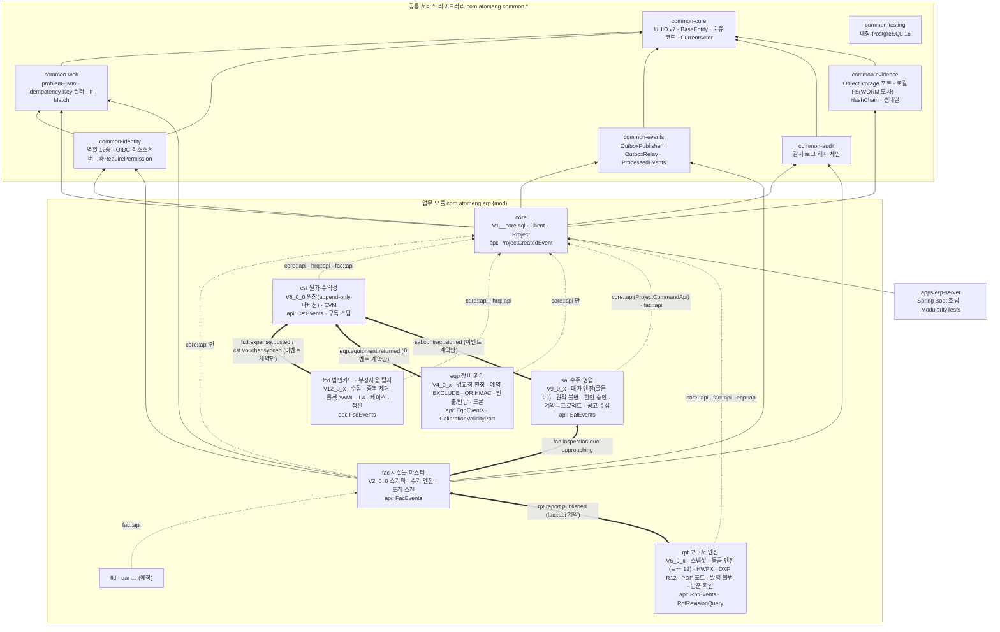

# 에이톰 안전진단 ERP — 공통 플랫폼 (Phase 0, 첫 단계)

## 쉬운 말 한 장 요약

- 이 저장소는 회사 ERP(회사 일을 한곳에서 관리하는 프로그램)의 **바닥 공사**입니다. 집으로 치면 기초·배관·전기 배선을 먼저 깐 상태예요.
- 지금 들어 있는 것은 다섯 가지입니다.
  1. **데이터 창고 설계도**(`V1__core.sql`): 고객·프로젝트·직원 표와, 기록을 지울 수 없게 막는 장치.
  2. **우편함(Outbox)**: "프로젝트가 생겼어요" 같은 소식을 업무 저장과 **같이** 저장했다가, 배달부(Relay)가 나중에 확실히 전달합니다. 배달이 실패하면 10초→20초→40초→80초 기다렸다 다시 시도하고, 5번 실패하면 "반송함"(DLQ)에 넣습니다.
  3. **중복 클릭 방지**(Idempotency-Key): 현장 태블릿이 같은 요청을 여러 번 보내도 한 번만 처리하고, 두 번째부터는 "이미 처리했어요"(`Idempotent-Replayed: true`)라고 같은 답을 돌려줍니다.
  4. **출입증 검사**(역할·권한): 12가지 역할(임원, 영업, 기술자, 재무, 감사 등)마다 할 수 있는 일을 정하고, 기술자는 **자기가 투입된 프로젝트만** 볼 수 있습니다.
  5. **알기 쉬운 오류 쪽지**(problem+json): 오류마다 `CORE-409-010` 같은 번호가 붙어 원인을 바로 찾을 수 있습니다.
  6. **누가 무엇을 할 수 있나 표 전수 검사**: 설계 표(12역할 × 11모듈 = 132칸)를 한 칸씩 모두 시험합니다.
  7. **개인정보 가리기**: 민감정보를 조회하면 감사 로그에 "누가 봤는지"는 남기되, 이름은 `홍*동`처럼 가려서 남깁니다.
  8. **사진 증거 보관**: 현장 사진을 올리면 서버가 지문(SHA-256)을 다시 계산해 위조를 막고, 사진끼리 지문을 사슬처럼 이어(해시 체인) 중간 사진을 몰래 바꾸면 들통나게 합니다. 원본은 지울 수 없는 칸(WORM)에 보관하고 작은 미리보기(썸네일)를 만듭니다.
  9. **첫 업무 모듈 FAC(시설물 마스터)**: 건물을 등록하고(같은 건물 중복 등록은 막음), 점검 보고서가 나오면 안전등급(A~E)을 기록합니다. 등급 기록은 고칠 수도 지울 수도 없습니다. 법에서 정한 점검 주기 표(⚠️ 예시 값)로 다음 점검 날짜를 계산하고, 180·90·30일 전과 날짜가 지났을 때 영업팀에 알림 이벤트를 보냅니다.
  10. **건축물대장 자동 입력·병합·위치 계층**: 주소를 넣으면 공공 API(도로명주소·건축물대장)에서 건물 정보를 가져와 자동으로 채우고, API가 멈추면 3번 다시 시도한 뒤 손으로 입력하는 방식으로 넘어갑니다. 같은 건물이 두 번 등록됐으면 하나로 합치고(병합), 층·구역·기둥·보 같은 위치를 나무 모양 목록(ltree)으로 관리합니다. 결함이 기록된 기둥은 대신할 기둥을 정해야만 지울 수 있습니다.
  11. **두 번째 업무 모듈 HRQ(인력·자격)**: 기술자 등급·자격을 기록하고, 자격 만료가 다가오면 한 번만 알립니다. 회사가 안전진단기관 등록을 유지하려면 등급별로 사람이 몇 명 있어야 하는데(⚠️ 예시 기준), 누가 퇴사하면 언제부터 모자라는지 미리 계산합니다. 근무시간(타임시트)은 팀장이 승인하면 원가로 넘어가고, 고칠 때는 지우지 않고 "새 판(리비전)"을 만들며, 월 마감한 달은 함부로 못 고칩니다.
  12. **세 번째 업무 모듈 CST(원가·수익성, 첫 단계)**: 팀장이 승인한 근무시간이 오면 "시간 ÷ 8 × 등급별 하루 단가"로 인건비를 원가 장부(원장)에 적습니다. 장부는 **고치거나 지울 수 없고**, 근무시간이 정정되면 원래 줄을 마이너스로 지우는 줄(역분개)과 새 줄을 함께 적습니다. 같은 소식이 두 번 와도 한 번만 적고, 정정 소식이 원래 소식보다 먼저 오면 잠시 미뤘다가 다시 처리합니다. 마감한 달에 들어올 원가는 다음 열린 달로 넘깁니다. HRQ 월 마감 소식은 **장부에 다시 적지 않고** 두 시스템 합계가 맞는지만 확인합니다(이중 집계 방지). 계획 대비 실적(EVM: CPI·SPI 등)을 계산해 신호등(초록·노랑·빨강)으로 경보합니다. 금액은 전부 소수 오차가 없는 BigDecimal 로 계산합니다.
  13. **네 번째 업무 모듈 FCD(법인카드 관리 · 부정사용 탐지, 첫 단계)**: 카드사 명세서(CSV · 엑셀)를 올리면 글자 깨짐(한글 인코딩)과 머리글 줄을 스스로 알아내고, 같은 결제가 여러 파일에 두 번 들어와도 **한 건으로 합칩니다**(애매하면 사람에게 확인 요청). 카드번호 원문은 어디에도 저장하지 않고 '지문(토큰)'만 남깁니다. 규칙 책(룰셋 YAML)은 **파이썬 시제품과 똑같은 파일**을 그대로 읽어 "심야 사용 · 금지 업종 · 쪼개기 결제" 같은 규칙을 점수(0–100)로 바꾸는데, 같은 합성 데이터로 돌렸을 때 **파이썬과 결과가 한 글자도 다르지 않음**을 시험으로 확인했습니다(골든 패리티). 점수가 높은 거래는 한 달 검토 예산(1,000건당 20건) 안에서 '확인이 필요한 사용'으로 케이스를 열고, 본인이 소명하면 **본인 · 결재자가 아닌 감사 담당**이 판정합니다. 정산이 끝나면 원가 모듈(CST)에 `fcd.expense.posted` 를 보내 원가 장부에 적히고, 전표가 동기화되면 회신(`cst.voucher.synced`)을 받아 정산서를 '전표 완료'로 바꿉니다. 퇴사 소식이 오면 카드에 '정지 검토' 표시만 하고 **결제를 자동으로 막지는 않습니다**.
  14. **다섯 번째 업무 모듈 EQP(장비 관리, 첫 단계)**: 슈미트해머·초음파 측정기·드론 같은 장비를 대장에 올리고, 검교정(장비가 정확한지 공인기관이 확인한 날짜와 유효기한)을 기록합니다. 유효기한이 지난 장비는 예약도 반출도 막고(QA 가 사유를 적어 최대 7일까지만 예외 허용), 같은 장비를 같은 날짜에 두 팀이 동시에 예약해도 데이터베이스가 한 건만 받아 줍니다. 장비에 붙이는 QR 은 비밀 열쇠로 서명해서 위조 라벨은 거부합니다. 매일 밤 "곧 만료(D-60·30·7·0)"·"만료됨" 알림을 한 번씩만 보내고, 장비를 반납하면 사용 일수를 원가 모듈(CST)에 알려 장비 사용료가 원가 장부에 한 번만 올라갑니다. 드론 비행기록은 승인 구역을 벗어났는지 표시합니다.
  15. **여섯 번째 업무 모듈 SAL(수주·영업, 첫 단계)**: 영업 기회를 "리드 → 검토 → 제안 → 협상 → 수주(WON) → 계약"으로 관리하고, 정해진 순서 말고는 단계를 못 건너뛰게 합니다. 용역비(대가)는 **기준일에 유효한 요율표(⚠️ 예시 값)** 로 "인·일 × 노임단가 + 경비 + 제경비 + 기술료"를 계산하며, 같은 입력을 **파이썬으로 따로 계산한 합성 정답 22건**과 원 단위까지 맞는지 시험합니다. 견적은 버전(v1, v2 …)으로 쌓이고, **발행된 견적은 데이터베이스가 금액을 못 고치게 막습니다.** 할인은 영업 5%·영업팀장 10%까지 바로 되고, 넘으면 **임원(EXEC)만** 승인할 수 있습니다(최대 49%, 50% 이상은 데이터베이스가 거부). 계약은 임원 결재 → 고객 서명 기록 순서로 진행되고, 서명이 기록되는 순간 **프로젝트 번호(PRJ-연도-번호)** 가 생기며 원가 모듈(CST)에 소식이 가서 **실행예산 초안**이 한 번만 만들어집니다. 나라장터 공고는 "마지막으로 성공한 수집 시각 − 10분"부터 다시 읽어 실패한 구간도 빠뜨리지 않고(공공 API 명세 ⚠️ 확인 필요), 적격심사 점수는 **실적증명서 표(performance_record)만** 근거로 쓰며 공동도급 실적은 지분만큼만 셉니다.
  16. **일곱 번째 업무 모듈 RPT(보고서 엔진, 첫 단계)**: 현장 결함 자료를 한 시점에 **얼려(스냅샷 동결)** 지문(SHA-256)을 남기고, 기둥·보·슬래브 같은 부재마다 균열폭·박리 면적·철근노출 비율을 **기준표(⚠️ 예시 값, 시행일이 있는 규칙표)** 에 대어 a~e 로 매긴 뒤 층 → 동 → 시설물 순서로 점수를 모아 **안전등급 A~E 초안**을 냅니다. 같은 계산을 **파이썬으로 따로 만든 합성 정답 12건**과 한 자리까지 맞는지 시험합니다. 결함물량표·상태평가표·외관조사망도(CAD 로 여는 **DXF** 도면 + 미리보기 그림)를 자동으로 만들고, 한글 문서(**HWPX** = XML 을 묶은 압축 파일)를 서식(템플릿)에 채워 넣어 만든 뒤 압축을 풀어 구조·스키마·참조를 스스로 검사합니다(한컴 프로그램 없이). PDF 는 변환 서버(Gotenberg) 연결 부품으로 만들고, 시험에서는 가짜 변환기를 씁니다. 책임기술자가 등급을 바꾸려면 **사유 100자 + 근거 결함**이 필요하고, 검토 승인 뒤 **발행하면 고칠 수도 지울 수도 없습니다**(데이터베이스가 막고, 파일은 지울 수 없는 칸에 보관). 발주처가 받았다고 확인하면 '납품됨'이 되고, 고칠 일이 생기면 **정정본(Rev.2)** 을 새로 발행해 이전 판은 '대체됨'이 됩니다. 발행 소식은 FAC 가 받아 안전등급 이력과 다음 점검일을 바로 고칩니다(실제 흐름으로 시험). 검토(QAR) 모듈을 위해 문단마다 **몇 쪽 어디에 있는지(anchors.json)** 와 **섹션별로 누가 고쳤는지**를 알려 주는 조회 창구도 만들었습니다.
- 모든 기능은 자동 시험 **656개**(655개 통과, 1개는 PostGIS 서버가 있을 때만 실행)로 확인했습니다. 공공 API 는 WireMock 가짜 서버(합성 응답)로 시험합니다. 시험 데이터는 전부 **가짜(합성) 데이터**입니다.

> 설계 근거: Notion「00. 공통 아키텍처 · 설계 표준 v0.3」, 「00-IMPL. 공통 플랫폼 구현 보고서」, 「에이톰 플랫폼 모듈 라이브러리(ATOM-LIB-001)」.

### 용어 정리

| 용어 | 쉬운 뜻 |
|---|---|
| 모듈형 모놀리스 | 프로그램은 하나지만 안에 칸막이(모듈)를 쳐서 서로 함부로 못 건드리게 한 구조 |
| Spring Modulith | 칸막이를 어겼는지 자동으로 검사해 주는 도구 |
| Flyway | 데이터베이스 설계도를 버전 순서대로 적용해 주는 도구 |
| Outbox / Relay | 보낼 소식을 먼저 우편함에 넣고(Outbox), 배달부(Relay)가 꺼내 전달 |
| DLQ (outbox_dead) | 여러 번 배달 실패한 소식을 모아 두는 반송함 |
| 멱등(Idempotency) | 같은 요청을 여러 번 보내도 결과가 한 번 보낸 것과 같음 |
| ETag / If-Match | 문서 버전 번호. 남이 먼저 고쳤으면 "버전이 달라요"(412)라고 막음 |
| 해시 체인 | 기록마다 앞 기록의 지문을 이어 붙여, 중간을 몰래 고치면 들통나게 하는 방법 |
| UUID v7 | 시간 순서대로 정렬되는 고유 번호(아이디) |
| RFC 7807 problem+json | 오류를 정해진 JSON 모양으로 알려주는 국제 표준 |

---

## 1. 모듈 구성



- 공통 라이브러리는 업무 모듈(`com.atomeng.erp..`)을 **절대 import 하지 않습니다**(ArchUnit 규칙 R1).
- 업무 모듈끼리는 `{mod}::api` 명명 인터페이스로만 접근합니다(Spring Modulith `verify()`).

```
atom-erp/
├─ common/common-{core,web,identity,events,audit,testing}
├─ modules/core/                 # com.atomeng.erp.core
│  └─ src/main/resources/db/migration/core/V1__core.sql
│     └─ db/migration-ext/V1_1__core_postgis_ext.sql   (프로필 postgis)
└─ apps/erp-server/              # com.atomeng.erp.ErpServerApplication
```

## 2. 빌드 방법 (Windows, 시스템 설정 변경 없이)

시스템에 Java/Gradle/Docker/PostgreSQL 이 없어도 됩니다. PyCharm 에 들어 있는 JBR(JDK 25)을 **명령 한 번에만** 지정합니다.

```bash
# Git Bash
cd C:/Users/atomS/atom-erp
JAVA_HOME="/c/Program Files/JetBrains/PyCharm 2026.1.2/jbr" ./gradlew build
```

```powershell
# PowerShell (현재 창에서만 유효)
$env:JAVA_HOME = "C:\Program Files\JetBrains\PyCharm 2026.1.2\jbr"; .\gradlew.bat build
```

- Gradle 9.7.1 은 wrapper 가 자동으로 내려받습니다.
- 바이트코드는 `--release 21`(Java 21)로 만듭니다. JDK 21 이 있는 CI 에서는 toolchain 21 로 바꿔도 됩니다.
- 통합 테스트는 **zonky embedded-postgres**(PostgreSQL 16.15 바이너리, Maven Central)로 Docker 없이 실행됩니다.
- 모듈 문서(PlantUML)는 `apps/erp-server/build/spring-modulith-docs/` 에 생성됩니다.

선택 실행:

```bash
./gradlew :modules:core:test          # 마이그레이션 테스트
./gradlew :apps:erp-server:test --tests '*ModularityTests*'
ATOM_PG_POSTGIS_URL='jdbc:postgresql://host:5432/db?user=..&password=..' ./gradlew :modules:core:test  # PostGIS 확장 테스트(TC-CORE-008)
```

로컬 실행(실제 PostgreSQL 필요, Keycloak 없이 헤더 인증):

```bash
PG_HOST=localhost PG_APP_USER=postgres PG_APP_PASSWORD=... \
  ./gradlew :apps:erp-server:run --args='--spring.profiles.active=local-noauth'
# 요청 예: -H 'X-Actor-Id: <uuid>' -H 'X-Roles: SALES' -H 'Idempotency-Key: <uuid>'
```

## 3. 구현 내용 ↔ 설계 대응

| 설계 | 구현 위치 | 핵심 |
|---|---|---|
| 7.2 core 스키마·공통 6컬럼 | `V1__core.sql`, `BaseEntity` | client·employee·project·project_member·code·attachment·hash_anchor·audit_log(월 파티션)·doc_sequence |
| UUID v7 | `UuidV7`(Java), `core.uuid_generate_v7()`(SQL) | 같은 ms 단조 증가, 시계 역행 보호 |
| 10.2/10.3 Outbox | `OutboxPublisher`(MANDATORY), `OutboxRelay` | `FOR UPDATE SKIP LOCKED`, 이벤트 1건=트랜잭션 1개, 백오프 5·2ⁿ초(10/20/40/80), 5회째 `outbox_dead`, `requeueDead()` |
| 컨슈머 멱등 | `ProcessedEvents`, `@IdempotentListener` | `INSERT … ON CONFLICT DO NOTHING`, 실패 시 함께 롤백 |
| 9.4 멱등 키 | `IdempotencyFilter`, `IdempotencyStore` | PK (actor_id,key), CORE-428-001 / CORE-409-010 / CORE-422-009, `Idempotent-Replayed`, 5xx 미저장, 24시간 보관·정리 배치 |
| 8장 RBAC | `Role`(12종), `JwtAuthConverter`, `@RequirePermission`, `core.role_permission` | EMPLOYEE·FIN·AUDITOR 포함, PROJECT/CLIENT 행 수준 권한(CORE-403-002) |
| 8.1 OIDC | `IdentityAutoConfiguration` | 다중 issuer(atom-internal/atom-portal), issuer 메타데이터 지연 조회, 테스트·로컬은 헤더 스텁 |
| 9.2 오류 모델 | `GlobalProblemHandler`, `ProblemFactory` | 모든 오류 problem+json + `code` + `traceId`, ko/en title |
| 9.1 동시성 | `IfMatch`, JPA `@Version` | ETag `"v{n}"`, If-Match 불일치·경합 → 412 CORE-412-001 |
| NFR-CORE-07 감사 | `AuditLog`, `core.audit_append()` | 해시 체인 + append-only 트리거 + `audit_verify_chain()` |
| 8.2 권한 매트릭스 | `permission-matrix-8.2.csv` → `tools/gen_role_permission_seed.py` → `V1_2__core_role_permission_matrix.sql` | 132셀·154권한, Java 독립 해석기로 셀별 정확 일치 검사 |
| 8.1 Keycloak | `deploy/keycloak/atom-internal-realm.json`, `atom-portal-realm.json` | 역할 11+1, 클라이언트 5, 매퍼 roles·eid·cid, PKCE, 조건부 OTP 흐름, 사용자·비밀값 없음 |
| Step 6 감사 | `@Audited` + `AuditAspect`, `@Pii` + `PiiMasking`, `AuditPartitionMaintenance` | VIEW_PII 동기 기록(fail-closed), 감사 JSON 마스킹, 월 파티션 사전 생성 |
| 11장 첨부 | `ObjectStorage`/`LocalFsObjectStorage`, `AttachmentService`, `ThumbnailGenerator` | presign→PUT→:complete, 해시 재계산(CORE-422-010), WORM 복사, 체인 잠금·연결·검증, outbox→썸네일 |
| 4장 모듈 경계 | `ModularityTests`, `ArchitectureRulesTest` | verify() + 위반 픽스처 음성 테스트 |

## 4. 테스트 ↔ TC-CORE

| TC | 시나리오 | 테스트 |
|---|---|---|
| TC-CORE-001 | ENG 가 담당 외 프로젝트 조회 → 403 CORE-403-002, 감사 로그 없음 | `AuthorizationIntegrationTest` |
| TC-CORE-002 | 같은 Idempotency-Key 로 고객 생성 3회 → 1건, 2·3회차 Replayed | `IdempotencyIntegrationTest` |
| TC-CORE-003 | 두 사용자 동시 수정 → 200 / 412 | `OptimisticLockIntegrationTest` (순차·동시 2종) |
| TC-CORE-004 | 생성 트랜잭션 예외 → 프로젝트·outbox 모두 롤백 | `OutboxIntegrationTest` |
| TC-CORE-005 | Relay 강제 종료 후 재기동 → 전량 발행, 중복 소비 0 | `OutboxIntegrationTest` |
| TC-CORE-006 | 해시 위조 업로드 → 422 CORE-422-010, temp 삭제 | `AttachmentIntegrationTest` |
| TC-CORE-007 | attachment.sha256 직접 UPDATE → 트리거 예외 | `CoreMigrationTest` |
| TC-CORE-009 | 오프라인 사진 10장 → 업로드 10, 체인 연속, 썸네일 | `AttachmentIntegrationTest` |
| TC-CORE-010 | PII 조회 → VIEW_PII 1건, 로그 원문 없음 | `AuditPiiIntegrationTest` |
| TC-CORE-008 | 규칙 기간 중복 ACTIVE → EXCLUDE 위반 | `PostgisExtMigrationTest` (PostGIS DB 있을 때만) |

권한 매트릭스: `PermissionMatrixTest` 152건(132셀 + 커버리지 1 + HTTP 프로브 19). 미대상: TC-CORE-011(AIP, Step 12), 012(PITR, Step 15).

## 4-1. FAC 시설물 마스터 (02 v0.3 / 02-IMPL Step 1·2·4·9·10·11 일부)

| 항목 | 구현 |
|---|---|
| 스키마 | `modules/fac/.../db/migration/fac/V2_0_0__fac_schema.sql` — site·building(정본)·parcel·location_node(ltree)·drawing(+version)·분류 규칙/분류·grade_history·inspection_cycle_rule(EXCLUDE)·inspection_due·due_notification·repair_history·repair_target(대리키) = 14개 |
| 불변 | `fac.forbid_grade_mutation()` 트리거 — UPDATE/DELETE/TRUNCATE 모두 `restrict_violation(23001)` |
| PostGIS | `db/migration-ext/V2_99__fac_postgis_ext.sql`(site.boundary, building.location) — 프로필 postgis, out-of-order |
| 규칙 | `V2_0_1__fac_cycle_rule_seed.sql` — 시특법 정기·정밀점검·정밀진단, 건축물관리법 점검 **⚠️ 예시 값**(approved_by NULL) |
| 엔진 | `InspectionCycleEngine`(순수 도메인): 기준일 시점 유효 규칙, 등급 일치 우선, 상위 점검 갈음, 최초 점검(사용승인일), calc_trace |
| API | `/api/v1/fac/buildings` POST(멱등)·GET 목록/단건(ETag)·PATCH(If-Match)·DELETE(논리) · `PUT /{id}/classification` · `GET /{id}/grades` · `GET /{id}/dues` |
| 이벤트 | 발행 `fac.building.registered`, `fac.grade.recorded`, `fac.grade.critical-detected`, `fac.inspection.due-approaching`, `fac.inspection.overdue` (core outbox) · 구독 `rpt.report.published` (스텁 계약) |
| 대장 ACL (Step 3) | `JusoClient`(도로명주소 → PNU), `BuildingRegisterClient`(총괄표제부·표제부·층별개요), 재시도 3회·지수 백오프, PNU 캐시 24h, 일일 쿼터, 키 미설정·장애 → 수기 모드. `GET /api/v1/fac/register-lookup`, 등록 시 `lookupAddress`·`mgmBldrgstPk`. **⚠️ 공공 API 명세 확인 필요** |
| 병합 (Step 5) | `POST /buildings/{id}/merge` — 노드(코드 충돌 `-M1`·ltree 루트 교체)·등급(복제+correction_of)·도래 취소·보수·도면·필지 이관, source=MERGED, `fac.building.merged` |
| 위치 계층 (Step 7) | `GET/POST /buildings/{id}/nodes`, `POST …/nodes:generate`(그리드 → COL·GIR·SLAB, 코드 `3F-C-X2Y3`), `POST …/nodes/{nodeId}:move`, `DELETE …/nodes/{nodeId}?replacedById=` — 결함 참조 읽기 모델 `fac.node_defect_ref`(`fld.defect.recorded` 구독) |
| TC | TC-FAC-001·002·003·004·005·006·007·008·011 (+ 상태 전이, 중복 PNU, 규칙 기간 중복, repair_target, ACL 7종) |

## 4-2. HRQ 인력·자격 (03 v0.4 / 03-IMPL Step 1·3·4·5·7·12 일부)

| 항목 | 구현 |
|---|---|
| 스키마 | `V3_0_0__hrq_schema.sql` — employee(core.employee 1:1)·employee_termination·grade_history(EXCLUDE)·credential·training·registration/role_requirement/concurrency 규칙(EXCLUDE)·allocation·timesheet_entry(리비전·`ux_ts_revision`·`ux_ts_current`·append-only 트리거)·month_close(char(6))·notification_log |
| 규칙 시드 | `V3_0_1` 등록요건·책임자격·동시수행·교육주기 **⚠️ 예시**(approved_by NULL) + HRQ 세부 권한 |
| 등록요건 | `ComplianceEngine`(순수, 높은 요건부터·낮은 적격 등급부터 소모, count_upward/count_leave), `GET /compliance`, `GET /compliance:forecast`(변화점 기반 최초 미달일) |
| 자격·등급 | 등록(PENDING)·승인/반려, 만료 스캔(06:00, 멱등 알림 기록), 등급 변경(이력 종료+신규), 퇴사 예정/확정 |
| 타임시트 | 주간 저장·제출, PM 승인, `POST /timesheets/{id}:correct`(Idempotency-Key 필수, 새 리비전), 월 마감·재오픈 |
| 이벤트 | `hrq.timesheet.confirmed`, `hrq.timesheet.corrected`(idempotencyKey=timesheetKey:newRevision), `hrq.manday.closed`, `hrq.credential.expired`, `hrq.employee.terminated`, `hrq.grade.changed` |
| TC | TC-HRQ-005(실데이터 예측)·006·007·011·012·013 (+ 등급 겹침, 확정 행 불변 트리거, 골든 8건) |

## 4-3. CST 원가·수익성 (08 v0.4 / 08-IMPL Step 1·3·6·11·12 일부)

| 항목 | 구현 |
|---|---|
| 스키마 | `modules/cst/.../db/migration/cst/V8_0_0__cst_schema.sql` — rate_table(EXCLUDE)·employee_cost_rate·project_facility(→`fac.building`)·wbs_node·budget_revision(APPROVED 1개)·budget_line·accounting_period(char(6))·**cost_ledger_entry**(월 LIST 파티션, append-only 트리거 `CST-409-001`, 마감 월 INSERT 차단 `CST-409-002`, `UNIQUE NULLS NOT DISTINCT (source_type, source_id, period_ym, reversal_of)`, `reversal_of`)·manday_reconciliation·progress_record·evm_snapshot·voucher_sync·`mv_project_profitability` · `V8_0_1` CST 세부 권한 |
| 금액 | numeric 만(부동소수 컬럼 0개 검사), Java `BigDecimal`/`Money`(KRW scale 0·외화 scale 2, HALF_UP 1회 반올림) |
| 인건비 전기 | `hrq.timesheet.confirmed` 가 **유일한 원천** — 라인마다 TIMESHEET 1행, 근무일 등급(`hrq::api HrqQueryApi.gradeOf`) × 근무일 표준단가 + 근무월 실단가(없으면 표준, `REAL_RATE_FALLBACK`) |
| 정정 | `hrq.timesheet.corrected` → 직전 리비전 REVERSAL(음수, `reversal_of`) + 새 리비전 TIMESHEET, 한 트랜잭션, 업무 멱등키 `timesheetKey:newRevision`(core.processed_event), 귀속월 CLOSED 면 다음 OPEN 월, 원 행 미도착이면 `CST-409-003` 예외 → outbox 재시도(10·20·40·80초) |
| 월 마감 대사 | `hrq.manday.closed` → **원장 기록 없이** (프로젝트·기술자·등급·업무유형) 단위 `round(Σh/8, 2)` 비교, MATCHED/MISMATCH 기록, payload 해시 멱등, CST 마감 체크리스트 전제 |
| 구독 스텁 | `fcd.expense.posted`(EXPENSE 행, 공급가만) → 더존 스텁 전표 → **`cst.voucher.synced`** 발행 · `fcd.expense.reversed`(역분개) · `eqp.equipment.returned`(일수 × EQUIP_DAILY) — 계약 레코드 `cst.api.CstSubscriptionContracts` |
| EVM | `EvmCalculator`(순수 도메인): PV(LINEAR·FRONT_LOADED)·EV·AC·CV·SV·CPI·SPI·EAC(3분기 규칙)·ETC·VAC·TCPI + 경보(지수·EAC·소진율 격차·WBS 초과) / `GET /projects/{id}/evm` 스냅샷 저장, PM 은 표준단가 AC |
| API | `/api/v1/cst/rates`(GET·POST) · `/projects/{id}/ledger`(실단가 열 마스킹) · `/ledger/summary` · `/evm` · `/progress`(±15%p 초과는 EXEC) · `/periods/{ym}` · `:close`(ADMIN, 체크리스트) · `:reopen`(SYSADMIN+사유) |
| 이벤트 | 발행 `cst.voucher.synced`, `cst.period.closed`, `cst.ledger.corrected` |
| 모듈 경계 | `allowedDependencies = core::api, hrq::api, fac::api` (ModularityTests), 원장 쓰기는 `CostLedgerService` 하나(ArchUnit) |
| TC | TC-CST-04·05·10·11(일부)·13·14, TC-HRQ-010(+정정·조정 변형), 계약 테스트 `CstHrqContractTest` |

## 4-4. FCD 법인카드 관리 · 부정사용 탐지 (12 FSD·TSD / 12-IMPL Step 1·2·3·5·7·8 일부, Python 프로토타입 `atom-fcd` 이식)

| 항목 | 구현 |
|---|---|
| 스키마 | `modules/fcd/.../db/migration/fcd/V12_0_0__fcd_schema.sql` — card(HMAC 토큰 · 앞6 · 뒤4 · 마스킹 생성 컬럼, **PAN 컬럼 없음**) · card_assignment(기간 중복 금지 트리거) · employee_status(퇴사 읽기 모델) · merchant · import_profile · import_batch(SHA 부분 유일 인덱스 BR-FCD-004) · import_row_error · import_staging · **txn**(승인 · 매입 · 청구 상태, 자연키, removed_at) · txn_source(채널 · 종류 · 원문 해시 멱등, detached) · dedup_candidate · rule_set(YAML 원문 · sha256 · 4-eyes CHECK) · **risk_score**(append-only 트리거, 특징 스냅샷) · review_run · fcd_case · case_txn · case_event(append-only) · explanation · evidence · feedback · expense_report · expense_line / `V12_0_1` 세부 권한 54개 · 매핑 프로파일 4종(합성 양식) |
| 수집 | `domain/ingest`: 매직넘버 형식 판별 → 인코딩(BOM → UTF-8 엄격 → CP949, 64KB 경계 보정) → 구분자 판별 → RFC4180 파서(따옴표 안 줄바꿈) / **XLSX 는 POI XSSF SAX 스트리밍**(표시형식 `0000…` 승인번호 선행 0 복원, 날짜 셀) · XLS(BIFF8, HSSF) · HTML-as-XLS → 헤더 30행 자동 탐지(2단 병합 헤더 결합) → 프로파일 Jaccard ≥ 0.8 자동 선택(아니면 NEEDS_MAPPING) → 행 검증(오류 리포트 BOM CSV) → 표준 레코드. 원문은 PAN 마스킹 후에만 저장 |
| 중복 제거 | `DedupEngine`(순수): 원문 해시 → 승인번호(±1일 · 금액/환율 2%, 같은 분이면 NATURAL_KEY) → 퍼지 S=Σw·s/Σw(시간 .35 · 금액 .35 · 가맹점 Jaro-Winkler .20 · 승인번호 .10) ≥ 0.92 자동 · 0.75–0.92 확인 큐 · 같은 채널 · 종류 원천은 거래당 1개 / 취소 · 중복 취소 · 고아 취소(재매칭) / `TxnDerivation` 재도출(매입 원화 우선, 정밀도 · 채널 우선) — 미리보기(드라이런)와 커밋이 같은 코드, 커밋 시 재판정 · advisory lock |
| 롤백 | BR-FCD-005: 영향 미리보기(DELETE_TXN · DETACH_SOURCE · KEEP_POSTED · KEEP_RESOLVED_CASE · DROP_ORPHAN) → 사유 필수 실행, 전표 반영 건 유지 → PARTIALLY_ROLLED_BACK, 감사 로그(해시 체인) · `fcd.import.rollback-completed` |
| 룰셋 · L1 | **프로토타입과 같은 YAML 8개**(`fcd/rulesets`, sha256 동일) 시드. `PyExpr` = Python 식 부분집합 전용 토크나이저 · 재귀 하강 파서(**eval · 스크립트 엔진 없음**, 화이트리스트 함수만) + `PyOps`(None · and/or · 대소비교 · 나눗셈 · % · round 짝수 등 Python 의미론) + `PyFormat`(`{x:,.0f}` 등 메시지 글자 일치). 시행일 기준 ACTIVE 선택(같은 시행일이면 상위 버전), 초안은 DRAFT, 4-eyes(API 403 + DB CHECK). `L1FeatureBuilder` = 프로토타입 tx.* 특징 48종(한도 · 일/월 누계 · 쪼개기 · 다중카드 쪼개기 · 정기결제 · 공휴일 · 업종 정책 …) |
| L2 · L3 | `FraudServicePort`(Python `atomeng_aip.fraud` 서비스): `/v1/fraud/context`(ctx.*) · `/v1/fraud/score`(l3.*, 800ms 타임아웃 → TIMEOUT/ERROR 시 L1+L2 잠정 점수). 기본은 스텁(맥락 없음 = 판정 보류) |
| L4 | `RiskCombiner`: noisy-OR · 완화(`effect.mitigates` 범위만, 하한 규칙 제외) · 하한 · L3 게이팅(params.l3_gate) · 전액취소 거래는 applies_to_cancelled 규칙만 · 짝수 반올림 · 등급(정상/주의/소명요청/고위험) · 사유 상위 3 / risk_score append + `fcd.risk.scored`(등급 변동 시) |
| 검토 큐 | `ReviewBudgetPolicy`: 월 예산 top-k(1,000건당 k, 기본 20 — 라운드 3–5 채택) 또는 임계 60, 쪼개기는 묶음 1케이스 |
| 케이스 | 상태 머신(A6.2) · 기한 영업일 5일(공휴일 캘린더) · 소명은 본인만 · 판정은 AUDITOR/EXEC 이면서 본인 · 결재자 아님(BR-FCD-018) · 라벨 → feedback · 재채점 하락은 score_dropped 표시만 · 부당 판정 + 전기 라인 → `fcd.expense.reversed` |
| 정산 · CST | 라인 입력(본인 거래, 공급가+부가세 = 순액) → 상신(BR-FCD-011 미소명 차단) → 결재(본인 금지) → 전표(BR-FCD-016 미판정 차단, 부당 라인 제외) → 라인별 `fcd.expense.posted` → CST 원장 EXPENSE 행 · 더존 스텁 → `cst.voucher.synced` → 라인 SYNCED · 정산서 POSTED |
| 구독 | `hrq.employee.terminated`(hrq::api) → 퇴사일 읽기 모델 + 카드 `deactivation_flag`(상태 ACTIVE 유지, 결제 차단 없음) + `fcd.card.deactivation-flagged` · `cst.voucher.synced`(FCD 쪽 계약 레코드) |
| API | `/api/v1/fcd/cards` · `/cards/{id}/assignments` · `/imports`(multipart) · `/{id}` · `/preview` · `/errors.csv` · `:commit` · `:discard` · `/rollback-impact` · `:rollback` · `/dedup-candidates` · `:decide` · `/rule-sets` · `:approve` · `/scoring:run` · `/review-queue/{ym}:run` · `/transactions` · `/{id}/risk` · `/cases` · `:request-explanation` · `/explanations` · `:resolve` · `:escalate` · `:request-supplement` · `/cases:sweep` · `/transactions/{id}/expense` · `/expense-reports/{period}:submit` · `/{id}:approve` · `:post` · `/employees/{id}/expense-gate` |
| 모듈 경계 | `allowedDependencies = core::api, hrq::api` — CST 와는 이벤트 계약만(`FcdCstContractTest` JSON 왕복) |
| 골든 패리티 | `tools/fcd_parity_export.py` 가 `atom-fcd` 를 **읽기 전용**으로 실행(바이트코드 · 캐시 · 내보내기는 atom-erp · 임시 폴더로)해 픽스처 생성 → `GoldenParityTest`(A: env 843건 L1/L2/L3 적중 · 강도 · 메시지 · 근거 · L4 점수 · 사유 완전 일치, B: 카드 20장 · 4개월 1,338건 L1 특징 48종 · 적중 · 점수 일치) · `IngestTest`(카드사 양식 3종 3,152행 표준 레코드 일치) |
| TC | TC-FCD-001~007 · 009~018 · 023~027 · 030 (+ 롤백 · 확인 큐 · 퇴사 · 월 예산 큐 · 안전 평가기) |

## 4-5. EQP 장비 관리 (04 v0.2 / 04-IMPL Step 1·2·3·5·6·7·8·11 일부, 12 의 CST 반납 계약)

| 항목 | 구현 |
|---|---|
| 스키마 | `modules/eqp/.../db/migration/eqp/V4_0_0__eqp_schema.sql` — equipment_type · calibration_rule(btree_gist EXCLUDE) · code_sequence(채번 카운터) · equipment(유형+시리얼 UNIQUE, qr_secret, 삭제 금지 트리거) · equipment_status_history · calibration(append-only, next_due_on = valid_until) · calibration_override(최대 7일 CHECK) · **reservation(daterange + `no_double_booking` EXCLUDE, 활성 상태만)** · checkout(clientOpId UNIQUE, `ux_active_checkout` 부분 유니크) · fault · notification_log(멱등키) · drone_profile · flight_approval · flight_log = 14개. `V4_0_1` 유형 11종 · 규칙(**⚠️ 예시 값**) · 세부 권한 31건 |
| 확장 | 내장 PG 에 **btree_gist 는 있음**(fac · hrq · cst 와 같이 EXCLUDE 사용) · PostGIS 없음 → 위치는 위경도 숫자, 비행 구역 · 경로는 jsonb 좌표 + Java `Geo.pointInPolygon` |
| 판정 | `CalibrationValidityService`(= `eqp::api CalibrationValidityPort`) 단일 진입점 — 폐기 · 분실 · 고장 · 수리 → `EQP_NOT_USABLE`, 키트 자식 재귀(`EQP_KIT_CHILD_INVALID`), 교정 비대상, 측정일 포함 PASS/LIMITED 교정 + 이후 FAIL 검사, 프로젝트 한정 · 전역 QA Override, 그 외 `EQP_CAL_EXPIRED`. 예약(시작 · 종료일) · 반출(반출일 KST) 모두 이 판정만 사용 |
| 상태 | `EquipmentStatus` 전이표(설계 A6.1 100조합 테스트) + `equipment_status_history`. 교정 PASS → AVAILABLE(경로 전이), FAIL → BROKEN, 스캔 만료 → CAL_DUE |
| QR | `QrToken` `eqp1.{code}.{epoch}.{HMAC-SHA256 16자}`(장비별 32바이트 키, 상수 시간 비교), 라벨 재출력 `rotate` 시 키 회전 → 옛 라벨 403, ZPL 50×30mm |
| 예약 | 동시 요청은 DB EXCLUDE 가 1건만 통과(23P01 → 409 `EQP-409-002`) — 삽입은 짧은 트랜잭션, 대체 장비 추천(B7.2 점수 상위 3)은 롤백 뒤 계산. BR-EQP-002 기간 중 만료 409 · 승인 · 취소(슬롯 자동 해제) · 가용 조회 |
| 반출 · 반납 | QR 검증 → 장비 행 `FOR UPDATE` → clientOpId 재전송 REPLAYED(200) → 판정 409 + `alternatives` · `overrideAllowed` → 슈미트해머 앤빌 80±2(422) → 활성 반출 있으면 `sync_conflict` 202 + `eqp.checkout.conflicted` → 예약 매칭(다른 프로젝트 예약 기간 409) / 반납: 사용 일수(KST 양 끝 포함) · 예약 RETURNED · 이상 시 고장 + BROKEN |
| 스캔 | `CalibrationScanService` 매일 00:10 KST(`atom.eqp.calibration-scan`), 수동 `POST /calibration-scan:run`. due-soon 은 남은 일수 이하인 가장 작은 기준 1회(누락 없는 따라잡기), expired 는 `(equipmentId, expiredOn)` 1회 + CAL_DUE 보정, `notification_log ON CONFLICT DO NOTHING` 이 이긴 경우만 발행 |
| 드론 | 기체 프로필(보험) · 비행승인(구역 · 기간) · 비행로그: 보험 만료 422, 조종자 자격 포트(`PilotQualificationPort`, 기본 스텁 VALID · `atom.eqp.drone.hrq-check=true` 면 Fail-closed 422), 구역 이탈 `out_of_area`, 기간 밖 경고 |
| API | `/api/v1/eqp/equipment` POST(멱등)·GET 목록(status·type·calDueWithinDays)·GET 단건(ETag)·PATCH(If-Match)·`:dispose`(If-Match) · `/{id}/validity` · `/{id}/labels` · `/scan/{qrToken}` · `/{id}/calibrations` · `/{id}/calibration-overrides` · `/calibration-scan:run` · `/reservations`(+`:approve`·`:cancel`·`availability`) · `/checkouts` · `/checkouts/{id}/return` · `/drones/{id}/profile`·`flight-approvals`·`flight-logs` |
| 이벤트 | `eqp.equipment.registered` · `eqp.calibration.recorded` · **`eqp.calibration.due-soon`** · **`eqp.calibration.expired`** · `eqp.equipment.checked-out` · `eqp.checkout.conflicted` · **`eqp.equipment.returned`**(CST 스텁 계약과 필드 동일 — `EqpCstContractTest`, 반납 → Relay → CST EQUIP_USE 원장 E2E) · `eqp.fault.reported` · **`eqp.flight.logged`** |
| 모듈 경계 | `allowedDependencies = core::api`, TC-EQP-012 ArchUnit(다른 모듈 → eqp 내부 0건, eqp → 다른 업무 모듈 0건) |
| TC | TC-EQP-001·002(동시 5회)·003(순차 + 동시)·004·006·007·008·010·011·012 (+ 대장 ETag · QR 위조/회전 · 경계값 · 스캔 멱등 · 반납 → CST) |

## 4-6. SAL 수주·영업 (01 v0.3 / 01-IMPL Step 1·2·4·5·6·8·9·10·12 일부)

| 항목 | 구현 |
|---|---|
| 스키마 | `modules/sal/.../db/migration/sal/V9_0_0__sal_schema.sql` — bid_notice(ux (source,bid_no,bid_seq), tsvector) · bid_filter · bid_result · **collect_log**(BR-SAL-013) · opportunity(ux_opp_due · ux_opp_portal · ck_lost_reason · ck_opp_owner) · stage_history · activity · sales_group_member(SALES_LEAD) · **fee_rule_set · qual_criteria**(유효기간, ACTIVE 겹침 EXCLUDE) · qual_simulation · bid_decision · **estimate**(ux (estimate_no, version_no), ck_discount 0.5 미만) · estimate_line · **불변 트리거** `sal.estimate_immutable_guard()`(ISSUED 이후 · EXEC 승인 이후 금액 · 요율 · 스냅샷 · 라인 변경/삭제/TRUNCATE → `SAL-409-010`) · contract(ck_negotiated · ck_fx · ck_project_when_signed) · contract_change · payment_term · **performance_record**(cert_no UNIQUE, joint_share 0–100) = 18개 / `V9_0_1` 예시 규칙(2025.1 · 2026.1 · 적격심사 1종, ⚠️ 예시 · verified_by NULL) + 세부 권한 43건 |
| 대가 엔진 | `FeeEngine`(순수 도메인, BigDecimal): 면적 구간 [from,to) 밖 → `SAL-422-005`(보간 금지) · 보정계수(화이트리스트 변수 한 단 조건, SpEL 없음) 곱 · 공종 override · 등급 인·일 HALF_UP 2자리 · 라인 절사(FLOOR_1/FLOOR_10/HALF_UP_1) · 제경비 · 기술료(규칙 min–max 밖 `SAL-422-002`) · 합계 절사(FLOOR_1000 등) · VAT. 기준일 ACTIVE 규칙만(`SAL-422-004`), 규칙 의미 검증(gradeMix 합 1 · 구간 연속). jsonb 키 순서 대신 공종 · 등급 표준 순서로 라인 고정 |
| 골든 | `tools/sal_golden_gen.py` 가 **Python Decimal 독립 구현**으로 합성 사례 22건(`golden/estimates/G-01~22.json`, 규칙 4종) 생성 → `FeeEngineGoldenTest` 원 단위 · 라인 단위 일치. 시드 규칙 본문 = 픽스처 JSON(통합 시험 대조) |
| 견적 | 기회당 견적번호 1개 · 버전 증가 · 이전 열린 버전 SUPERSEDED · 규칙/시설물/근거 스냅샷(BR-SAL-002) · 제안가 = 합계 × (1−할인) 천 원 절사. `:issue` 때 발행자 역할 + 그룹 한도(`atom.sal.discount-limits` SALES 0.05 · SALES_LEAD 0.10 · EXEC 0.49) 초과면 **PENDING_APPROVAL**(발송 `SAL-422-007`), `POST /estimates/{id}:approve-discount`(**EXEC 전용 `sal:discount:approve` · If-Match**) APPROVE → approved_by → `:issue` ISSUED · REJECT → DRAFT, EXEC 한도 초과 `SAL-422-006`. `:send`(기회 → NEGOTIATING) · `:accept`(→ WON) · `:reject` |
| 계약 | 등록(WON 기회 · ACCEPTED 견적, 수의계약 사유 DB CHECK → `SAL-422-011`, 견적 대비 1% 이상 차이 사유 `SAL-422-012`, 외화 환산) → `:approve`(EXEC, If-Match) PENDING + **`sal.contract.ready-to-sign`** → `:sign`(고객 서명 기록, If-Match) HRQ 투입 가능성 포트(스텁, 충돌 `SAL-409-003` 전부 롤백) → **core::api `ProjectCommandApi.createFromContract`** 같은 트랜잭션(PRJ-{서명연도}, 지분 금액, contract_id 연결) → APPROVED · 기회 CONTRACTED → **`sal.contract.signed`**(산출내역 라인 포함) |
| 공고 수집 | `BidNoticeSourcePort` + `G2bApiClient`(RestClient, KST yyyyMMddHHmm, 본문 첫 글자로 XML 오류 판별, 5xx/타임아웃 3회 재시도, 4xx 즉시 실패, 원문 raw_json 보존, ⚠️ 명세 확인 필요). `BidCollectService`: 구간 = **직전 성공 NOTICE 실행 range_to − 10분** ~ 현재(첫 실행 2일), collect_log 시작/종료 별도 트랜잭션, Upsert(원문 같으면 갱신 없음), 정정 → 이전 차수 SUPERSEDED + 기회 criteria_changed, 취소 → 기회 DROPPED, 신규 → `sal.bid-notice.collected`. 스케줄러 30분(`atom.sal.collect.enabled`, 기본 false), 수동 `:collect`(BACKFILL) · `:collect-now` |
| 적격심사 | `QualificationScorer`(순수): 항목 구간표 · 신용 등급표 · 가점 + 가격점수 유형 코드(LOCAL_GOV_A, ⚠️ 예시 산식) · 낙찰하한율 미만 탈락 · 추천 투찰률(참고용). 실적은 **`sal.performance_record` 만**(같은 용역 · 최근 5년, Σ 금액 × 지분/100), 입력 스냅샷 저장. 실적 이관 `POST /performance-records:import`(cert_no 중복 · 배치 안 중복 거부 리포트) |
| 구독 | `fac.inspection.due-approaching`(fac::api) → DUE_SOON 리드(진행 중 기회 있으면 활동만, ON CONFLICT DO NOTHING) · `ptl.service-request.submitted`(스텁 계약 `SalSubscriptionContracts`) → PORTAL 리드 |
| 이벤트 | 발행 `sal.bid-notice.collected` · `sal.opportunity.stage-changed` · **`sal.estimate.issued`** · **`sal.contract.ready-to-sign`**(이름 규칙에 정식 상태명으로 추가) · **`sal.contract.signed`** |
| CST 연결 | `cst.api.CstSubscriptionContracts.SalContractSigned` + `SalContractListener` + `BudgetDraftService`: 실행예산 **Rev.0 DRAFT** 1건(이벤트 멱등 + "프로젝트에 Rev 있으면 생략"), 공종별 WBS(가중치 = 공종 인건비 비율, 합 100) + 90-EXPENSE, 라인 = 견적 인·일 × 단가(등급 → HRQ 코드), BAC = 라인 합 — **TC-CST-01** |
| 모듈 경계 | `allowedDependencies = core::api, fac::api`, ArchUnit(sal → hrq · cst · fcd · eqp · core/fac 내부 0건, 다른 모듈 → sal 0건), CST 와는 JSON 계약 테스트 `SalCstContractTest` |
| TC | TC-SAL-001 · 002 · 003(부분) · 004 · 010 · 011 · 012 · 013 · 014 · 015 · 016 · 020 · 030 · 031 · 032 · 040(수기 대조 3건) · 041, TC-CST-01 (+ 전이표 121/64 조합, 골든 22, 승인 한도 · 반려, PTL 리드, 백필 권한) |

## 4-7. RPT 보고서 엔진 (06 v0.2 / 06-IMPL Step 1·2·3·4·5·6·7·8·9·13 일부)

| 항목 | 구현 |
|---|---|
| 스키마 | `modules/rpt/.../db/migration/rpt/V6_0_0__rpt_schema.sql` — template · template_version · report · **report_revision**(A6 상태 · 본문 해시 · 발행 정보 · superseded_by) · **snapshot**(정규 JSON · SHA-256 · 고정 rule 버전, append-only) · validation_issue · **section · block**(블록 id = 앵커 기준, 잠금 블록) · **block_edit**(편집 이력, append-only) · grade_result(ck_override) · member_rating(근거 jsonb) · **rule_set · rule_item**(유효기간, DEPLOYED 겹침 금지 트리거) · drawing_sheet · render_job · **revision_anchor**(anchors.json) · **delivery_confirmation**(append-only) = 17개 / `V6_0_1` 공통 HWPX 템플릿 1종 + 세부 권한 / `V6_0_2` rule 시드(생성기 출력, ⚠️ 예시) |
| 불변 | `rpt.revision_guard()` — PUBLISHED · DELIVERED · SUPERSEDED 리비전의 해시 · 파일 키 · 스냅샷 · 발행 정보 변경, DELETE, TRUNCATE 거부(`RPT-409-010`). 허용 전이는 PUBLISHED → DELIVERED/SUPERSEDED · DELIVERED → SUPERSEDED 와 그 표시 컬럼만. `rpt.revision_child_guard()` — 발행 리비전의 섹션 · 블록 · 등급 · 부재평가 · 망도 · 렌더 · 앵커 · 검증 행 INSERT/UPDATE/DELETE 거부. 발행 파일은 `reports`(WORM) 버킷 |
| 등급 엔진 | `GradeEngine`(순수 도메인, BigDecimal): 지표 crack_width_mm(최대폭) · spall_m2_per_member · rebar_exposure_ratio → 구간 등급 → 분포 보정(결함 부재 비율) → 부재 = 최악 지표 → 층(존재 부재 가중치 재정규화, 6자리) → 동(AVG / AVG_WORST_BLEND) → 시설물(연면적 가중, 3자리) → GRADE_BAND → 하한 규칙(주요부재 e → 최소 D). 근거(evidence: 지표 · 값 · 단위 · 등급 · 구간 상한 · 결함번호) 포함, 결과 정규 JSON SHA-256 |
| rule table | `RuleTables`(구간 오름차순 · else 마지막 · 단위 필수 · 단조성 · 가중치 양수 검증), `RuleTableService`: 점검일 기준 DEPLOYED 버전을 종류별(COND_RATING · GRADE_WEIGHT · GRADE_BAND)로 찾아 스냅샷에 `BLD_RC@2026.1` 로 고정, compose 는 고정 버전으로 다시 읽음(BR-RPT-002). 시드 2025.1(2025-01-01~) · 2026.1(2026-01-01~) **⚠️ 예시**. `GET /api/v1/rpt/rule-sets?asOf=` |
| 골든 | `tools/rpt_golden_gen.py` 가 **Python Decimal 독립 구현**으로 합성 사례 12건(`golden/cases/GOLD-01~12.json` — A~E · 분포 보정 · 하한 규칙 · 2025/2026 규칙 · 경계일)과 규칙 픽스처 · 시드 SQL 을 만든다 → `GradeEngineGoldenTest` 부재 등급 · 근거 · 점수 · 등급 완전 일치, DB 조립 규칙 = 픽스처(`RptMigrationTest`) |
| 스냅샷 · 사전검증 | `POST /reports/{id}/snapshots`(합성 FLD export 본문) → 배열 안정 정렬 · 정규 JSON · SHA-256 · `rpt-snapshots` 저장 · `rpt.snapshot.frozen`. BLOCKING: VAL-MEMBER-UNCLASSIFIED · GROUP-MISSING · BUILDING-UNKNOWN · CRACK-WIDTH-NULL · DEFECT-TYPE/ID · **CALIBRATION-EXPIRED**(eqp::api `CalibrationValidityPort`), WARNING: DRAWING-POLYLINE-MISSING. BLOCKING 이면 SNAPSHOT_FROZEN → DRAFT, compose `RPT-409-002` |
| compose | 등급 결과 · 결함물량표 · 층별 망도(`DxfR12Writer` AC1009 POLYLINE/VERTEX/SEQEND · CIRCLE · TEXT, 레이어 9개 + 미리보기 `DefectMapPng`) · 섹션 5개(개요 · 물량표 · 망도 · 상태평가 · 종합 의견) 블록 생성, 수치 블록 잠금, 사람이 고친 섹션은 재생성 때 유지, 리비전 최초 1회 **`rpt.report.drafted`**. `GET /revisions/{id}/drawings/{동}/{층}.dxf` |
| 편집 · 등급 확정 | `PUT /revisions/{id}/sections/{key}`(If-Match, 잠금 블록 수정 · 삭제 `RPT-422-002`, 블록 id 유지) · `PUT /revisions/{id}/grade/decision`(If-Match, `rpt:grade:decide` = PM, 산정과 다르면 사유 100자 + 스냅샷에 있는 근거 결함 `RPT-422-003`, 감사 로그) |
| HWPX | `HwpxPackage`(mimetype STORED 첫 엔트리) · `RunNormalizer`(분할 run 병합, TC-RPT-005) · `HwpxBinder`(`{{path}}` · `{{#each}}` 표 행 복제 + rowAddr/rowCnt · `{{blocks:sections}}` → 문단 · 표(hp:tbl) · 그림(hp:pic + BinData + content.hpf 등록)) · `HwpxTemplateChecker`(매니페스트 · 필수 · 짝) · `HwpxValidator`(정형성 · container/manifest/spine · BinData 등록 · **부분 XSD**(`rpt/hwpx/xsd/owpml-*-subset.xsd`) · header id 참조 · binaryItemIDRef · 표 행/열 · 문단 id 중복 · 남은 placeholder). 템플릿 `rpt/templates/RT_COMMON/2026.1.0`(합성 서식) |
| PDF · 앵커 | `PdfConverterPort` — `GotenbergPdfConverter`(multipart `/forms/libreoffice/convert`, `atom.rpt.pdf.gotenberg-url`) / 미설정이면 `StubPdfConverter`(구조상 유효한 PDF 1.4, 추정 쪽수). `AnchorLayout` → **anchors.json**(blockId · sectionKey · kind · page · rects[mm] · textHash, source=ESTIMATED) → `rpt-renders` + `rpt.revision_anchor` |
| 발행 · 납품 · 정정 | `POST /revisions/{id}/review-request`(등급 확정 + 최신 렌더 필수, 편집 후면 `RPT-409-004`) → `qar.review.approved/rejected`(스텁 계약 `RptSubscriptionContracts`) → `POST …/publish`(`rpt:report:approve`, APPROVED → SIGNING → PUBLISHED, PDF · HWPX · anchors · 스냅샷 WORM 저장, SHA-256) · **`POST /revisions/{revId}/delivery-confirmation`**(PM · ADMIN `rpt:delivery:confirm`, DELIVERED, 중복 `RPT-409-005`) · `POST /reports/{id}/revisions`(정정본, 스냅샷 재사용 · 재동결) → 새 판 발행 시 이전 판 SUPERSEDED |
| 이벤트 | 발행 **`rpt.report.drafted` · `rpt.report.published` · `rpt.report.delivered` · `rpt.report.superseded`**(v0.2 정식 세트) + `rpt.snapshot.frozen`. published payload = fac::api `ReportPublishedContract`(reportId · revisionId · revNo · projectId · reportType · buildingIds · grade · inspectionType · performedOn · approvedBy · pdfSha256, 계약 테스트 `RptFacContractTest`) · 구독 `qar.review.approved/rejected` |
| 공개 조회 | rpt::api **`RptRevisionQuery.anchors(revisionId)`**(마지막 렌더 앵커) · **`sectionEditors(revisionId)`**(섹션별 편집자 · AUTO/HUMAN · 횟수 · 처음/마지막 시각, QAR 자기 검토 금지용) + REST `GET /revisions/{id}/anchors` · `/section-editors` |
| FAC 연결 | `FacIntegrationTest` 의 등급 기록(TC-FAC-003 · 005 · 006 · 007)이 **실제 RPT 흐름**(생성 → 동결 → compose → 확정 → 렌더 → 검토 → QAR 승인 → 발행)으로 `rpt.report.published` 를 만든다(`support/RptFlow`). 정정본(Rev.2) 등급은 FAC 가 `correction_of` 로 이전 행에 잇는다(`ux_grade_report_building` 충돌 방지) |
| 모듈 경계 | `allowedDependencies = core::api, fac::api, eqp::api`, ArchUnit(rpt → hrq · cst · fcd · sal · 다른 모듈 내부 0건, 다른 모듈 → rpt 내부 0건) |
| TC | TC-RPT-001(합성 골든 12/12) · 002(100회 · 순서 섞기 해시 동일) · 003 · 005 · 007(DB · API · WORM) · 010 (+ 상태 전이 81조합, rule 의미 검증 · 단조성 1,000건, HWPX 음성 6종, DXF 구조, Gotenberg WireMock, 납품 · 정정 · QAR 반려 · 프로젝트 범위) / 미대상: 004(LLM) · 006(전자서명) · 008(대용량 렌더) · 009(사전/사후) |

## 5. 설계와 다른 점 (의도적 편차)

1. **Redis 대신 DB 잠금**: 멱등 키 "처리 중" 잠금을 Redis `SET NX 30s` 대신 `idempotency_key` 행(response_code NULL)으로 구현. 30초 지난 잠금은 다음 요청이 이어받음. Redis 어댑터는 Step 2 로컬 스택 후 추가.
2. **PostGIS·pg_trgm·btree_gist 분리**: 내장 PostgreSQL 에 확장이 없어 `client.geom`, `attachment.captured_geom`, 트라이그램 인덱스, `rule_set`(EXCLUDE) 을 `db/migration-ext`(프로필 `postgis`)로 분리.
3. **마이그레이션 1개 파일**: 설계의 V1_0_0~V1_0_6 대신 `V1__core.sql` 하나(요청 사양). 다음부터 `V1_1`, `V1_2` … 로 증분.
4. **`audit_log.module`, `attachment.owner_module` 을 varchar(4)** 로 확장('CORE' 수용).
5. **audit_log 해시 체인 컬럼 추가**(`prev_hash`, `row_hash`) — 설계 7.2 에는 없음(ATOM-LIB-001 C2 반영). 기본 파티션(`audit_log_default`)도 안전망으로 추가.
6. **Relay 리더 선출(ShedLock) 미구현**: `SKIP LOCKED` 로 다중 인스턴스도 안전하지만 중복 폴링 비용이 있음 → Step 15.
7. **Spring Boot Gradle 플러그인 미사용**(BOM 만 사용) — Gradle 9.7 호환성 위험 회피. 실행은 `application` 플러그인. 배포용 bootJar 는 Step 14 에서.
8. **convention plugin(build-logic) 대신 루트 `subprojects` 블록**.
9. 감사 로그는 **동기 기록**(업무 트랜잭션 참여). 비동기·파일 폴백·PII 마스킹·`@Audited` AOP 는 Step 6.
10. JDK 21 툴체인이 없어 **JDK 25 로 `--release 21` 컴파일·테스트**.
11. **권한 매트릭스 해석 규칙**(설계 표에 없는 부분을 정함): 셀에 ◐ 가 있으면 셀 전체 동작에 범위 적용(CUSTOMER→CLIENT, 본인·시간·경비·라벨 과제→SELF, 그 외 PROJECT). 모듈 기본 리소스(sal:opportunity, fld:defect …)와 한정어 리소스(가용인력→hrq:availability 등)는 생성기 주석 참조. IMPL 의 "120건" 대신 표 실제 칸 수 132.
12. **Keycloak 조건부 OTP**: `conditional-user-role` 은 역할 1개만 받으므로 JSON 에는 EXEC 예시만 — 운영은 `mfa-required` 복합 역할로 4역할을 묶어 적용(Step 2에서 실제 import 검증).
13. **MinIO 어댑터 미구현**: 포트 + 로컬 파일시스템 어댑터(WORM 모사)만. presign URL 은 `local://` 표시용, 클라이언트 PUT 은 테스트에서 `storage.put` 으로 모사. 썸네일은 libvips webp 대신 JDK ImageIO PNG, 동기 리스너.
14. 첨부 `:complete` 는 WORM 복사 후 DB 커밋 — DB 단계 실패 시 WORM 에 고아 객체가 남을 수 있음(정리 배치는 후속). 일일 해시 앵커(hash_anchor) 배치 미구현.
16. **FAC**: 공통 6컬럼 version 은 bigint(설계 int), 컨슈머 멱등은 `core.processed_event`(설계 fac.processed_event), 등록 시 대장 ACL(Step 3)이 없어 PNU 가 있으면 VERIFIED 로 간주, 중복 탐지는 PNU+동 일치 + 같은 도로명주소·명칭 유사도 0.85(반경 50m 는 PostGIS 프로필 이후), 도래 스캔은 남은 일수 이하 가장 작은 threshold 하나만 발행(누락일 보충), RLS·병합·위치계층·도면은 미구현. 구독 이벤트는 설계 정본 `rpt.report.published` 하나만.
17. **FAC Step 3·5·7**: Resilience4j·Redis 대신 자체 재시도·프로세스 메모리 캐시·쿼터(서킷브레이커 없음), 좌표 지오코딩 없음, 템플릿은 층당 구역 1개(3×3 베이 분할은 후속), 대량 생성은 COPY 대신 JDBC batch, 결함 참조는 FLD API 호출 대신 `fld.defect.recorded` 이벤트 읽기 모델(모듈 의존 방향 유지), 병합 시 core.project_facility 재연결은 테이블 미존재로 보류.
18. **HRQ**: 더존 동기화(Step 2) 대신 수동 등록 API, 알림 채널 미연동(멱등 기록+로그), what-if 가상 이벤트 저장(Step 8)은 미구현이고 실데이터 변화점 예측만, 배정·제약 검사(Step 9·10)·장애인 고용(Step 14)·민감정보 롤은 미구현, 인·일 집계는 posting_period(원가 귀속 월) 기준(조정분이 원 월 합계를 바꾸지 않도록), 확정 타임시트 불변은 DB 트리거로도 강제.
15. VIEW_PII 감사는 비동기·파일 폴백 대신 **동기 기록(실패 시 응답 실패)**. `@PostMapping` 에 `@Audited` 강제 ArchUnit 규칙은 아직(서비스에서 직접 기록하는 경로와 병존).

19. **CST**: 마이그레이션 V300~V308 9개 대신 `V8_0_0`·`V8_0_1`(모듈 번호 대역). 경비·기성·청구·수금·환율·공동도급 테이블은 해당 Step 에서 추가. core.project 에 facility_id 가 없어 `cst.project_facility` 연결표로 fac.building 참조(MV 의 facility_type = `main_purpose_nm`). 원장에 대사용 컬럼(grade_code·work_type·hours)·flags·source_ref 추가, qty 는 numeric(12,4)(인·일 반올림 손실 방지). STD_LABOR 요율 값은 **일 단가**(설계 B7.4 의 "월 단가 ÷ 근무일" 대신) — 시드 없음(ADMIN 입력, ⚠️ 법령 최신본 확인 필요). 실단가는 pgcrypto 암호화 대신 평문 + API 열 마스킹(Step 14). 멱등 2차 키는 core.processed_event 재사용(`cst.timesheet-corrected:key` 등, UUID=nameUUID(업무키)). 재시도 큐는 별도 테이블 대신 outbox 재시도(5회 후 DLQ). 일 02:00 보정 배치·Redis 요율 캐시·`hrq.grade.changed` 사후 재배부는 미구현(전기 시점 등급 조회로 승급일 분할). 대사는 HRQ 가 posting_period 의 **현재 리비전** 기준이므로 CST 도 다른 월 원본에 대한 조정 역분개를 해당 월 대사에서 제외. EVM 경보 기본값은 B7.2·08-IMPL(0.95/0.90, 0.85/0.80) 사용(A3.2 의 0.9/0.85 와 다름), TC-CST-10 의 YELLOW 는 B4 예시처럼 WBS_OVERRUN 경보로 성립, EAC 는 반올림 전 CPI 로 계산. 더존·FCD·EQP 는 스텁(합성 전표번호 `DZ-STUB-…`). 실행예산 결재 API(Step 2·5)는 아직 — 테스트는 SQL 로 Baseline 구성.

20. **FCD**: 마이그레이션 `V12_001__fcd_init.sql` 대신 `V12_0_0`·`V12_0_1`(모듈 번호 대역). 내장 PG 에 확장이 없어 PostGIS geom → 위경도 숫자, pg_trgm 인덱스 생략, 대여 EXCLUDE → 트리거. 승인시각은 timestamptz 대신 **KST 현지시각 timestamp**(명세서 · 자연키 분 비교 기준). 규칙은 설계 B3 의 `fcd.rule`·`category_policy` 행 대신 **YAML 원문 1건 = rule_set 1행**(프로토타입과 같은 포맷 · 같은 평가 결과가 목표 — 사용자 지시), 설계의 Spring Bean 규칙 SPI(B7.3 코드) 대신 YAML 평가기. 업종 매핑 · 공휴일은 테이블 대신 클래스패스 자원(`categories.csv` · `category-hints.json` · `kr-holidays.csv`, 프로토타입 합성 세계 · holidays.KR 내보내기, ⚠️ 실제 카드사 업종 코드표 · core 공휴일 캘린더로 교체 필요). 롤백 삭제는 risk_score append-only 보존을 위해 물리 삭제 대신 `removed_at`. 이벤트 `fcd.import.rolled-back` 은 이름 규칙(끝단어 과거형)에 걸려 `fcd.import.rollback-completed`. `fcd.transaction.ingested`(거래별)는 아직 발행하지 않고 배치 단위 `fcd.import.committed` 만. 결재선(BR-FCD-015 · core 결재 엔진)은 FIN · EXEC 단일 승인으로 대체, 이해충돌의 '결재선 상위자'는 해당 직원 정산서 결재자로 근사(부서장 정보 없음). 프로젝트 귀속 없는 정산 라인은 이번 단계 전기 미지원(CST 원장이 project 필수). 무작위 감사 표본(F11) · 웹훅 · 카드사 API 어댑터(Step 10) · 영수증 OCR · 대시보드 · 보정(Step 11) · what-if 시뮬레이션은 미구현. 월 예산 큐는 운영 보완으로 minScore(기본 30) 미만은 뽑지 않음(프로토타입은 0). 행 수준 SELF 권한은 actorId = employeeId 로 판정.
21. **EQP**: 마이그레이션 `V4_001`~`V4_012` 대신 `V4_0_0`·`V4_0_1`. PostGIS 없음 → checkout 위치 위경도 숫자, flight_approval.area · flight_log.track 은 jsonb 좌표(구역 판정 Java, 5m 버퍼 없음). 설계 전이표에 **CAL_DUE → CHECKED_OUT 1건 추가**(QA Override 유효 중 반출 — 없으면 스캔 뒤 Override 가 무의미). 장비 상태 RESERVED 는 쓰지 않고 예약 상태로만 관리(여러 미래 예약 공존). 조건부 예약(BR-EQP-002 교정 일정 선행)은 교정 일정 테이블이 없어 미구현 → 기간 중 만료는 거부. Override 7일은 **양 끝 포함 7일**(CHECK `valid_to - valid_from <= 6`, 설계 DDL `<= 7` 보다 1일 엄격). `eqp.equipment.returned` payload 는 CST 스텁 계약(rentalId=checkoutId · days)에 맞춰 설계의 usageDays · dailyRate 대신 days 만(단가는 CST rate_table EQUIP_DAILY). 오류 코드는 `EQP-{HTTP}-nnn`, 설계 문자열 사유(EQP_CAL_EXPIRED 등)는 problem `reason` 속성. 조종자 자격은 hrq::api 조회 포트가 없어 EQP 포트 + 스텁(Fail-closed 플래그). 측정 추적성(measurement_trace · FAIL 소급 영향 · `eqp.calibration.failed`) · 감가상각 · 수리 · 엑셀 이관 · OVERDUE/EXPIRED 예약 배치는 후속. 이벤트 이름 규칙(`EventNames`)에 설계 정식명 `due-soon`(상태 서술) · `checked-out`(구동사 과거형) 허용 추가.

22. **SAL**: 마이그레이션 `V9_0_0`~`V9_0_5` 6개 대신 `V9_0_0`·`V9_0_1`. `core.rule_set`(FEE_STANDARD · QUALIFICATION_CRITERIA)은 PostGIS 확장 프로필에만 있어 **sal 전용 유효기간 테이블**(fee_rule_set · qual_criteria, ACTIVE 겹침 EXCLUDE)로 대체, JSON Schema 검증 · 규칙 관리 화면 · 검증자 서명 활성화 API · Redis 규칙 캐시는 후속(시드는 ⚠️ 예시 · verified_by NULL 인 채 ACTIVE). pg_trgm 이 없어 공고 트라이그램 인덱스 · 고객 중복 병합(Step 3)은 미구현. **권한명**: 8.2 표 셀 검사(PermissionMatrixTest)가 sal:opportunity · estimate · contract 리소스를 셀과 정확히 비교하므로 설계의 `sal:estimate:*`·`sal:contract:*` 세부 권한 대신 `sal:quote:*`(견적) · `sal:discount:approve`(할인 승인, EXEC) · `sal:agreement:*`(계약 등록 · 결재 · 서명 기록)를 쓴다. **SALES_LEAD** 는 12역할에 없어 `sal.sales_group_member` 그룹 표로 두고 한도 계산 때 역할과 합친다. 할인 한도는 **발행(:issue) 하는 사람** 기준. EXEC 승인은 approved_by 만 기록하고 상태는 PENDING_APPROVAL 유지 → 다음 `:issue` 에서 ISSUED(TC-SAL-016 흐름), 승인 이후 금액 · 할인 변경도 트리거로 차단. 새 버전 생성 시 SENT 뿐 아니라 DRAFT · PENDING · ISSUED 이전 버전도 SUPERSEDED. 견적서 HWPX/PDF 렌더(RPT 포트)와 문서 첨부 2건 · 고객 포털 공유 · 메일은 미구현(`document_id` NULL, `:issue` 는 200 동기 응답). FAC 시설물 조회 API 가 fac::api 에 없어 대가 산정 시설물 규모는 **요청 본문(facility)** 으로 받고, 점검 도래 리드는 고객 · 담당 없이 LEAD(담당 배정은 QUALIFYING 전이 때 — `owner_id` NULL 허용 + CHECK). 계약은 v0.3 ready-to-sign 을 반영해 **EXEC 사내 결재(:approve) → 고객 서명 기록(:sign) 때 프로젝트 생성**으로 2단계(설계 B4 의 `:approve` 한 번에 프로젝트 생성과 다름), HRQ 투입 가능성은 포트 + 스텁(항상 OK, 테스트 대역으로 충돌 재현). `sal.contract.signed` payload 에 projectNo · jointShare 추가, amount = 자사 지분 KRW. 공고 수집은 Resilience4j · Redis 락 · 적합도 점수 · 알림 · 일일 대사 대신 자체 재시도 · 프로세스 내 플래그, "직전 성공"은 가장 최근 성공 실행(id 순), 시계 역행 시 최소 10분 구간. 수동 백필은 202 Job 대신 동기 200. 적격심사의 물가 환산 · 인력(HRQ) · 신용 입력은 요청값(수동 입력 모드), 가격점수 산식 LOCAL_GOV_A 는 ⚠️ 예시. 골든 20건은 실제 수기 견적 대신 **Python 독립 구현 합성 22건**(실데이터 도착 시 교체). CST 실행예산 초안은 제경비 · 기술료를 라인에 넣지 않고(가격 구성요소), 낙찰률 조정안 · WBS 템플릿 · `cst.budget.drafted` 는 후속.

23. **RPT**: 마이그레이션 `V0601`~`V0612` 대신 `V6_0_0`·`V6_0_1`·`V6_0_2`(규칙 시드는 골든 생성기 출력). 내장 PG 에 btree_gist 가 없어 rule_set 기간 겹침 EXCLUDE → 트리거(`RPT-409-011`). 섹션 본문은 ProseMirror JSON 대신 **블록 행**(rpt.block — 블록 id 가 anchors.json · QAR 코멘트 기준), 편집 이력 rpt.block_edit(sectionEditors) · 납품 확인 · 앵커 표 추가(v0.2 · QAR 연동), report_revision 에 content_hash · drafted_at · delivered_at · anchors_object_key 추가. **FLD · FAC · HRQ 스냅샷 API 가 없어** 결함 · 부재 그룹(부재 수) · 동(연면적)은 동결 요청 본문(합성 FLD export)으로 받고, 검교정만 eqp::api 실제 포트로 판정. rule 은 상태평가 3종(COND_RATING · GRADE_WEIGHT · GRADE_BAND)만 시드(⚠️ 예시 · approved_by NULL), 캐시 · 관리 화면 · 엑셀 업로드 · VALIDATION 오버라이드는 후속. 지표는 균열폭 · 박리면적/부재 · 철근노출 비율 3종(처짐 · 백태 판정은 후속). 망도는 06-IMPL 의 DXF R2018(LWPOLYLINE · HATCH · BLOCK) 대신 **R12(AC1009)** 최소 엔티티(ASCII 텍스트), 라벨 배치(어닐링) · 도면 배경 affine · SVG 는 후속, PNG 는 Batik 대신 Java2D. HWPX 는 StAX 스트리밍 대신 DOM, 템플릿 업로드 API(FR-RPT-013)는 아직 없이 classpath 합성 템플릿 1종(한글 실제 저장본 대비 검증은 Step 9 PoC 게이트), 검증은 공식 XSD 가 아닌 **부분 XSD + 참조 검사**. 렌더는 Redis 큐 · 워커 · PDF/A-2b · 품질 검사 대신 **동기 처리**, Gotenberg 미설정 시 스텁 PDF(경고 로그). anchors.json 은 PDF 글자 좌표가 아니라 **흐름 배치 추정**(source=ESTIMATED). 전자서명(PAdES) · 서명 순서 · step-up 인증은 후속 — 발행 때 SIGNING 을 서명 계획 0건으로 즉시 통과(A6 전이는 유지). QAR 결정은 스텁 이벤트 계약(`qar.review.approved/rejected`), 검토 요청은 RPT REST. 발행본은 MinIO Object Lock 대신 common-evidence WORM 모사(`reports`), WORM 저장 뒤 DB 실패 시 고아 객체 가능(14번과 같음). LLM 소견 · 사진대지 · 보수보강 · 납품 패키지 · FMS · 사전/사후 비교 · 다국어는 후속. FAC 구독 계약 레코드에 RPT 필드(revisionId · revNo · projectId · reportType · pdfSha256)를 더했고, FAC 는 정정본(revNo > 1) 등급을 `correction_of` 로 잇는다(등급 없는 유형은 기록 생략). 권한은 8.2 표 rpt:report 셀 + 세부 권한 `rpt:grade:decide`(PM) · `rpt:delivery:confirm`(PM · ADMIN) · `rpt:rule:read`, 리비전 API 의 프로젝트 범위는 서비스(`RptAccess`)가 확인. 동결 · compose · 렌더는 202 Job 대신 동기 200/201.

## 6. 다음 단계

- Step 2: docker compose(PostGIS·Keycloak·Redis·MinIO) → PostGIS 프로필 테스트 상시화, Redis 멱등 잠금
- Step 4 마무리: ProjectScope Redis 캐시 + member-changed 무효화, Keycloak 실제 import 검증
- Step 5 마무리: 커서 페이징, springdoc OpenAPI 스냅샷·diff
- Step 6 마무리: 비동기 기록·파일 폴백, `@Audited` 강제 ArchUnit 규칙, 5년 경과 파티션 아카이브
- Step 7 마무리: 이벤트 JSON Schema(`contracts/events`), `outbox_pending` 게이지, ShedLock
- Step 8 마무리: MinIO 어댑터(Object Lock), 일일 해시 앵커·RFC 3161, 고아 객체 정리, libvips 워커
- FCD 다음: Step 10 카드사 API 어댑터 · 웹훅(서명 · ±5분 · 멱등) + `fcd.transaction.ingested`, Step 6 L2 포트를 HRQ · FLD 조회 API 로 실제 연결(현재 Python 서비스 · 스텁), Python 서비스 `/v1/fraud/context · score` 엔드포인트 구현 · 계약 테스트, 무작위 감사 표본(F11) · 영수증 OCR · 증빙 업로드(core 첨부), 결재선 엔진 연동(BR-FCD-015), 월 청구 대사 · 마감 월 조정(BR-FCD-020, TC-FCD-028), 룰셋 what-if 시뮬레이션 · 대시보드 · 보정(Step 11), 실데이터 전환 체크리스트(atom-fcd README §12)
- CST 다음: Step 2·5 실행예산 편성·Rev·결재 API(BR-CST-001·002, TC-CST-02·03), Step 4 예산 초안의 낙찰률 조정안 · WBS 템플릿(TC-CST-01 기본은 완료), 02:00 누락 보정 배치·EVM 일 배치·72h 경보 억제, 마일스톤 이벤트 진척 반영, `hrq.grade.changed` 사후 재배부, 실단가 pgcrypto(Step 14), FCD·EQP 실제 모듈 계약 이관, 더존 중계 Adapter(Step 9)
- EQP 다음: Step 9 측정 추적성(`measurement_trace` INSERT ONLY · FLD `recordTrace` MANDATORY 트랜잭션 · RPT equipment-sheet), Step 10 고장 · 수리 · FAIL 소급 영향(`eqp.calibration.failed`, TC-EQP-005), Step 12 감가상각(TC-EQP-009) · 더존, 예약 EXPIRED/OVERDUE 배치 · 지연 반납 알림, hrq::api 조종자 자격 조회 연결(TC-EQP-011 실연동), 엑셀 대장 이관(Step 4), PostGIS 프로필 ST_Within, ShedLock
- SAL 다음: Step 3 고객 CRM · 360 · 중복 병합(pg_trgm 프로필), Step 4 규칙 JSON Schema · 관리 화면 · 검증자 서명 활성화 API · 캐시 무효화, Step 6 RPT 렌더 포트(HWPX/PDF 2건) · 포털 공유 · 견적 만료 배치, Step 8 칸반 보드 API · 가중 매출, Step 9 변경계약(`sal.contract.changed`) · 기성 조건 · 외화 환율 API · hrq::api 투입 가능성 실제 연결(TC-SAL-030 실연동) · HRQ/FAC 구독, Step 10 Resilience4j CircuitBreaker · ShedLock · 일일 대사, Step 11 적합도 점수 · 알림, Step 12 품의(BR-SAL-009) · 발주기관 유형 5종 · 검증 사례 10건(TC-SAL-040), Step 13 개찰결과 자동 Won/Lost, 실데이터 골든 20건 교체 · 나라장터 명세서 확정
- RPT 다음: Step 3 FLD/FAC/HRQ 스냅샷 공개 API 연결(요청 본문 → 모듈 API) · 스냅샷 diff, Step 2 rule 관리(엑셀 업로드 · QA 승인 · 배포 · 캐시) · VALIDATION 오버라이드, Step 7 라벨 배치 · 도면 배경 affine · SVG · DXF R2018, Step 8 템플릿 업로드 API(매니페스트 검증) · 한글 실제 저장본 골든 · 템플릿 8종, Step 9 Redis 렌더 큐 · 워커 · Gotenberg 커스텀 이미지 PoC · PDF/A-2b · 품질 검사 · PDF 글자 좌표 기반 anchors(PDF_TEXT), Step 10 사진대지 · 보수보강, Step 11 작업공간 UI · 섹션 lease, Step 12 LLM 소견 · CitationVerifier(TC-RPT-004), Step 13 전자서명 PAdES · 서명 순서(TC-RPT-006) · `hrq.credential.expired` 차단, Step 14 납품 패키지 · FMS · 사전/사후 비교(TC-RPT-009), 실제 보고서 골든 10건 교체(TC-RPT-001), QAR 모듈의 RptRevisionQuery 사용
