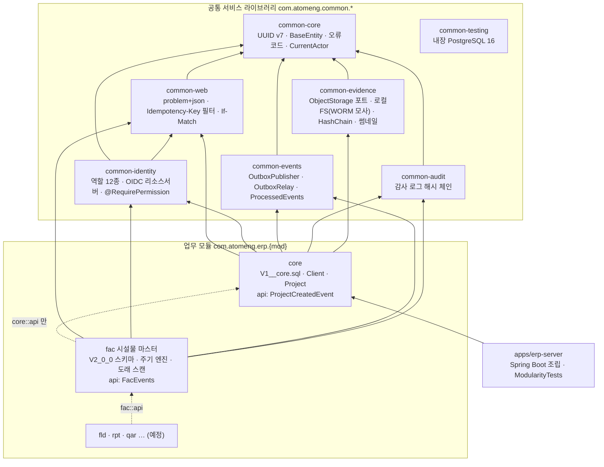

# 에이톰 안전진단 ERP — 공통 플랫폼 (Phase 0, 첫 단계)

## 쉬운 말 한 장 요약

- 이 저장소는 회사 ERP(회사 일을 한곳에서 관리하는 프로그램)의 **바닥 공사**입니다. 집으로 치면 기초·배관·전기 배선을 먼저 깐 상태예요.
- 지금 들어 있는 것은 다섯 가지입니다.
  1. **데이터 창고 설계도**(`V1__core.sql`): 고객·프로젝트·직원 표와, 기록을 지울 수 없게 막는 장치.
  2. **우편함(Outbox)**: "프로젝트가 생겼어요" 같은 소식을 업무 저장과 **같이** 저장했다가, 배달부(Relay)가 나중에 확실히 전달합니다. 배달이 실패하면 10초→20초→40초→80초 기다렸다 다시 시도하고, 5번 실패하면 "반송함"(DLQ)에 넣습니다.
  3. **중복 클릭 방지**(Idempotency-Key): 현장 태블릿이 같은 요청을 여러 번 보내도 한 번만 처리하고, 두 번째부터는 "이미 처리했어요"(`Idempotent-Replayed: true`)라고 같은 답을 돌려줍니다.
  4. **출입증 검사**(역할·권한): 12가지 역할(임원, 영업, 기술자, 재무, 감사 등)마다 할 수 있는 일을 정하고, 기술자는 **자기가 투입된 프로젝트만** 볼 수 있습니다.
  5. **알기 쉬운 오류 쪽지**(problem+json): 오류마다 `CORE-409-010` 같은 번호가 붙어 원인을 바로 찾을 수 있습니다.
  6. **누가 무엇을 할 수 있나 표 전수 검사**: 설계 표(12역할 × 11모듈 = 132칸)를 한 칸씩 모두 시험합니다.
  7. **개인정보 가리기**: 민감정보를 조회하면 감사 로그에 "누가 봤는지"는 남기되, 이름은 `홍*동`처럼 가려서 남깁니다.
  8. **사진 증거 보관**: 현장 사진을 올리면 서버가 지문(SHA-256)을 다시 계산해 위조를 막고, 사진끼리 지문을 사슬처럼 이어(해시 체인) 중간 사진을 몰래 바꾸면 들통나게 합니다. 원본은 지울 수 없는 칸(WORM)에 보관하고 작은 미리보기(썸네일)를 만듭니다.
  9. **첫 업무 모듈 FAC(시설물 마스터)**: 건물을 등록하고(같은 건물 중복 등록은 막음), 점검 보고서가 나오면 안전등급(A~E)을 기록합니다. 등급 기록은 고칠 수도 지울 수도 없습니다. 법에서 정한 점검 주기 표(⚠️ 예시 값)로 다음 점검 날짜를 계산하고, 180·90·30일 전과 날짜가 지났을 때 영업팀에 알림 이벤트를 보냅니다.
- 모든 기능은 자동 시험 **296개**(295개 통과, 1개는 PostGIS 서버가 있을 때만 실행)로 확인했습니다. 시험 데이터는 전부 **가짜(합성) 데이터**입니다.

> 설계 근거: Notion「00. 공통 아키텍처 · 설계 표준 v0.3」, 「00-IMPL. 공통 플랫폼 구현 보고서」, 「에이톰 플랫폼 모듈 라이브러리(ATOM-LIB-001)」.

### 용어 정리

| 용어 | 쉬운 뜻 |
|---|---|
| 모듈형 모놀리스 | 프로그램은 하나지만 안에 칸막이(모듈)를 쳐서 서로 함부로 못 건드리게 한 구조 |
| Spring Modulith | 칸막이를 어겼는지 자동으로 검사해 주는 도구 |
| Flyway | 데이터베이스 설계도를 버전 순서대로 적용해 주는 도구 |
| Outbox / Relay | 보낼 소식을 먼저 우편함에 넣고(Outbox), 배달부(Relay)가 꺼내 전달 |
| DLQ (outbox_dead) | 여러 번 배달 실패한 소식을 모아 두는 반송함 |
| 멱등(Idempotency) | 같은 요청을 여러 번 보내도 결과가 한 번 보낸 것과 같음 |
| ETag / If-Match | 문서 버전 번호. 남이 먼저 고쳤으면 "버전이 달라요"(412)라고 막음 |
| 해시 체인 | 기록마다 앞 기록의 지문을 이어 붙여, 중간을 몰래 고치면 들통나게 하는 방법 |
| UUID v7 | 시간 순서대로 정렬되는 고유 번호(아이디) |
| RFC 7807 problem+json | 오류를 정해진 JSON 모양으로 알려주는 국제 표준 |

---

## 1. 모듈 구성



- 공통 라이브러리는 업무 모듈(`com.atomeng.erp..`)을 **절대 import 하지 않습니다**(ArchUnit 규칙 R1).
- 업무 모듈끼리는 `{mod}::api` 명명 인터페이스로만 접근합니다(Spring Modulith `verify()`).

```
atom-erp/
├─ common/common-{core,web,identity,events,audit,testing}
├─ modules/core/                 # com.atomeng.erp.core
│  └─ src/main/resources/db/migration/core/V1__core.sql
│     └─ db/migration-ext/V1_1__core_postgis_ext.sql   (프로필 postgis)
└─ apps/erp-server/              # com.atomeng.erp.ErpServerApplication
```

## 2. 빌드 방법 (Windows, 시스템 설정 변경 없이)

시스템에 Java/Gradle/Docker/PostgreSQL 이 없어도 됩니다. PyCharm 에 들어 있는 JBR(JDK 25)을 **명령 한 번에만** 지정합니다.

```bash
# Git Bash
cd C:/Users/atomS/atom-erp
JAVA_HOME="/c/Program Files/JetBrains/PyCharm 2026.1.2/jbr" ./gradlew build
```

```powershell
# PowerShell (현재 창에서만 유효)
$env:JAVA_HOME = "C:\Program Files\JetBrains\PyCharm 2026.1.2\jbr"; .\gradlew.bat build
```

- Gradle 9.7.1 은 wrapper 가 자동으로 내려받습니다.
- 바이트코드는 `--release 21`(Java 21)로 만듭니다. JDK 21 이 있는 CI 에서는 toolchain 21 로 바꿔도 됩니다.
- 통합 테스트는 **zonky embedded-postgres**(PostgreSQL 16.15 바이너리, Maven Central)로 Docker 없이 실행됩니다.
- 모듈 문서(PlantUML)는 `apps/erp-server/build/spring-modulith-docs/` 에 생성됩니다.

선택 실행:

```bash
./gradlew :modules:core:test          # 마이그레이션 테스트
./gradlew :apps:erp-server:test --tests '*ModularityTests*'
ATOM_PG_POSTGIS_URL='jdbc:postgresql://host:5432/db?user=..&password=..' ./gradlew :modules:core:test  # PostGIS 확장 테스트(TC-CORE-008)
```

로컬 실행(실제 PostgreSQL 필요, Keycloak 없이 헤더 인증):

```bash
PG_HOST=localhost PG_APP_USER=postgres PG_APP_PASSWORD=... \
  ./gradlew :apps:erp-server:run --args='--spring.profiles.active=local-noauth'
# 요청 예: -H 'X-Actor-Id: <uuid>' -H 'X-Roles: SALES' -H 'Idempotency-Key: <uuid>'
```

## 3. 구현 내용 ↔ 설계 대응

| 설계 | 구현 위치 | 핵심 |
|---|---|---|
| 7.2 core 스키마·공통 6컬럼 | `V1__core.sql`, `BaseEntity` | client·employee·project·project_member·code·attachment·hash_anchor·audit_log(월 파티션)·doc_sequence |
| UUID v7 | `UuidV7`(Java), `core.uuid_generate_v7()`(SQL) | 같은 ms 단조 증가, 시계 역행 보호 |
| 10.2/10.3 Outbox | `OutboxPublisher`(MANDATORY), `OutboxRelay` | `FOR UPDATE SKIP LOCKED`, 이벤트 1건=트랜잭션 1개, 백오프 5·2ⁿ초(10/20/40/80), 5회째 `outbox_dead`, `requeueDead()` |
| 컨슈머 멱등 | `ProcessedEvents`, `@IdempotentListener` | `INSERT … ON CONFLICT DO NOTHING`, 실패 시 함께 롤백 |
| 9.4 멱등 키 | `IdempotencyFilter`, `IdempotencyStore` | PK (actor_id,key), CORE-428-001 / CORE-409-010 / CORE-422-009, `Idempotent-Replayed`, 5xx 미저장, 24시간 보관·정리 배치 |
| 8장 RBAC | `Role`(12종), `JwtAuthConverter`, `@RequirePermission`, `core.role_permission` | EMPLOYEE·FIN·AUDITOR 포함, PROJECT/CLIENT 행 수준 권한(CORE-403-002) |
| 8.1 OIDC | `IdentityAutoConfiguration` | 다중 issuer(atom-internal/atom-portal), issuer 메타데이터 지연 조회, 테스트·로컬은 헤더 스텁 |
| 9.2 오류 모델 | `GlobalProblemHandler`, `ProblemFactory` | 모든 오류 problem+json + `code` + `traceId`, ko/en title |
| 9.1 동시성 | `IfMatch`, JPA `@Version` | ETag `"v{n}"`, If-Match 불일치·경합 → 412 CORE-412-001 |
| NFR-CORE-07 감사 | `AuditLog`, `core.audit_append()` | 해시 체인 + append-only 트리거 + `audit_verify_chain()` |
| 8.2 권한 매트릭스 | `permission-matrix-8.2.csv` → `tools/gen_role_permission_seed.py` → `V1_2__core_role_permission_matrix.sql` | 132셀·154권한, Java 독립 해석기로 셀별 정확 일치 검사 |
| 8.1 Keycloak | `deploy/keycloak/atom-internal-realm.json`, `atom-portal-realm.json` | 역할 11+1, 클라이언트 5, 매퍼 roles·eid·cid, PKCE, 조건부 OTP 흐름, 사용자·비밀값 없음 |
| Step 6 감사 | `@Audited` + `AuditAspect`, `@Pii` + `PiiMasking`, `AuditPartitionMaintenance` | VIEW_PII 동기 기록(fail-closed), 감사 JSON 마스킹, 월 파티션 사전 생성 |
| 11장 첨부 | `ObjectStorage`/`LocalFsObjectStorage`, `AttachmentService`, `ThumbnailGenerator` | presign→PUT→:complete, 해시 재계산(CORE-422-010), WORM 복사, 체인 잠금·연결·검증, outbox→썸네일 |
| 4장 모듈 경계 | `ModularityTests`, `ArchitectureRulesTest` | verify() + 위반 픽스처 음성 테스트 |

## 4. 테스트 ↔ TC-CORE

| TC | 시나리오 | 테스트 |
|---|---|---|
| TC-CORE-001 | ENG 가 담당 외 프로젝트 조회 → 403 CORE-403-002, 감사 로그 없음 | `AuthorizationIntegrationTest` |
| TC-CORE-002 | 같은 Idempotency-Key 로 고객 생성 3회 → 1건, 2·3회차 Replayed | `IdempotencyIntegrationTest` |
| TC-CORE-003 | 두 사용자 동시 수정 → 200 / 412 | `OptimisticLockIntegrationTest` (순차·동시 2종) |
| TC-CORE-004 | 생성 트랜잭션 예외 → 프로젝트·outbox 모두 롤백 | `OutboxIntegrationTest` |
| TC-CORE-005 | Relay 강제 종료 후 재기동 → 전량 발행, 중복 소비 0 | `OutboxIntegrationTest` |
| TC-CORE-006 | 해시 위조 업로드 → 422 CORE-422-010, temp 삭제 | `AttachmentIntegrationTest` |
| TC-CORE-007 | attachment.sha256 직접 UPDATE → 트리거 예외 | `CoreMigrationTest` |
| TC-CORE-009 | 오프라인 사진 10장 → 업로드 10, 체인 연속, 썸네일 | `AttachmentIntegrationTest` |
| TC-CORE-010 | PII 조회 → VIEW_PII 1건, 로그 원문 없음 | `AuditPiiIntegrationTest` |
| TC-CORE-008 | 규칙 기간 중복 ACTIVE → EXCLUDE 위반 | `PostgisExtMigrationTest` (PostGIS DB 있을 때만) |

권한 매트릭스: `PermissionMatrixTest` 152건(132셀 + 커버리지 1 + HTTP 프로브 19). 미대상: TC-CORE-011(AIP, Step 12), 012(PITR, Step 15).

## 4-1. FAC 시설물 마스터 (02 v0.3 / 02-IMPL Step 1·2·4·9·10·11 일부)

| 항목 | 구현 |
|---|---|
| 스키마 | `modules/fac/.../db/migration/fac/V2_0_0__fac_schema.sql` — site·building(정본)·parcel·location_node(ltree)·drawing(+version)·분류 규칙/분류·grade_history·inspection_cycle_rule(EXCLUDE)·inspection_due·due_notification·repair_history·repair_target(대리키) = 14개 |
| 불변 | `fac.forbid_grade_mutation()` 트리거 — UPDATE/DELETE/TRUNCATE 모두 `restrict_violation(23001)` |
| PostGIS | `db/migration-ext/V2_99__fac_postgis_ext.sql`(site.boundary, building.location) — 프로필 postgis, out-of-order |
| 규칙 | `V2_0_1__fac_cycle_rule_seed.sql` — 시특법 정기·정밀점검·정밀진단, 건축물관리법 점검 **⚠️ 예시 값**(approved_by NULL) |
| 엔진 | `InspectionCycleEngine`(순수 도메인): 기준일 시점 유효 규칙, 등급 일치 우선, 상위 점검 갈음, 최초 점검(사용승인일), calc_trace |
| API | `/api/v1/fac/buildings` POST(멱등)·GET 목록/단건(ETag)·PATCH(If-Match)·DELETE(논리) · `PUT /{id}/classification` · `GET /{id}/grades` · `GET /{id}/dues` |
| 이벤트 | 발행 `fac.building.registered`, `fac.grade.recorded`, `fac.grade.critical-detected`, `fac.inspection.due-approaching`, `fac.inspection.overdue` (core outbox) · 구독 `rpt.report.published` + 별칭 `rpt.revision.published` (스텁 계약) |
| TC | TC-FAC-001·003·004·005·006·007 (+ 상태 전이, 중복 PNU, 규칙 기간 중복, repair_target) |

## 5. 설계와 다른 점 (의도적 편차)

1. **Redis 대신 DB 잠금**: 멱등 키 "처리 중" 잠금을 Redis `SET NX 30s` 대신 `idempotency_key` 행(response_code NULL)으로 구현. 30초 지난 잠금은 다음 요청이 이어받음. Redis 어댑터는 Step 2 로컬 스택 후 추가.
2. **PostGIS·pg_trgm·btree_gist 분리**: 내장 PostgreSQL 에 확장이 없어 `client.geom`, `attachment.captured_geom`, 트라이그램 인덱스, `rule_set`(EXCLUDE) 을 `db/migration-ext`(프로필 `postgis`)로 분리.
3. **마이그레이션 1개 파일**: 설계의 V1_0_0~V1_0_6 대신 `V1__core.sql` 하나(요청 사양). 다음부터 `V1_1`, `V1_2` … 로 증분.
4. **`audit_log.module`, `attachment.owner_module` 을 varchar(4)** 로 확장('CORE' 수용).
5. **audit_log 해시 체인 컬럼 추가**(`prev_hash`, `row_hash`) — 설계 7.2 에는 없음(ATOM-LIB-001 C2 반영). 기본 파티션(`audit_log_default`)도 안전망으로 추가.
6. **Relay 리더 선출(ShedLock) 미구현**: `SKIP LOCKED` 로 다중 인스턴스도 안전하지만 중복 폴링 비용이 있음 → Step 15.
7. **Spring Boot Gradle 플러그인 미사용**(BOM 만 사용) — Gradle 9.7 호환성 위험 회피. 실행은 `application` 플러그인. 배포용 bootJar 는 Step 14 에서.
8. **convention plugin(build-logic) 대신 루트 `subprojects` 블록**.
9. 감사 로그는 **동기 기록**(업무 트랜잭션 참여). 비동기·파일 폴백·PII 마스킹·`@Audited` AOP 는 Step 6.
10. JDK 21 툴체인이 없어 **JDK 25 로 `--release 21` 컴파일·테스트**.
11. **권한 매트릭스 해석 규칙**(설계 표에 없는 부분을 정함): 셀에 ◐ 가 있으면 셀 전체 동작에 범위 적용(CUSTOMER→CLIENT, 본인·시간·경비·라벨 과제→SELF, 그 외 PROJECT). 모듈 기본 리소스(sal:opportunity, fld:defect …)와 한정어 리소스(가용인력→hrq:availability 등)는 생성기 주석 참조. IMPL 의 "120건" 대신 표 실제 칸 수 132.
12. **Keycloak 조건부 OTP**: `conditional-user-role` 은 역할 1개만 받으므로 JSON 에는 EXEC 예시만 — 운영은 `mfa-required` 복합 역할로 4역할을 묶어 적용(Step 2에서 실제 import 검증).
13. **MinIO 어댑터 미구현**: 포트 + 로컬 파일시스템 어댑터(WORM 모사)만. presign URL 은 `local://` 표시용, 클라이언트 PUT 은 테스트에서 `storage.put` 으로 모사. 썸네일은 libvips webp 대신 JDK ImageIO PNG, 동기 리스너.
14. 첨부 `:complete` 는 WORM 복사 후 DB 커밋 — DB 단계 실패 시 WORM 에 고아 객체가 남을 수 있음(정리 배치는 후속). 일일 해시 앵커(hash_anchor) 배치 미구현.
16. **FAC**: 공통 6컬럼 version 은 bigint(설계 int), 컨슈머 멱등은 `core.processed_event`(설계 fac.processed_event), 등록 시 대장 ACL(Step 3)이 없어 PNU 가 있으면 VERIFIED 로 간주, 중복 탐지는 PNU+동 일치 + 같은 도로명주소·명칭 유사도 0.85(반경 50m 는 PostGIS 프로필 이후), 도래 스캔은 남은 일수 이하 가장 작은 threshold 하나만 발행(누락일 보충), RLS·병합·위치계층·도면은 미구현. 구독 이벤트명은 설계 정본 `rpt.report.published` 와 조정 요청명 `rpt.revision.published` 를 모두 수신(RPT 설계 확정 시 하나로).
15. VIEW_PII 감사는 비동기·파일 폴백 대신 **동기 기록(실패 시 응답 실패)**. `@PostMapping` 에 `@Audited` 강제 ArchUnit 규칙은 아직(서비스에서 직접 기록하는 경로와 병존).

## 6. 다음 단계

- Step 2: docker compose(PostGIS·Keycloak·Redis·MinIO) → PostGIS 프로필 테스트 상시화, Redis 멱등 잠금
- Step 4 마무리: ProjectScope Redis 캐시 + member-changed 무효화, Keycloak 실제 import 검증
- Step 5 마무리: 커서 페이징, springdoc OpenAPI 스냅샷·diff
- Step 6 마무리: 비동기 기록·파일 폴백, `@Audited` 강제 ArchUnit 규칙, 5년 경과 파티션 아카이브
- Step 7 마무리: 이벤트 JSON Schema(`contracts/events`), `outbox_pending` 게이지, ShedLock
- Step 8 마무리: MinIO 어댑터(Object Lock), 일일 해시 앵커·RFC 3161, 고아 객체 정리, libvips 워커
